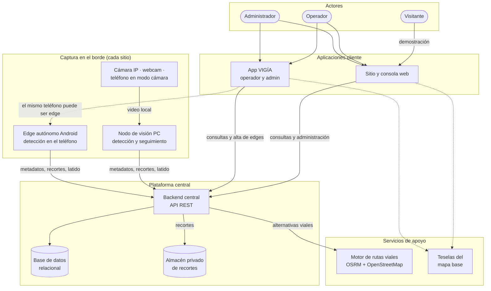
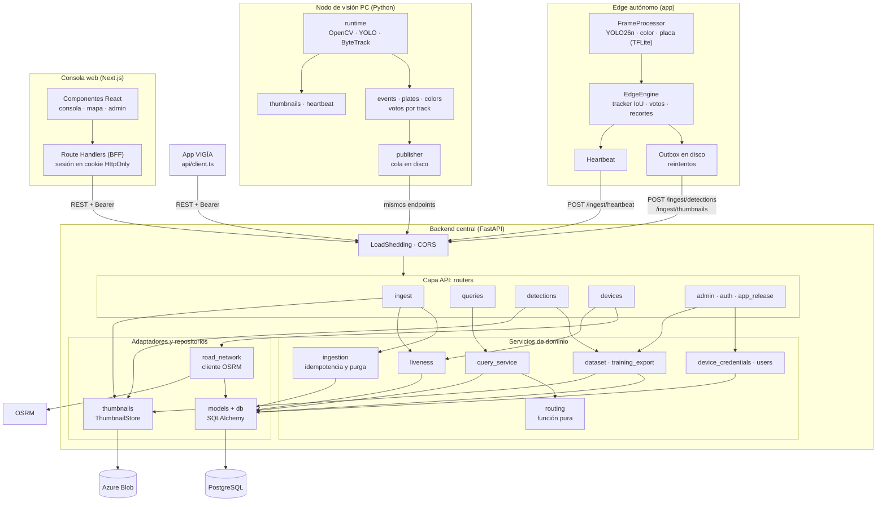
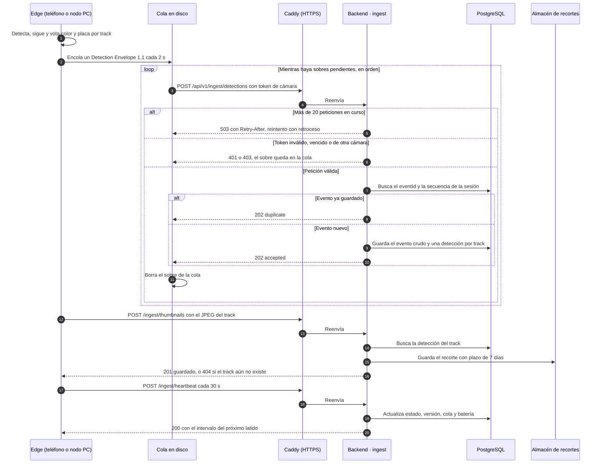
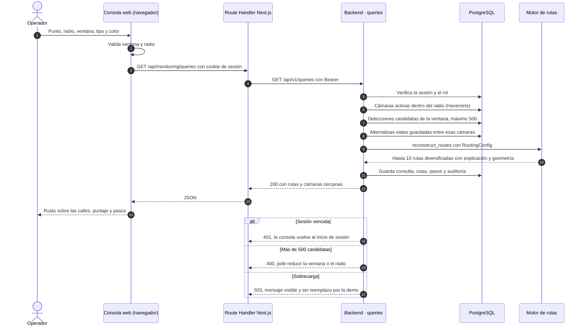
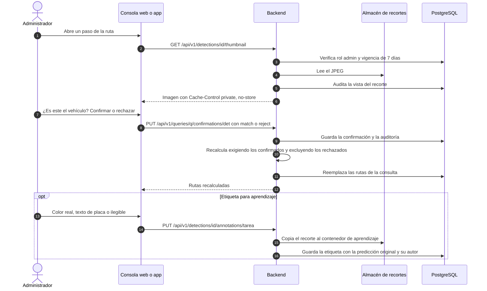
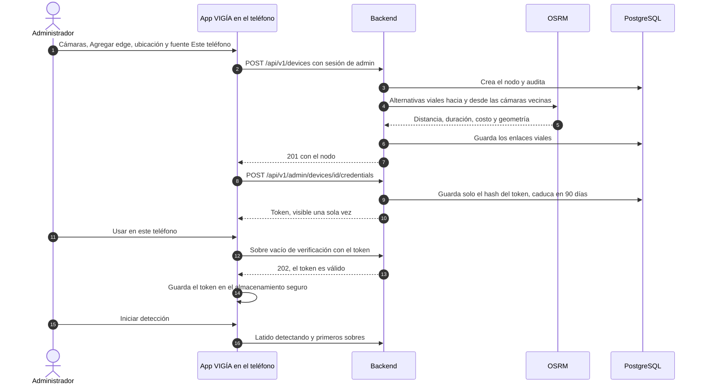
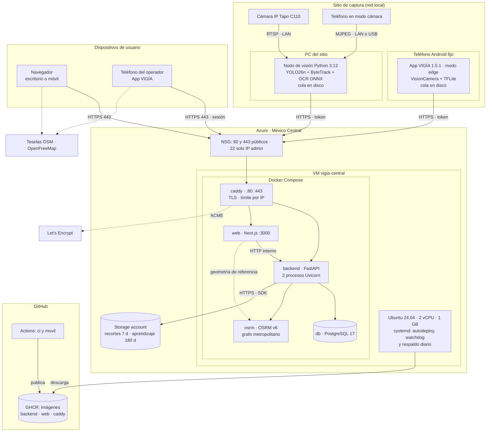

# Informe final - VIGÍA

**Plataforma distribuida para estimar trayectorias de vehículos con cámaras y teléfonos comunitarios.**
Estado del proyecto al 20 de noviembre de 2026 · Piloto en Barranquilla · App VIGÍA 1.5.1

## Resumen / Abstract

### Resumen

Las cámaras residenciales y comerciales de una ciudad graban mucho video, pero funcionan como islas: cada una pertenece a un dueño distinto, usa su propio equipo y guarda sus grabaciones por separado. Reconstruir el recorrido de un vehículo exige pedir y revisar a mano el video de varias de ellas, un trabajo lento que no escala. Centralizar todo ese video tampoco es una salida: consume red, cuesta y expone datos personales.

VIGÍA propone procesar el video **donde se captura**. Un teléfono Android fijo o un nodo de visión en un PC detecta y sigue los vehículos, vota su color y, si la vista lo permite, su placa, y al centro solo envía metadatos con un contrato versionado, una cola en disco y reintentos idempotentes. Ante una consulta autorizada, la plataforma central toma las detecciones cercanas en espacio y tiempo, las encadena siguiendo la red vial (OSRM sobre OpenStreetMap) mediante una búsqueda en haz y devuelve varias rutas candidatas, cada una con un puntaje explicable. Una ruta es una estimación, no una identificación: un administrador puede revisar el recorte de cada paso, confirmarlo o descartarlo, y las rutas se recalculan con esa respuesta.

El proyecto se desarrolló de forma iterativa e incremental, con flujos verticales completos, priorización por riesgo, integración continua y decisiones respaldadas por mediciones. Hoy opera un piloto en una máquina virtual de Azure con despliegue continuo y vuelta atrás automática, una consola web, una app React Native para Android y catorce nodos de captura. Con la carga esperada, la ingestión responde con un p95 de 152 ms hasta 50 nodos, sin pérdidas ni duplicados; tras un corte de red de 5 minutos llegaron 248 de 248 eventos exactamente una vez; el teléfono analiza 6,6 cuadros por segundo; el color acierta el 91,6 % en la prueba de sitio; y el top-k diversificado sube el recall@3 de 0,429 a 0,571 en el dataset sintético. En la prueba de campo del 20/11, dos de tres recorridos reales se reconstruyeron completos con puntajes de 0,81 y 0,83, y el tercero reveló un caso que se corrigió. Se concluye que la arquitectura híbrida es viable con recursos académicos y protege la privacidad por diseño, y que la principal limitación es distinguir vehículos parecidos en tráfico denso, que hoy se resuelve con la placa y la confirmación humana.

### Abstract

Residential and commercial cameras record a large amount of video, but they behave as islands: each one has a different owner, its own equipment and its own storage. Reconstructing a vehicle's path requires requesting and manually reviewing the footage of several cameras, which is slow and does not scale. Centralizing all the video is not a solution either, because it consumes bandwidth, costs money and exposes personal data.

VIGÍA processes video **where it is captured**. A fixed Android phone or a PC vision node detects and tracks vehicles, votes their color and, when the view allows it, their license plate, and sends only metadata to the central platform through a versioned contract, a disk-backed queue and idempotent retries. Upon an authorized query, the platform selects detections that are close in space and time, chains them along the road network (OSRM on OpenStreetMap) with a beam search and returns several candidate routes, each with an explainable score. A route is an estimate, not an identification: an administrator can review the crop of each step, confirm or reject it, and the routes are recomputed accordingly.

The project followed an iterative and incremental process with end-to-end vertical slices, risk-driven prioritization, continuous integration and measurement-backed decisions. A pilot currently runs on an Azure virtual machine with continuous deployment and automatic rollback, a web console, a React Native Android app and fourteen capture nodes. Under the expected load, ingestion has a p95 latency of 152 ms up to 50 nodes with no loss or duplication; after a 5-minute network outage, 248 of 248 events arrived exactly once; the phone analyzes 6.6 frames per second; color classification reaches 91.6% on the site test; and diversified top-k raises recall@3 from 0.429 to 0.571 on the synthetic dataset. In the field test of November 20, two of three real trips were fully reconstructed with scores of 0.81 and 0.83, and the third exposed a case that was fixed. The hybrid architecture proves feasible with academic resources and protects privacy by design; its main limitation is telling similar vehicles apart in dense traffic, currently handled through license plates and human confirmation.

**Palabras clave:** computación en el borde, detección de vehículos, seguimiento multiobjeto, reconstrucción de trayectorias, OSRM, privacidad por diseño.

## 1. Introducción

En Barranquilla, como en muchas ciudades de Colombia, la videovigilancia crece por agregación. Cada vivienda, conjunto residencial, comercio o institución instala sus propias cámaras, con su marca, su grabador y su política de almacenamiento. El resultado es una ciudad con muchos ojos, pero sin memoria común: no existe un índice que diga qué cámara vio un vehículo, a qué hora y hacia dónde iba.

Cuando ocurre un hurto, un accidente con fuga o simplemente hace falta saber por dónde salió un vehículo de un barrio, el procedimiento habitual es manual. Alguien identifica las cámaras cercanas, contacta a sus dueños, obtiene el video, lo revisa cuadro a cuadro buscando un vehículo de cierto tipo y color, y repite el proceso en la siguiente cámara probable. Cada paso depende de la disponibilidad de una persona distinta, y el video de interés puede desaparecer cuando el grabador sobrescribe su almacenamiento.

Tres cambios tecnológicos recientes abren una oportunidad. Primero, los modelos de detección de objetos se volvieron lo bastante livianos para correr en un teléfono de gama media: en este proyecto, un OPPO CPH2599 analiza 6,6 cuadros por segundo con YOLO26n sin ayuda de un PC. Segundo, la red vial abierta de OpenStreetMap y motores como OSRM permiten razonar sobre recorridos reales por las calles, no sobre líneas rectas. Tercero, una máquina virtual pequeña en la nube basta para coordinar muchos nodos cuando lo que llega no es video, sino metadatos.

VIGÍA aprovecha esa oportunidad: convierte el video en metadatos en el propio sitio de captura y los correlaciona en un centro que, ante una consulta autorizada, propone trayectorias candidatas con un puntaje que se puede explicar. Este informe documenta el proyecto completo: el marco conceptual (sección 2), el problema y su alcance (3), los objetivos (4), las soluciones relacionadas (5), la solución propuesta (6), la metodología (7), los requerimientos (8), la evaluación de alternativas (9), la arquitectura (10), la implementación (11), el despliegue (12), la validación (13), los resultados y conclusiones (14) y el trabajo futuro (15).

## 2. Marco conceptual

Esta sección define los conceptos necesarios para entender el problema, la solución y las decisiones técnicas. La tabla 2.1 los agrupa por área y señala cómo se usan en VIGÍA.

**Tabla 2.1.** Conceptos fundamentales y su uso en el proyecto.

| Concepto | Definición | Uso en VIGÍA |
|---|---|---|
| **Computación en el borde (edge)** | Procesar los datos cerca de donde se generan, en lugar de enviarlos a un centro | Teléfonos y PC junto a cada cámara ejecutan la detección; al centro solo llegan metadatos |
| **Nodo edge** | Dispositivo que captura o recibe video y lo procesa localmente | Dos tipos: *edge autónomo* (teléfono Android que detecta por sí mismo) y *nodo de visión PC* (Python, para cámaras IP, webcams o teléfonos en modo cámara) |
| **Detección de objetos** | Localizar instancias de clases en una imagen con una caja y una confianza | YOLO26n de Ultralytics [2], variante *nano* de una sola etapa y sin NMS, para automóviles y motocicletas |
| **Seguimiento multiobjeto (MOT)** | Relacionar detecciones de cuadros consecutivos y asignarles un identificador temporal (*track*) | ByteTrack en el nodo PC [1], [3]; un rastreador por IoU en el teléfono. El `trackId` identifica un vehículo solo dentro de una cámara y una sesión, nunca entre cámaras |
| **Clasificación de color** | Asignar a un recorte del vehículo una de varias clases de color | Clasificador de 8 colores sobre recortes de 128 px; el color final se vota entre cuadros del mismo track |
| **Reconocimiento de placas (ALPR)** | Detectar la placa dentro de la imagen y leer sus caracteres (OCR) | Detector YOLO26n entrenado con recortes de vehículos y OCR `cct-xs-v2` [17]; solo se acepta una lectura con formato colombiano, todos los caracteres con probabilidad ≥ 0,5 y al menos dos votos sin empate |
| **Metadatos de detección** | Descripción estructurada de lo observado, sin la imagen | Tipo, color, dirección en la imagen, confianza, hora, placa votada (opcional) |
| **Recorte (*thumbnail*)** | Imagen pequeña de la caja de un vehículo, no de la escena | JPEG ≤ 64 KB por track, privado, 7 días, solo para administradores |
| **Contrato versionado** | Esquema de mensaje estable e independiente de la implementación | `Detection Envelope 1.1` (JSON Schema): `eventId`, `sessionId`, `sequenceNumber`, `cameraId`, modelo, versión, *digest* y detecciones |
| **Entrega al menos una vez e idempotencia** | El emisor reintenta hasta recibir acuse; el receptor reconoce los repetidos y no los procesa dos veces | Cola en disco (*outbox*) [27] con retroceso exponencial en el edge; el centro deduplica por `eventId` y por (cámara, sesión, track). El efecto es una sola fila por evento |
| **Latido (*heartbeat*)** | Mensaje periódico con el estado del emisor | Cada 30 s: estado, versión, cola, análisis por segundo y batería. Permite distinguir *detectando*, *en segundo plano*, *detenido* y *sin señal* |
| **Red vial y enrutamiento** | Grafo de calles con sentidos y costos; un motor calcula caminos y alternativas | OpenStreetMap [6] y OSRM [4], [5] con el algoritmo MLD; se guardan distancia, duración, costo y geometría de hasta tres alternativas dirigidas entre cada par de cámaras |
| **Reconstrucción de trayectorias** | Encadenar observaciones de distintas cámaras en secuencias físicamente compatibles | Búsqueda en haz (*beam search*) sobre detecciones y alternativas viales, con filtros duros (tiempo creciente, velocidad 8–70 km/h, enlace ≤ 2 km, color y placa sin contradicción) |
| **Puntaje explicable** | Valor que ordena hipótesis y muestra la contribución de cada señal | 35 % calidad de detección, 40 % compatibilidad temporal, 15 % apariencia y 10 % costo vial. No es una probabilidad calibrada |
| **Top-k diversificado** | Selección de resultados que privilegia hipótesis distintas antes que variantes de la misma | Primero rutas que no comparten detecciones; después, alternativas marcadas con la ruta con la que se solapan |
| **Humano en el circuito** | Una persona valida o corrige la salida automática y el sistema la incorpora | El admin responde «¿Es este el vehículo?» en cada paso (`match`/`reject`) y la consulta se recalcula |
| **Métricas de recuperación** | recall@k: fracción de trayectorias reales entre las k primeras; tasa de enlaces falsos: tramos del top que unen vehículos distintos | Evaluación del motor de rutas con el dataset sintético `scoring-v1` (14 trayectorias con verdad de terreno) |
| **Percentiles de latencia** | p50 y p95: tiempo por debajo del cual queda el 50 % y el 95 % de las peticiones | Umbrales de aceptación de ingestión y consulta |
| **Descarte de carga (*load shedding*)** | Rechazar de inmediato el trabajo que excede la capacidad, para no colapsar [28] | Más de 20 peticiones en curso por proceso reciben `503` con `Retry-After`; los edges reintentan |
| **Monolito modular** | Una sola unidad desplegable dividida en módulos con fronteras claras | Backend central en FastAPI: routers, servicios de dominio y adaptadores |
| **BFF (*Backend for Frontend*)** | Capa de servidor dedicada a una interfaz, que media entre el navegador y los servicios | Route Handlers de Next.js [19]: el navegador nunca habla con el backend ni guarda su token |
| **Despliegue continuo por extracción** | El servidor descarga y aplica versiones publicadas, en lugar de recibir órdenes de la integración continua | Un temporizador en la VM descarga las imágenes de GHCR, migra, verifica salud y vuelve atrás si falla |
| **Aprendizaje supervisado por lotes** | Reentrenar un modelo con datos etiquetados, fuera de producción, y evaluarlo contra una prueba fija | Fase 4: etiquetas explícitas de color y placa, exportación inmutable, prueba congelada sin fuga por track |
| **Datos personales y minimización** | Ley 1581 de 2012 [7]: tratamiento con finalidad, acceso restringido y conservación limitada. Las cámaras captan datos personales [8] | El video no sale del sitio; recortes y placas se conservan 7 días, solo para administradores y con cada acceso auditado |

## 3. Planteamiento del problema

El problema central es la **imposibilidad práctica de seguir un vehículo a través de cámaras de distintos dueños** sin un esfuerzo manual que crece con cada cámara consultada y sin trasladar a un tercero el video completo de cada sitio. VIGÍA busca convertir observaciones aisladas en trayectorias candidatas, en segundos, de forma trazable y respetando la privacidad. La pregunta que guía el proyecto es:

> ¿Cómo estimar, en segundos y de forma explicable, las trayectorias probables de un vehículo a partir de observaciones de cámaras heterogéneas de distintos dueños, sin centralizar su video?

### 3.1 Descripción del problema

**La problemática.** Las cámaras comunitarias producen observaciones valiosas, pero no se pueden consultar como una red. No hay un registro común de *qué* vio cada cámara y *cuándo*; solo hay horas de video en grabadores independientes.

**Causas.**

1. **Propiedad fragmentada.** Cada cámara pertenece a una persona u organización distinta, con su propia disposición para compartir.
2. **Heterogeneidad técnica.** Fabricantes, protocolos (RTSP, aplicaciones propietarias), resoluciones y formatos distintos.
3. **Búsqueda manual.** Encontrar un vehículo de cierto tipo y color en una ventana de tiempo exige revisar video, cámara por cámara.
4. **Costo de centralizar el video.** Un solo flujo de una Tapo C110 mide 1,10 Mbit/s, unos 0,5 GB por hora (medido en la sección 9). Llevar el video de decenas de cámaras a un centro exige red, almacenamiento y cómputo que una comunidad no tiene.
5. **Ambigüedad.** Muchos vehículos se parecen. Con solo tipo, color y hora, dos automóviles blancos en hora pico son indistinguibles.
6. **Riesgo legal.** El video de una cámara capta personas y placas, datos personales cuyo tratamiento está regulado [7], [8].

**A quién afecta.** A las comunidades y administraciones de conjuntos que invierten en cámaras sin poder aprovecharlas en red; a los operadores de seguridad que dedican horas a revisar grabaciones; a las víctimas de hurtos o accidentes con fuga, que dependen de la rapidez de esa búsqueda; y, en el otro extremo, a todas las personas captadas por las cámaras, cuya privacidad se expone si el video se comparte o centraliza sin control.

**Consecuencias.** Tiempos de respuesta de horas o días; evidencia que se pierde cuando el grabador sobrescribe su almacenamiento; conclusiones tomadas con información incompleta; y, cuando se intenta centralizar, costos de red y almacenamiento desproporcionados y una superficie de exposición de datos personales mucho mayor.

### 3.2 Restricciones y supuestos de diseño

**Restricciones.**

| Tipo | Restricción |
|---|---|
| Técnica | El centro corre en una VM Azure Standard_B2ats_v2: 2 vCPU, 1 GB de RAM y 2 GB de swap, sin GPU. Los edges son teléfonos Android de gama media (referencia: OPPO CPH2599) y PC portátiles sin GPU dedicada |
| Técnica | Los edges están detrás de NAT residenciales: el centro no puede iniciar conexiones hacia ellos; todo flujo debe partir del edge |
| Técnica | Android limita la ejecución en segundo plano: la detección necesita la app abierta y el teléfono conectado al cargador |
| Económica | Suscripción Azure for Students: la VM entra en las 750 h/mes gratuitas; la IP pública y el disco, unos 6 USD al mes, se pagan con el crédito. Sin licencias pagas |
| De tiempo | Un semestre académico: desarrollo entre agosto y noviembre de 2026 |
| Normativa | Ley 1581 de 2012 [7] y lineamientos de la SIC sobre videovigilancia [8]: placas y recortes son datos personales. La región de Azure permitida es México Central, la más cercana a Barranquilla |
| Normativa | Ultralytics YOLO se distribuye bajo AGPL-3.0, lo que condiciona la licencia del repositorio |
| Distribución | La app Android se firma en el equipo del proyecto. iOS compila en CI, pero sin una cuenta de desarrollador no se distribuye |
| Datos | No existe un conjunto de recorridos reales etiquetados de la ciudad: la evaluación combina un dataset sintético y pruebas de campo |

**Supuestos.**

1. La ubicación de una detección es la ubicación fija de la cámara que la produjo.
2. Los relojes de los edges están sincronizados por la red del teléfono o del sistema operativo; el error es de segundos, no de minutos.
3. El vehículo circula por la red vial y respeta los sentidos de las calles; un enlace A→B no autoriza el sentido B→A.
4. La velocidad implícita entre dos cámaras consecutivas está entre 8 y 70 km/h (el límite urbano general en Colombia es de 50 km/h [29]), y dos cámaras consecutivas de una ruta están a no más de 2 km por calle. Son parámetros de laboratorio medidos con un análisis de sensibilidad, no normas universales.
5. El tipo de vehículo no cambia entre cámaras; el color conocido tampoco, salvo error del clasificador.
6. La dirección de un vehículo en la imagen (izquierda a derecha) no equivale a un rumbo geográfico, porque depende de la orientación de cada cámara.
7. Los dueños de las cámaras participan voluntariamente y las consultas las hacen personas autorizadas con una cuenta.

### 3.3 Alcance

**Incluye.**

- Detección, seguimiento, color, lectura de placas y recortes en el borde, tanto en un teléfono Android autónomo como en un nodo PC con cámaras RTSP, webcams o teléfonos en modo cámara.
- Ingestión idempotente de metadatos, recortes y latidos, con identidad por cámara.
- Consulta de trayectorias por punto o cámara de referencia, radio, ventana de tiempo, tipo, color y, para administradores, placa; rutas candidatas sobre la red vial con puntaje explicable.
- Revisión de recortes, confirmación de pasos y etiquetado para aprendizaje supervisado.
- Consola web, sitio público con demostración y app Android para operadores, administradores y edges.
- Usuarios con roles, sesiones, auditoría y exportación auditada.
- Piloto desplegado en Azure con HTTPS, despliegue continuo, respaldos y vuelta atrás automática.
- Documentación de arquitectura, operación y evidencias de validación.

**No incluye.**

- Identificación de personas, reconocimiento facial o análisis de comportamiento.
- Reidentificación visual de vehículos por apariencia entre cámaras (vectores de características).
- Transmisión, grabación o almacenamiento central de video.
- Alertas en tiempo real, notificaciones *push* o búsquedas automáticas programadas.
- Integración con sistemas policiales o valor probatorio legal de los resultados.
- Detección con la pantalla apagada en Android y distribución firmada para iPhone.
- Reentrenamiento automático de modelos en producción.

**Entregables.** Repositorio con el código de todos los componentes; servicio piloto en `https://vigia-5dfe.mexicocentral.cloudapp.azure.com`; APK firmado de la app (versión 1.5.1); documentación técnica y de operación; evidencias de pruebas y este informe.

## 4. Objetivos

**Objetivo general.** Desarrollar y validar, en un piloto en Barranquilla, una plataforma distribuida que, a partir de detecciones de vehículos procesadas en cámaras y teléfonos comunitarios, estime y presente de forma explicable las trayectorias probables de un vehículo, sin centralizar el video.

**Objetivos específicos.** Cada uno tiene un indicador medible. Los umbrales de la tabla se fijaron antes de medir cuando existían; donde no hubo un umbral previo, se reporta el valor obtenido.

**Tabla 4.1.** Objetivos específicos, indicadores y resultado alcanzado.

| # | Objetivo específico | Indicador y criterio | Resultado (sección) |
|---|---|---|---|
| OE1 | Procesar el video en el borde, en teléfono y en PC, produciendo metadatos de tipo, color, dirección y placa por vehículo | Análisis por segundo en un teléfono de gama media; exactitud de color en una prueba de sitio separada del entrenamiento; fragmentación de tracks | 6,6 análisis/s en el OPPO CPH2599; color 91,6 %; tracks de 74 a 23 por minuto (11.2, 13.1) |
| OE2 | Transportar los metadatos de forma confiable y eficiente hasta el centro | ≥ 10 msg/s con p95 < 500 ms; 0 pérdidas y 0 duplicados ante cortes y reinicios; cola drenada en < 60 s | 25 msg/s con p95 de 152 ms; 248/248 eventos tras un corte de 5 min; 0 pérdidas y 2,2 s de drenado tras un reinicio (9, 13.2) |
| OE3 | Estimar trayectorias candidatas sobre la red vial con un puntaje explicable | Recall@3 y enlaces falsos en el dataset sintético; p95 de consulta < 2 s con 10 operadores; recorridos reales reconstruidos | Recall@3 de 0,429 a 0,571 y enlaces falsos de 0,24 a 0,167; p95 de 1,0–1,5 s; 2 de 3 recorridos del 20/11 completos (13.2) |
| OE4 | Ofrecer interfaces web y móvil para consultar, inspeccionar, confirmar y exportar resultados, con roles diferenciados | Flujos completos verificados de extremo a extremo en escritorio y móvil | 18 escenarios E2E en dos perfiles (36 ejecuciones) y app 1.5.1 publicada (11.2, 13.2) |
| OE5 | Operar el piloto con seguridad, protección de datos y actualización controlada | Disponibilidad ≥ 99,5 % (SLA de una VM); HTTPS, identidad por cámara, roles, auditoría y retención; despliegue con vuelta atrás | ≥ 99,8 % medida del 11 al 19/10; controles en operación (12) |
| OE6 | Validar el sistema con recorridos reales en la ciudad | Jornadas de campo con ruta conocida y hallazgos convertidos en correcciones | Pruebas del 28/10 y del 20/11; cuatro correcciones derivadas (13.2) |

## 5. Estado del arte / soluciones relacionadas

Las soluciones existentes para aprovechar cámaras en la ciudad se pueden agrupar en cinco enfoques.

**Grabadores y sistemas de gestión de video (NVR/VMS).** Centralizan la grabación y la reproducción de cámaras de un mismo propietario. Funcionan bien cuando todas las cámaras pertenecen a una organización y comparten infraestructura, pero no correlacionan cámaras de distintos dueños y transmiten y almacenan todo el video. La búsqueda sigue siendo manual o, en versiones con analítica, limitada a las cámaras de ese sistema.

**NVR inteligentes locales.** Frigate es un NVR de código abierto que ejecuta detección de objetos cerca de las cámaras, se integra con otros sistemas mediante MQTT y, en versiones recientes, lee placas con un detector y un OCR propios [9], [10]. Comparte con VIGÍA el procesamiento local, pero su foco es un sitio: detectar, grabar y automatizar. No reconstruye recorridos entre sitios de dueños distintos, y su documentación recomienda aceleradores dedicados para la inferencia.

**Plataformas industriales de analítica multicámara.** NVIDIA DeepStream y su referencia multicámara procesan muchos flujos con GPU, generan metadatos normalizados y alimentan una analítica central mediante un *broker* [11], [12]. NVIDIA reporta cientos de cuadros por segundo por GPU sobre video 1080p. Validan la idea de separar percepción y correlación, pero exigen GPU NVIDIA, su pila de software y calibración, y suelen operar sobre cámaras de una sola organización.

**Lectura de placas comercial y redes de cámaras LPR.** Servicios como Plate Recognizer ofrecen lectura de placas en la nube o en local para más de 90 países, con 50 a 100 ms por imagen según el fabricante [13]. Redes comerciales como Flock Safety instalan cámaras dedicadas a placas en vecindarios y comparten las lecturas en una plataforma en la nube [14]. Resuelven la identidad del vehículo cuando la placa es legible, pero dependen de hardware o servicios de terceros, de licencias recurrentes y de enviar imágenes o lecturas de placas fuera del sitio, lo que amplía el tratamiento de datos personales.

**Investigación en seguimiento multicámara.** El seguimiento multiobjeto dentro de una cámara está maduro: ByteTrack asocia detecciones de alta y baja confianza y reduce la fragmentación [1]. El seguimiento de vehículos entre cámaras se estudia con conjuntos como CityFlow, de la AI City Challenge, que combina geometría, tiempo y reidentificación por apariencia en cámaras calibradas de una misma ciudad [15]. Estos trabajos suponen video centralizado, cámaras calibradas y modelos de reidentificación entrenados para esas cámaras, condiciones que una red comunitaria no cumple.

**Tabla 5.1.** Comparación de soluciones relacionadas.

| Solución | Enfoque | Ventajas | Limitaciones | Oportunidad para VIGÍA |
|---|---|---|---|---|
| NVR / VMS tradicional | Grabación y consulta centralizadas | Maduro; revisión completa del video de un propietario | Un solo dueño; búsqueda manual; transmite y almacena todo el video | Indexar lo que ve cada cámara sin mover su video |
| Frigate [9], [10] | NVR local con detección, MQTT y placas | Código abierto; procesamiento local; integración por mensajes | Un sitio; recomienda acelerador; no correlaciona sitios | Reutilizar la idea de detección local y llevarla a una red de sitios |
| NVIDIA DeepStream [11], [12] | Analítica multicámara con GPU | Alto caudal; metadatos normalizados; referencia multicámara | GPU NVIDIA y pila propietaria; video centralizado | Separar percepción y correlación, pero con la percepción en el borde |
| Plate Recognizer [13] | Lectura de placas como servicio | Muchos países; fácil de integrar | Costo por licencia; imágenes o lecturas a un tercero; cifras del fabricante sin verificación independiente | Leer la placa en el propio edge y votarla por track |
| Flock Safety [14] | Red comercial de cámaras de placas en la nube | Cobertura de vecindarios; búsqueda centralizada por placa | Hardware dedicado; suscripción; lecturas centralizadas en un proveedor | Usar cámaras y teléfonos que la comunidad ya tiene, y conservar los datos en su infraestructura |
| CityFlow / AI City [15] | Investigación en seguimiento multicámara | Combina tiempo, geometría y apariencia; métricas estándar | Video centralizado; cámaras calibradas; modelos por escenario | Empezar con señales explicables (tiempo, red vial, color, placa) y dejar la apariencia como extensión |

VIGÍA se ubica entre un NVR inteligente y una plataforma industrial. Comparte con Frigate el procesamiento local y con DeepStream los metadatos normalizados y la analítica posterior, pero apunta a cámaras de **distintos dueños** y de bajo costo, incluidos teléfonos en desuso, y a un resultado **explicable** en lugar de una identificación opaca. Su aporte no es un detector nuevo, sino la integración trazable de captura en el borde, transporte confiable, correlación sobre la red vial, revisión humana y protección de datos bajo restricciones académicas.

## 6. Solución propuesta

VIGÍA es una **red colaborativa híbrida**: los sitios de captura procesan su propio video y una plataforma central coordina la red, guarda metadatos y responde consultas. A alto nivel se construyeron cuatro piezas:

1. **Edges de captura.** Una app Android que convierte cualquier teléfono fijo en una cámara inteligente, y un nodo de visión en Python para cámaras IP, webcams o teléfonos que solo transmiten video. Ambos detectan, siguen y describen los vehículos, y publican metadatos, un recorte por vehículo y un latido.
2. **Plataforma central.** Recibe y deduplica los eventos, mantiene el registro de nodos, personas y credenciales, y reconstruye trayectorias sobre la red vial de la ciudad.
3. **Interfaces.** Un sitio público con demostración, una consola web y la misma app móvil, que permiten consultar, comparar rutas, revisar recortes, confirmar pasos, administrar la red y exportar resultados.
4. **Operación.** Un piloto en la nube con HTTPS, despliegue continuo, vuelta atrás automática y respaldos.

**Principios que guían la propuesta.**

- **Procesar donde se captura.** El video no sale del sitio. Al centro llegan unos 11 kbit/s de metadatos por cámara en lugar de 1,1 Mbit/s de video, unas 100 veces menos.
- **Un contrato estable entre el borde y el centro.** Los edges y el centro solo comparten un esquema versionado; cualquier detector, rastreador o dispositivo que lo respete se integra sin tocar el centro.
- **Estimación, no identificación.** Siempre se devuelven varias rutas candidatas con su puntaje y la contribución de cada señal. La interfaz evita presentar una línea en el mapa como la calle exacta recorrida.
- **Humano en el circuito.** Cuando las señales automáticas no bastan, un administrador revisa el recorte y confirma o descarta el paso; el sistema recalcula. Esas decisiones son, además, datos etiquetados para mejorar los modelos.
- **Minimización y trazabilidad.** Recortes y placas se conservan 7 días, solo los ve un administrador y cada acceso queda auditado [38]. Toda consulta, exportación y cambio tiene autor.
- **Operación sencilla y económica.** Una sola VM pequeña, contenedores y un despliegue que se aplica y se revierte solo.

**Valor frente a las soluciones existentes.** A diferencia de un NVR, VIGÍA correlaciona cámaras de distintos dueños; a diferencia de DeepStream o de las redes LPR comerciales, no necesita GPU, hardware dedicado ni enviar video o imágenes a un tercero; a diferencia de la investigación multicámara, funciona sin calibrar las cámaras ni entrenar modelos por escenario, porque razona con tiempo, red vial, tipo, color y placa. Su resultado es explicable y revisable, lo que reduce el riesgo de tomar una coincidencia como certeza.

**Por qué es una respuesta adecuada.** Cumple las restricciones del proyecto: corre en una VM de 1 GB dentro del crédito académico, usa teléfonos que la comunidad ya tiene y respeta la minimización de datos personales. Responde a los objetivos: cada pieza se corresponde con un objetivo específico (tabla 4.1) y se validó con mediciones. Y respeta el alcance: no identifica personas ni centraliza video, y declara sus límites en la propia interfaz.

**Usuarios y capacidades.** La tabla 6.1 resume qué puede hacer cada tipo de usuario.

**Tabla 6.1.** Usuarios de VIGÍA y sus capacidades.

| Usuario | Dónde | Qué puede hacer |
|---|---|---|
| Visitante | Web | Conocer el proyecto y recorrer una demostración guiada con datos de ejemplo, siempre identificada como tal |
| Operador | Web y app | Ver la red de cámaras y su estado real; consultar por punto, radio, horario, tipo y color; comparar rutas sobre el mapa con su explicación; historial y exportación auditada |
| Administrador | Web y app | Todo lo anterior, más buscar por placa, ver recortes, confirmar o descartar pasos, etiquetar recortes para aprendizaje, dar de alta, mover o eliminar nodos, emitir y revocar credenciales y revisar la auditoría |
| Teléfono fijo (edge autónomo) | App | Detectar, seguir, votar color y placa, enviar recortes, mantener una cola sin red y reportar su estado cada 30 s |
| Cámara IP o teléfono en modo cámara | Nodo PC | Transmitir video por la red local o USB a un nodo de visión que hace la detección |

## 7. Metodología de desarrollo

**Enfoque.** El proyecto siguió un proceso **iterativo e incremental** con tres prácticas centrales: (1) **flujos verticales completos**, es decir, construir primero un camino delgado de extremo a extremo (cámara → edge → centro → consulta → mapa) y engrosarlo después; (2) **priorización por riesgo**, con bloques P0 (lo que impide operar), P1 (lo que impide afirmar que funciona) y P2 (mejoras de visión); y (3) **decisiones respaldadas por evidencia**: cada umbral se midió antes de fijarse y cada cambio importante dejó un registro reproducible.

**Justificación.** El proyecto tenía una incertidumbre técnica alta: no se sabía si un teléfono de gama media podía detectar a un ritmo útil, si la red vial bastaba para distinguir recorridos ni si una VM de 1 GB soportaría la carga. Un plan en cascada habría postergado esas respuestas hasta el final. Las iteraciones cortas con un sistema siempre funcionando permitieron medir pronto, corregir con datos y llevar a producción cada mejora en cuanto pasaba sus pruebas. El trabajo se organizó con ramas cortas y *pull requests* que solo se fusionan con la integración continua en verde; las decisiones de arquitectura se registraron como ADR.

**Iteraciones.** La tabla 7.1 resume las fases y sus resultados. Las fechas provienen del historial del repositorio.

**Tabla 7.1.** Fases de trabajo.

| Fase | Periodo | Objetivo | Resultados principales |
|---|---|---|---|
| 0. Exploración | Agosto | Validar la captura y el contrato | Cámara Tapo C110 por RTSP en un nodo Python con YOLO y ByteTrack; vista previa en una consola Next.js con datos simulados; contratos versionados; ADR-001 (arquitectura híbrida) |
| 1. Flujo vertical | Septiembre | Unir edge, centro y consola | Backend central (ADR-002) con el algoritmo de rutas como función pura; flujo completo con la Tapo real (28/09); ingestión idempotente con el Detection Envelope 1.1; credenciales por cámara; OSRM y WireGuard autogestionados (30/09) |
| 2. Endurecimiento y piloto | 1–12 de octubre | Cerrar los bloqueos P0 y salir a operación | Migraciones, usuarios, roles y auditoría; PostgreSQL con respaldos; prueba de resiliencia (08/10); app Flutter y teléfonos como edges; centro en Azure con HTTPS (10/10); edge autónomo en el teléfono (11/10); CI/CD con vuelta atrás; color y seguimiento sin fragmentar; benchmark de carga y corrección del colapso; grafo vial metropolitano (12/10) |
| 3. Visión avanzada y experiencia | 13 de octubre – 2 de noviembre | Distinguir vehículos parecidos y mejorar la consola | Placas en el nodo PC y en el centro; primera prueba de campo (28/10) y su corrección; recortes con revisión del administrador; consola con el diseño de Figma; top-k diversificado; consultas densas acotadas; límite por IP y CSP |
| 4. App nativa y cierre | 3–20 de noviembre | Migrar la app y cerrar el ciclo de aprendizaje | App React Native (ADR-003) con el edge de 2,6 a 6,6 análisis/s y placas en el teléfono; estado real de los nodos con latido; fase 4 de aprendizaje con etiquetas; eliminación de nodos; APK 1.5.1 en producción (20/11); segunda prueba de campo (20/11) y sus correcciones |

**Prototipos y refinamiento.** Hubo cinco prototipos sucesivos, cada uno funcional y desplegable: (P1) consola con datos simulados para validar la interacción; (P2) flujo vertical en local con la cámara real; (P3) piloto en Azure con varios edges reales; (P4) app Flutter con edge autónomo; y (P5) app React Native con el diseño morado de Figma, placas y latido. Cada prototipo se refinó con lo aprendido del anterior: la prueba de campo del 28/10 mostró que el tráfico del mismo color ocultaba rutas largas y motivó tanto el límite de una estimación por trayectoria como los recortes sugeridos por los tutores; la del 20/11 mostró que el OCR confundía una letra y que los vehículos rápidos se quedaban sin recorte.

**Mecanismos de validación.**

- **Pruebas automáticas como compuerta.** Cada *pull request* ejecuta las suites de backend (también contra PostgreSQL), visión, web y móvil; nada se fusiona en rojo.
- **Mediciones con umbrales previos.** El benchmark de carga, la prueba de resiliencia y el análisis de sensibilidad fijaron sus criterios antes de medir.
- **Dataset sintético con verdad de terreno.** `scoring-v1` [36], con 14 trayectorias y escenarios de ruido y vehículos parecidos, para comparar variantes del motor de rutas sin sesgo.
- **Mediciones en el dispositivo.** Tiempos por etapa del edge en el teléfono real.
- **Pruebas de campo.** Recorridos con un vehículo y una ruta conocidos, contrastados con lo que devolvió el sistema.
- **Revisión de los tutores**, que propusieron los recortes y la política de retención.

**Artefactos.** El repositorio reúne 220 *commits* en la rama principal y 66 *pull requests* fusionados; tres ADR; dos contratos versionados; 23 guías de arquitectura, operación y modelado; 11 evidencias con sus datos crudos; el dataset `scoring-v1`; los modelos TFLite y ONNX del edge; el diseño en Figma «VIGÍA-DESIGN»; las imágenes de contenedor en GHCR y los APK firmados.

## 8. Requerimientos

Esta sección detalla lo que el sistema debe cumplir para considerarse correcto y útil. Cada requerimiento indica su estado al 20/11/2026.

### 8.1 Funcionales

**Tabla 8.1.** Requerimientos funcionales.

| Código | Requerimiento | Estado |
|---|---|---|
| RF-01 | **Registro de nodos.** Un administrador registra un nodo edge con identificador, nombre, ubicación, tipo y fuente de video; puede editarlo, moverlo, eliminarlo (borrado lógico que conserva sus detecciones) y restaurarlo | Cumplido |
| RF-02 | **Credenciales por cámara.** Un administrador emite un token por cámara, que se muestra una sola vez, con caducidad (90 días por defecto); puede rotarlo y revocarlo | Cumplido |
| RF-03 | **Detección y seguimiento en el borde.** El edge detecta automóviles y motocicletas y los sigue con un identificador local, tanto en el teléfono como en el nodo PC | Cumplido |
| RF-04 | **Descripción del vehículo.** El edge clasifica el color (8 clases) y lee la placa colombiana cuando mide al menos 45 px, votando ambos por track | Cumplido |
| RF-05 | **Publicación confiable.** El edge publica metadatos con el Detection Envelope 1.1, una cola en disco de hasta 10 000 eventos y reintentos; el centro guarda cada evento una sola vez | Cumplido |
| RF-06 | **Recortes.** El edge sube un recorte JPEG por vehículo; el centro lo conserva 7 días y solo lo muestra a un administrador | Cumplido |
| RF-07 | **Estado de los nodos.** El edge envía un latido cada 30 s y la consola muestra si está *detectando*, *en segundo plano*, *detenido*, *sin señal* o *sin conectar*, con su versión, cola y batería | Cumplido |
| RF-08 | **Consulta de trayectorias.** Un operador consulta por punto o cámara de referencia, radio, ventana de tiempo, tipo y color; un administrador puede filtrar además por placa | Cumplido |
| RF-09 | **Rutas candidatas explicables.** El sistema devuelve hasta 10 rutas ordenadas, dibujadas sobre las calles, con su puntaje, sus pasos y la contribución de cada señal; indica tramos distantes y cuándo la geometría es solo referencia visual | Cumplido |
| RF-10 | **Confirmación humana.** Un administrador confirma o rechaza cada paso de una ruta y la consulta se recalcula con esa respuesta | Cumplido |
| RF-11 | **Etiquetas para aprendizaje.** Un administrador etiqueta el color y la placa de un recorte (o los marca como no determinables); las muestras se copian a un almacén separado y se exportan como versiones inmutables | Cumplido; falta el primer reentrenamiento con esas etiquetas |
| RF-12 | **Historial y exportación.** El operador consulta su historial y exporta una consulta con sus rutas; cada exportación queda auditada | Cumplido |
| RF-13 | **Acceso de personas.** Inicio y cierre de sesión, roles `operator` y `admin` aplicados por el backend y registro de auditoría consultable por el administrador | Cumplido |
| RF-14 | **Demostración.** Un visitante recorre una demostración guiada con datos de ejemplo, siempre identificada y sin tocar el servicio real | Cumplido |
| RF-15 | **Distribución de la app.** La app se descarga desde el sitio con su huella SHA-256 y avisa cuando hay una versión nueva | Cumplido |
| RF-16 | **Modo cámara.** Un teléfono transmite su cámara por MJPEG en la red local o por USB, con clave, para que un nodo PC haga la detección | Cumplido |

### 8.2 No funcionales

**Tabla 8.2.** Requerimientos no funcionales, métrica y resultado.

| Código | Atributo | Requerimiento y métrica | Resultado |
|---|---|---|---|
| RNF-01 | Rendimiento de ingestión | ≥ 10 msg/s sostenidos con p95 < 500 ms | 25 msg/s (50 nodos) con p95 de 152 ms; media de 132–173 ms con 2 a 25 msg/s. **Cumple** |
| RNF-02 | Rendimiento de consulta | p95 < 2 s con 10 operadores concurrentes | p95 de 1,0 s (12/10) y 1,5 s con zonas más densas (19/10), con 9 % de respuestas 503. **Cumple con observaciones** |
| RNF-03 | Confiabilidad | 0 pérdidas y 0 duplicados ante cortes de red, caídas del backend o de la base; cola drenada en < 60 s | 248/248 eventos tras 5 min de corte; 2 249/2 249 tras reiniciar el backend bajo carga, drenado en 2,2 s. **Cumple** |
| RNF-04 | Disponibilidad | ≥ 99,5 % mensual (SLA de una VM de instancia única [25]) | ≥ 99,8 % medido del 11 al 19/10. **Cumple** |
| RNF-05 | Seguridad [41] | HTTPS; solo puertos 80/443 expuestos; tokens de cámara guardados como hash; contraseñas con `scrypt`; bloqueo tras 5 intentos en 15 min; sesiones revocables de 8 h; límite por IP (10 inicios de sesión y 1 200 peticiones por minuto); CSP en la consola | En operación. **Cumple** |
| RNF-06 | Privacidad | El video no sale del sitio; recortes ≤ 64 KB, 7 días, solo admin y auditados; placas 7 días y solo admin; etiquetas de aprendizaje en un almacén separado con plazo propio | En operación. **Cumple**; falta la política formal aprobada para el dataset |
| RNF-07 | Eficiencia de red | Tráfico por cámara al menos un orden de magnitud menor que su video | ≈ 11 kbit/s frente a 1,10 Mbit/s. **Cumple** |
| RNF-08 | Rendimiento en el borde | Ritmo de análisis suficiente para seguir vehículos urbanos en un teléfono de gama media | 6,6 análisis/s en el OPPO CPH2599. **Cumple** |
| RNF-09 | Escalabilidad | Degradación controlada, sin bloqueo ni pérdida, por encima de la capacidad | A 200 msg/s entran 184 y el resto recibe 503 reintentable; `/health` responde todo el tiempo. **Cumple** |
| RNF-10 | Usabilidad y accesibilidad | Español de Colombia y hora de Colombia (UTC−5); estados de carga, vacío y error; demo identificada; navegación por teclado; contraste AA; diseño adaptable; reducción de movimiento | Implementado y cubierto por pruebas E2E. **Parcial**: falta la prueba formal con participantes externos (13.3) |
| RNF-11 | Explicabilidad | Cada ruta guarda la versión del modelo, sus parámetros y la contribución de cada señal | Implementado (`weighted-evidence-v2`, `diversified-v1`). **Cumple** |
| RNF-12 | Mantenibilidad | Contratos versionados; migraciones de esquema; pruebas automáticas en cada cambio; decisiones documentadas | Migraciones Alembic 0001–0009, CI en cada PR, 3 ADR. **Cumple** |
| RNF-13 | Portabilidad | App Android; iOS compilable; nodo PC en cualquier equipo con Python | Android en producción; iOS compila sin firma en CI. **Parcial** |
| RNF-14 | Costo | Operación dentro del crédito académico | ≈ 6 USD al mes. **Cumple** |

## 9. Evaluación de alternativas

Antes de definir cómo construir el sistema se analizaron tres formas posibles de implementarlo:

- **A) Video centralizado.** Cada cámara transmite su video a un servidor central que decodifica, detecta, sigue y correlaciona.
- **B) Edge + centro modular.** Cada nodo procesa el video junto a la cámara y publica metadatos a un centro que los guarda y correlaciona.
- **C) Plataforma industrial con GPU**, representada por NVIDIA DeepStream: un servidor con GPU procesa muchos flujos de video y entrega metadatos a una analítica central.

A y C comparten la idea de llevar el video al centro; difieren en el hardware. La comparación responde tres preguntas con criterios fijados antes de medir. B se midió en su despliegue real en Azure con una herramienta de carga que se comporta como un edge (`apps/backend/tools/load_bench.py`); de A se midieron sus dos costos dominantes (red e inferencia por flujo) con el hardware disponible; C se midió en un portátil con GPU NVIDIA. Los datos crudos y las herramientas están en las evidencias del proyecto [33]. Cada valor se marca como **medido** (con artefacto reproducible), **derivado** (calculado a partir de una medición) o **analítico** (razonamiento sin medición).

### Pregunta 1: ¿Cuál alternativa ofrece mejor desempeño bajo la carga esperada?

**Criterios:** latencia promedio y máxima de las operaciones críticas (ingestión y consulta), *throughput* y comportamiento bajo carga concurrente. La carga esperada del piloto es de 4 a 10 nodos con un sobre cada 1 a 5 s y hasta 10 operadores.

**Montaje de B.** VM Standard_B2ats_v2 en México Central con Caddy, backend y PostgreSQL 17; generador en Barranquilla por Internet residencial, de modo que la latencia incluye la red real. Los nodos simulados usan un token por cámara, una cola con retroceso exponencial y reenvían a propósito el 5 % de los sobres aceptados para comprobar la idempotencia. Se crearon 100 cámaras de prueba que se borraron al final, previo respaldo.

**Tabla 9.1.** Escalada de ingestión en Azure tras la corrección de sobrecarga (60 s por escalón; 12/10 y 19/10).

| Nodos × intervalo | Ofrecido → aceptado (msg/s) | Media | p50 / p95 | Máxima | 503 | Perdidos |
|---|---:|---:|---:|---:|---:|---:|
| 4 × 2 s | 2 → 2 | 173 ms | 126 / 512 ms | 1 538 ms | 0 | 0 |
| 10 × 2 s | 5 → 5 | 138 ms | 124 / 181 ms | 1 504 ms | 0 | 0 |
| 25 × 2 s | 12,5 → 12,5 | 132 ms | 123 / 139 ms | 463 ms | 0 | 0 |
| 50 × 2 s | 25 → 25 | 136 ms | 123 / 153 ms | 742 ms | 0 | 0 |
| 100 × 2 s | 50 → 50 | 193 ms | 128 / 397 ms | 3 512 ms | 2,3 % | 0 |
| 100 × 1 s | 100 → 99,8 | — | 253 / 970 ms | — | 1 476 | 0 |
| 100 × 0,5 s | 200 → 184,3 | — | 329 / 531 ms | — | 4 311 | 0 (870 en cola al cierre) |

La mediana, cercana a 125 ms, es sobre todo la ida y vuelta por Internet entre Barranquilla y México. Hasta 50 nodos (25 msg/s, 2,5 veces la carga mínima exigida) se cumplen todos los umbrales. La base guardó cada evento exactamente una vez en todas las corridas: por ejemplo, 25 028 eventos aceptados y 25 028 guardados, todos únicos.

**Hallazgo negativo y corrección.** En la primera corrida, a 200 msg/s el backend se bloqueó: las peticiones esperaban hasta 30 s por una conexión del pool, el cliente reintentaba y los reintentos mantenían el pool agotado. Hubo que reiniciarlo a mano, sin pérdida de datos. Ese mismo día se introdujo el descarte de carga (20 peticiones en curso por proceso, el resto recibe `503` con `Retry-After`), un tiempo máximo de 5 s para obtener una conexión, dos procesos de Uvicorn y un vigilante que reinicia los servicios no sanos. La tabla 9.1 refleja el comportamiento corregido: ya no colapsa.

**Tabla 9.2.** Consultas con reconstrucción de rutas mientras 25 nodos publican (radio de 600 m, ventana de 3 min).

| Fecha | Operadores | Media | p50 / p95 | Máxima | Candidatas (media) | Errores | p95 < 2 s |
|---|---:|---:|---:|---:|---:|---:|---|
| 12/10 | 1 | — | 128 / 204 ms | — | 5,6 | 0 | Cumple |
| 12/10 | 10 | — | 372 / 1 014 ms | — | 20,9 | 0 | Cumple |
| 19/10 | 1 | 253 ms | 177 / 358 ms | 7 479 ms | 73,2 | 0 | Cumple |
| 19/10 | 10 | 640 ms | 438 / 1 543 ms | 6 469 ms | 35,9 | 87 × 503 | Cumple, con rechazos |

Con 140 a 220 candidatas por consulta (zona densa), el p95 llegó a 6–8 s. Por eso se acotó la búsqueda a los pares físicamente posibles: misma calidad de resultado y 43 % menos tiempo de reconstrucción en local con 220 candidatas.

**Alternativa A (medido y derivado).** El flujo principal de la Tapo C110 mide 1,10 Mbit/s (escena nocturna casi estática, cota inferior); los metadatos de la misma cámara, unos 2,7 KB cada 2 s, es decir, unos 11 kbit/s: **100 veces menos**. En cómputo, YOLO26n tarda 96 ms por cuadro a 640 px en los 8 hilos de un AMD Ryzen 7 3700U (unos 10 cuadros/s). Diez cámaras a 8 análisis/s exigirían unas 8 de esas CPU solo para inferir. En B, el centro dedicó el 2 % de una vCPU a 10 nodos. No se montó un servidor A completo porque la VM de 1 GB no puede ejecutar PyTorch de forma útil.

**Alternativa C (medido en local).** DeepStream 8.0 en una NVIDIA RTX 5050 Laptop (8 GB), con el pipeline de referencia (decodificación 1080p, TrafficCamNet en FP16 con TensorRT y el rastreador NvDCF): 344 FPS con un flujo y un techo cercano a **580 FPS agregados** desde 4 flujos (36 FPS por flujo con 16). Al ritmo de análisis de VIGÍA (6 a 10 por segundo) cabrían, en teoría, entre 58 y 97 cámaras por GPU. Es del orden de 50 a 60 veces el caudal de la CPU, aunque con modelos distintos y video repetido, sin cámaras reales.

**Tabla 9.3.** Desempeño de las tres alternativas.

| Criterio | A. Video centralizado | B. Edge + centro | C. DeepStream (GPU) |
|---|---|---|---|
| Latencia promedio y máxima | Red de video más cola de inferencia (analítico) | Media de 132–173 ms y máxima de 0,46–1,5 s de 2 a 25 msg/s; consulta con media de 0,25–0,64 s (medido) | Latencia por cuadro no medida |
| *Throughput* | ≈ 10 cuadros/s por CPU de portátil (medido); 10 cámaras ≈ 8 CPU (derivado) | 25 msg/s dentro de umbral en 2 vCPU; 184 de 200 msg/s en sobrecarga (medido) | ≈ 580 FPS agregados (medido) |
| Carga concurrente | Se satura cuando la inferencia no alcanza (derivado) | Degradación gradual con 503 reintentables, sin pérdidas; las consultas densas afectan la ingestión (medido) | El caudal por flujo se reparte (medido) |
| Red por cámara | ≥ 1,10 Mbit/s (medido) | ≈ 11 kbit/s (medido) | Igual que A |

**Respuesta.** B ofrece el mejor desempeño **con los recursos del proyecto**, porque el trabajo pesado ocurre en el borde. C muestra que, con una GPU, centralizar es técnicamente viable: el desempeño bruto no basta para decidir, y las dos preguntas siguientes completan el argumento.

### Pregunta 2: ¿Qué grado de acoplamiento introduce cada opción?

**Criterios:** dependencia de servicios externos, interdependencia entre módulos internos y facilidad de sustitución de componentes.

- **Servicios externos.** En operación, B no depende de ninguna API externa: OSRM y PostgreSQL corren en la propia VM y los modelos en el borde. Sus dependencias externas son de construcción y presentación (GitHub Actions y GHCR para desplegar, Let's Encrypt para certificados, teselas de OpenStreetMap para el mapa base) y su caída no detiene la ingestión ni la consulta. A necesita además acceso permanente a los flujos de cada cámara, con los protocolos y credenciales de cada fabricante. C añade la pila de NVIDIA (GPU, controladores, CUDA, TensorRT, DeepStream), cuyas versiones deben coincidir.
- **Interdependencia interna.** En B, el borde y el centro solo comparten el contrato. El edge del teléfono (TypeScript y Kotlin) y el nodo PC (Python) no comparten código, y el backend los trata igual. Durante el proyecto se cambió varias veces el detector (YOLO11n → YOLO26n), el rastreador, el clasificador de color e incluso la app completa (Flutter → React Native) sin tocar el centro. El motor de rutas es una función pura sin base de datos ni red. En A, captura, inferencia y correlación comparten servidor y recursos; en C, todo vive dentro del pipeline del SDK.
- **Sustitución.** B ya demostró sustituciones sin rediseño: SQLite por PostgreSQL, el grafo vial del centro de Barranquilla por el del área metropolitana cambiando solo la *release* de OSRM, el nodo PC por el teléfono y la app Flutter por la React Native. El transporte HTTPS podría cambiarse por MQTT porque los mensajes son independientes del transporte, y un nodo con GPU (C) puede entrar como un edge más si publica el mismo contrato.

**Tabla 9.4.** Acoplamiento.

| Criterio | A. Video centralizado | B. Edge + centro | C. DeepStream (GPU) |
|---|---|---|---|
| Servicios externos en operación | Flujos de todas las cámaras | Ninguno (solo para desplegar, certificados y mapa base) | Pila de software de NVIDIA |
| Interdependencia interna | Alta: todo en el mismo servidor | Baja entre borde y centro; moderada dentro del backend (modelos ORM compartidos) | Alta dentro del pipeline |
| Sustitución | Difícil: afecta a todas las cámaras | Demostrada cuatro veces | Atada al proveedor de GPU |

**Respuesta.** B introduce el menor acoplamiento y lo concentra en un punto explícito y versionado: el contrato.

### Pregunta 3: ¿Qué nivel de disponibilidad y tolerancia a fallos ofrece cada alternativa?

**Criterios:** tiempo de disponibilidad esperado, mecanismos de recuperación e impacto de los fallos parciales.

- **Disponibilidad.** Con una sola VM sin réplica, el SLA de Azure acota la disponibilidad esperada en 99,5 % mensual [25], igual para las tres. La medida en el piloto fue mayor: entre el 11 y el 19/10 la VM no se reinició, ningún contenedor falló y las interrupciones (11 despliegues de 12 a 42 s, el bloqueo del benchmark y un mantenimiento) suman como cota superior unos 17 minutos en 8 días: **al menos 99,8 %**.
- **Recuperación.** B tiene recuperación en las dos mitades. En el borde, una cola en disco de 10 000 eventos (unas 5,5 horas de caída del centro a un sobre cada 2 s) con reintentos y reenvío idempotente. En el centro, descarte de carga, vigilante, vuelta atrás automática del despliegue y respaldo diario con prueba de restauración. A y C solo pueden reiniciar el servidor; el video de la caída no se analiza.
- **Fallos parciales.** En B, si cae un nodo se pierde solo esa cámara; si cae el centro o la red, los nodos siguen detectando y entregan todo al volver; solo se interrumpe la consulta. Si cae OSRM, las consultas siguen con los enlaces ya guardados. En A y C, la caída del servidor detiene a la vez el análisis de todas las cámaras.

**Tabla 9.5.** Reinicio del backend bajo carga (25 nodos durante 180 s; reinicio en el segundo 60).

| Medida | Resultado | Umbral |
|---|---|---|
| Sobres generados / aceptados | 2 249 / 2 249 | — |
| Perdidos | 0 | 0 |
| Backend fuera de servicio | 12,8 s (100 respuestas 502, todas reintentadas) | — |
| Cola drenada tras volver | 2,2 s | < 60 s |
| Reenvíos reconocidos como duplicados | 106/106 | Todos |

**Tabla 9.6.** Disponibilidad y tolerancia a fallos.

| Criterio | A. Video centralizado | B. Edge + centro | C. DeepStream (GPU) |
|---|---|---|---|
| Disponibilidad esperada | ≈ 99,5 % | 99,5 % por SLA; ≥ 99,8 % medido | ≈ 99,5 % |
| Recuperación | Reinicio, sin recuperar el video perdido | Cola, reintento, idempotencia, descarte de carga, vigilante, vuelta atrás y respaldos (medido: 0 pérdidas) | Depende de la orquestación (no medido) |
| Fallo del centro | Se pierde el análisis de todas las cámaras | Se interrumpe la consulta; la captura sigue y se entrega después | Igual que A |

**Respuesta.** B ofrece la mayor tolerancia a fallos [34]: con la misma disponibilidad esperada de una VM, es la única en la que una caída del centro no pierde información.

### Selección

Se selecciona **B, edge + centro modular**. Cumple los umbrales de desempeño con la carga esperada y hasta 50 nodos, introduce el menor acoplamiento y es la única que no pierde eventos cuando el centro cae. A eso se suman la red (100 veces menos datos por cámara), la privacidad (el video nunca sale del sitio) y el costo (una VM de 2 vCPU y 1 GB dentro del crédito académico). Para 60 cámaras, centralizar exigiría unos 66 Mbit/s hacia el centro frente a unos 0,66 Mbit/s de B. La selección no cierra la puerta a la GPU: si un sitio con muchas cámaras la necesita, se incorpora en el borde, donde está el video, como un nodo más que publica el mismo contrato.

Quedan sin medir un servidor A completo, la carga con 25 cámaras físicas (se usaron nodos simulados con el mismo contrato), DeepStream con cámaras reales y la red entre sedes por VPN. Ninguna de esas mediciones cambiaría el orden de las alternativas, pero sí los márgenes de B en un despliegue mayor.

## 10. Diseño y arquitectura

Esta sección explica cómo se estructura la solución y justifica sus decisiones clave. Incluye el diagrama de arquitectura (figura 1), el de interacción entre módulos (figura 2), cuatro diagramas de secuencia de procesos clave (figuras 3 a 6) y, en la sección 12, el diagrama de despliegue (figura 10).

### 10.1 Arquitectura

#### 10.1.1 Descripción general de la arquitectura

**Tipo de arquitectura.** VIGÍA es un sistema **cliente-servidor híbrido con procesamiento en el borde**. Tiene tres clases de clientes: los **edges**, que producen datos; las **aplicaciones de usuario** (consola web y app móvil), que los consultan; y el **sitio público**. Todos se conectan a una **plataforma central construida como monolito modular** detrás de un proxy HTTPS. La comunicación edge → centro es **asíncrona y basada en eventos** sobre HTTPS, con almacenamiento y reenvío (*store and forward*): el edge encola cada evento en disco y lo entrega cuando puede, y el centro lo acepta una sola vez. La consola web añade una capa **BFF** en el servidor de Next.js, de modo que el navegador nunca guarda el token de sesión del backend.

**Enfoque general.** El sistema separa **percepción** y **correlación**. La percepción (ver vehículos, seguirlos, describirlos) es costosa, ocurre a alta frecuencia y maneja video, así que se resuelve en el borde. La correlación (unir observaciones de varias cámaras en trayectorias) necesita la vista de toda la red y es poco frecuente, así que se resuelve en el centro, solo cuando alguien consulta. Entre ambas hay un contrato versionado y un canal confiable. Las piezas pesadas del centro que no dependen de la consulta se calculan antes: las alternativas viales entre cámaras se obtienen de OSRM cuando se registra o mueve una cámara y se guardan, de modo que una consulta no espera al motor de rutas.

**Relación con la alternativa seleccionada.** La arquitectura es la implementación directa de la alternativa B de la sección 9. Las tres propiedades por las que se eligió se traducen en decisiones de diseño concretas: el desempeño, en la inferencia en el borde y en la precomputación de enlaces viales; el bajo acoplamiento, en el contrato `Detection Envelope 1.1` y en un motor de rutas como función pura; y la tolerancia a fallos, en la cola en disco, la idempotencia, el descarte de carga y el despliegue con vuelta atrás. El centro es un monolito modular, y no un conjunto de microservicios, porque con una VM de 1 GB y un equipo pequeño la separación en procesos añadiría fallas distribuidas sin beneficio; las fronteras entre módulos permiten separar más adelante, por ejemplo, los trabajadores de ingestión de los de consulta.

#### 10.1.2 Componentes del sistema e interacción

##### 10.1.2.1 Descripción de componentes

La tabla 10.1 identifica los componentes principales, su responsabilidad y los requerimientos que atienden.

**Tabla 10.1.** Componentes del sistema.

| Componente | Responsabilidad | Requerimientos |
|---|---|---|
| **Edge autónomo Android** (app VIGÍA en modo edge) | Capturar con la cámara del teléfono; detectar, seguir, votar color y placa; generar recortes; encolar y publicar eventos; enviar el latido. El video no sale del teléfono | RF-03 a RF-07, RNF-03, RNF-07, RNF-08 |
| **Nodo de visión PC** | Leer una cámara RTSP, una webcam o un teléfono en modo cámara (MJPEG); detectar con YOLO y ByteTrack; color, placa, recortes, cola y latido con las mismas reglas que el teléfono | RF-03 a RF-07, RF-16 |
| **Backend central** | API REST: ingestión idempotente, recortes y latidos; registro de nodos y credenciales; consultas y reconstrucción de rutas; confirmaciones y etiquetas; usuarios, sesiones, roles y auditoría; versión publicada de la app | RF-01, RF-02, RF-05 a RF-13, RF-15, RNF-01 a RNF-06, RNF-09, RNF-11 |
| **Motor de rutas** (módulo del backend) | Encadenar detecciones candidatas en trayectorias físicamente compatibles, puntuarlas y diversificar el top-k | RF-09, RF-10, RNF-02, RNF-11 |
| **Base de datos relacional** | Persistir nodos, enlaces viales, credenciales, eventos crudos, detecciones, consultas, rutas, confirmaciones, etiquetas, usuarios, sesiones y auditoría | RF-01 a RF-13, RNF-03 |
| **Consola web y sitio público** | Sitio institucional, demostración guiada, consola de operación (resumen, cámaras, consultas, administración) y BFF hacia el backend | RF-08 a RF-14, RNF-10 |
| **App VIGÍA** (modo operador y administrador) | Mismas consultas, rutas, recortes, confirmaciones e historial que la consola; alta, movimiento y eliminación de edges; emisión de tokens; aviso de actualización | RF-01, RF-02, RF-08 a RF-12, RF-15 |
| **Motor de enrutamiento vial** (OSRM, servicio de apoyo) | Calcular distancia, duración, costo y geometría de las alternativas dirigidas entre cámaras, sobre el grafo del área metropolitana | RF-09, RNF-02 |
| **Almacén de objetos** (servicio de apoyo) | Guardar recortes de forma privada durante 7 días y las muestras de aprendizaje con su propio plazo | RF-06, RF-11, RNF-06 |
| **Teselas del mapa base** (servicio externo) | Dibujar el fondo del mapa en los clientes | RF-09 |

La figura 1 muestra la estructura lógica de alto nivel: actores, aplicaciones cliente, edges, plataforma central y servicios de apoyo, con las relaciones entre ellos. No detalla módulos internos ni la infraestructura donde se ejecutan; eso corresponde a las figuras 2 y 10.

**Figura 1.** Diagrama de arquitectura del sistema.

En la figura 1, los edges de la izquierda son los únicos que ven video: el nodo PC lo recibe por la red local y el edge autónomo lo captura él mismo. Hacia el centro solo fluyen metadatos, recortes y latidos. Los usuarios llegan al backend a través de la consola web o de la app; el visitante solo ve la demostración, que no toca el backend. El backend es el único que habla con la base de datos, con OSRM y con el almacén de recortes. El almacén de recortes se dibuja dentro de la plataforma porque es almacenamiento propio del sistema, aunque lo preste un servicio de Azure. Las teselas del mapa base las piden directamente los clientes y son el único servicio externo en tiempo de uso; si fallan, el mapa pierde el fondo pero las rutas se siguen calculando.

##### 10.1.2.2 Interacción entre módulos

**Cómo se comunican los componentes.**

- **Edge → backend:** JSON sobre HTTPS (`POST /api/v1/ingest/detections` y `/heartbeat`) y JPEG binario (`/ingest/thumbnails`), con la cabecera `X-Vigia-Device-Token`. Siempre inicia el edge, porque está detrás de un NAT.
- **App → backend:** JSON sobre HTTPS con un token de sesión `Bearer` guardado en el almacenamiento seguro del teléfono.
- **Navegador → consola → backend:** el navegador llama a Route Handlers de Next.js (`/api/monitoring/*`, `/api/admin/*`, `/api/detections/*`) con una cookie `HttpOnly`; el servidor de Next.js reenvía al backend por la red interna con el token de sesión, que el navegador nunca ve.
- **Backend → OSRM:** HTTP interno (servicio `route` con alternativas), solo al registrar o mover una cámara.
- **Backend → almacén de objetos:** SDK de Azure Blob detrás de una interfaz `ThumbnailStore`; en desarrollo, la misma interfaz escribe en un directorio local.
- **Backend → base de datos:** SQLAlchemy 2 con un pool de 5 + 5 conexiones por proceso.

**Flujos de datos.** (1) **Ingestión:** cuadro → detección → track → evento encolado → `ingested_events` (crudo, 7 días) y `edge_observations` (una por track) → `detections` (la observación lógica que usa la consulta). (2) **Recorte:** caja del track → JPEG ≤ 64 KB → almacén privado; la base solo guarda la clave. (3) **Consulta:** filtros → cámaras en el radio → detecciones candidatas → enlaces viales guardados → motor de rutas → `queries`, `route_results` y `route_result_detections`. (4) **Revisión:** confirmación → `detection_confirmations` → recálculo; etiqueta → `training_annotations` y copia del recorte a un contenedor separado → exportación de datasets inmutables.

**Dependencias.** Los routers dependen de los servicios de dominio y de `auth` para el control de acceso. Los servicios dependen de los modelos ORM. El motor de rutas (`routing.py`) no depende de nadie: recibe detecciones y enlaces y devuelve candidatas. Los adaptadores (`road_network`, `thumbnails`) encapsulan los servicios de apoyo. Los clientes dependen solo de la API publicada, y los edges solo del contrato y de tres endpoints.

**Nivel de acoplamiento.**

- **Bajo entre el borde y el centro:** el contrato versionado es el único punto en común. El backend no sabe si un evento vino de un teléfono o de un PC.
- **Bajo entre clientes y backend:** la API REST con esquemas Pydantic y documentación OpenAPI; la web y la app evolucionan por separado.
- **Bajo en el núcleo algorítmico:** el motor de rutas es una función pura, probada sin base de datos.
- **Moderado dentro del backend:** los servicios comparten los modelos ORM, lo que es aceptable en un monolito modular y se controla con migraciones que amplían el esquema.
- **Un acoplamiento a corregir:** la purga de datos vencidos (eventos crudos, recortes, placas y etiquetas) se dispara dentro de la ingestión, como máximo una vez por hora y por proceso. Es simple, pero mezcla una tarea de mantenimiento con la ruta crítica de la ingestión (ver 10.1.2.3).

La figura 2 abre el backend, la consola web y los dos tipos de edge para mostrar sus módulos internos, separando la capa API (routers), los servicios de dominio y los adaptadores o repositorios.

**Figura 2.** Diagrama de interacción entre módulos.

En la figura 2, los dos edges tienen la misma estructura interna, aunque estén escritos en lenguajes distintos: un procesador de cuadros, una etapa que agrupa por track y vota, una cola en disco y un emisor de latidos. Los dos entran al backend por los mismos tres endpoints. Dentro del backend, toda petición pasa primero por el descarte de carga; los routers solo validan, autorizan y delegan; los servicios de dominio contienen las reglas (idempotencia, estado de los nodos, consulta, credenciales, etiquetas); y los adaptadores aíslan la base de datos, OSRM y el almacén de objetos. El motor de rutas está aislado: lo usa solo `query_service` y no conoce la base de datos. La figura describe colaboración lógica; dónde corre cada pieza se muestra en la figura 10.

##### 10.1.2.3 Comportamiento

Se describen cuatro procesos clave, cada uno correspondiente a un caso de uso real del piloto: la publicación de detecciones desde un edge, la consulta de trayectorias, la revisión de recortes con confirmación de pasos y el alta de un teléfono como edge autónomo.

**Proceso 1. Publicación de detecciones, recortes y latido.** Caso de uso: un teléfono fijo frente a una calle detecta vehículos y los reporta al centro.

**Figura 3.** Secuencia de publicación de detecciones, recortes y latido.

*Resultado:* cada evento queda guardado una sola vez y cada vehículo aparece como una sola detección, aunque se haya reportado en varios sobres; el recorte queda asociado a esa detección y la consola muestra el estado del nodo. *Errores:* un `503` por sobrecarga o un fallo de red se reintentan con retroceso exponencial sin perder el orden; un `409` (secuencia en conflicto) o un evento malformado pasan a una carpeta de rechazados para no bloquear la cola; un token inválido detiene el envío y la app avisa que debe renovarse; un recorte que llega antes que su track recibe `404` y no se reintenta. *Puntos de espera:* la espera del reintento en curso (hasta 30 s más el tiempo de espera de 10 s) domina la latencia después de una falla; en operación normal la entrega tarda unos 125 ms, casi todo ida y vuelta por Internet.

**Proceso 2. Consulta de trayectorias.** Caso de uso: un operador busca un automóvil blanco que pasó cerca de un punto entre las 14:00 y las 14:40.

**Figura 4.** Secuencia de consulta de trayectorias.

*Resultado:* hasta 10 rutas candidatas ordenadas, diversificadas para mostrar vehículos distintos antes que variantes del mismo, cada una con su puntaje, sus pasos, la contribución de cada señal y la geometría vial elegida por el motor. *Errores:* sesión vencida, ventana inválida, exceso de candidatas o sobrecarga se muestran al usuario y nunca se sustituyen por datos de demostración. Si no hay enlaces viales sincronizados, la consola dibuja una línea marcada como «solo referencia visual». *Puntos de espera:* la reconstrucción en el motor de rutas, que crece con el número de candidatas; el resto son lecturas indexadas.

**Proceso 3. Revisión de recortes y confirmación de pasos.** Caso de uso: en una calle con mucho tráfico blanco, el administrador verifica cuál de los pasos de una ruta corresponde de verdad al vehículo buscado.

**Figura 5.** Secuencia de revisión de recortes y confirmación de pasos.

*Resultado:* la consulta se resuelve de nuevo con la decisión humana: los pasos confirmados deben estar en toda ruta mostrada y los rechazados desaparecen. La etiqueta opcional produce una muestra de entrenamiento con trazabilidad completa. *Errores:* un operador recibe `403` y no ve los controles; un recorte vencido responde «Recorte vencido»; deshacer una confirmación vuelve al resultado anterior. *Puntos de espera:* la lectura del recorte en el almacén (una petición HTTPS dentro de Azure) y el recálculo completo de la consulta.

**Proceso 4. Alta de un teléfono como edge autónomo.** Caso de uso: un administrador instala VIGÍA en un teléfono fijo frente a una calle y lo suma a la red.

**Figura 6.** Secuencia de alta de un teléfono como edge autónomo.

*Resultado:* en unos minutos el teléfono queda registrado con su ubicación, sus enlaces viales a las cámaras vecinas y su propio token, y empieza a aparecer como «detectando» en la consola. *Errores:* un identificador repetido devuelve `409`, y si pertenece a un nodo eliminado se ofrece restaurarlo en lugar de recrearlo; si OSRM no responde, el nodo se crea igual y la sincronización de enlaces se reintenta al moverlo; un token mal copiado falla en la verificación y no se guarda. *Puntos de espera:* las llamadas a OSRM durante el alta, una por cámara vecina.

**Análisis del comportamiento.**

- **¿El flujo es eficiente?** Sí en sus caminos frecuentes. La ingestión es una petición pequeña cada 2 s por nodo, resuelta con una o dos lecturas indexadas y una escritura. La consulta no llama a OSRM: las alternativas viales se calcularon al registrar las cámaras, así que su costo se paga una vez y no en cada búsqueda. La BFF de la consola añade un salto, pero ocurre dentro de la misma VM y a cambio el token de sesión nunca llega al navegador.
- **¿Existen pasos innecesarios?** Dos. (1) La purga de datos vencidos se ejecuta dentro de una petición de ingestión, una vez por hora y por proceso; esa petición paga una latencia ajena a su propósito. Debería moverse a una tarea programada. (2) La confirmación de un paso recalcula la consulta completa; es simple y correcto, pero repite trabajo que podría limitarse a las rutas afectadas. Como es una acción manual y poco frecuente, se aceptó.
- **¿Hay problemas de latencia?** La latencia de la ingestión la domina la red: unos 125 ms de ida y vuelta entre Barranquilla y la región de México, no el procesamiento. Durante una caída del centro, la latencia equivale al tiempo de la caída más la espera del reintento, por diseño. En la consulta, la latencia crece con el número de detecciones candidatas.
- **¿Existen cuellos de botella?** Tres, todos medidos. (1) La reconstrucción de rutas en zonas densas: con 140 a 220 candidatas el p95 llegó a 6–8 s; acotar los pares a la ventana física redujo un 43 % el tiempo en local, y falta repetir la medición en Azure. (2) Consultas e ingestión comparten los dos procesos del backend: con 10 operadores en una zona densa, la ingestión de fondo subió a un p95 de 2,5 s, sin pérdidas gracias a la cola. (3) La selección de cámaras cercanas recorre todos los nodos en Python; con decenas de nodos es despreciable, pero con miles necesitaría un índice espacial.
- **¿La interacción refleja un buen desacoplamiento?** Sí. Los edges solo conocen tres endpoints y un contrato; los clientes solo la API; el motor de rutas no conoce la base de datos; y los servicios de apoyo están detrás de adaptadores intercambiables (OSRM o enlaces heredados; Azure Blob o un directorio local). La debilidad es la purga dentro de la ingestión y que un mismo proceso atienda trabajo de naturaleza tan distinta como recibir eventos y reconstruir rutas.

## 11. Implementación

Esta sección documenta lo construido al 20/11/2026. El repositorio es un monorepo con unas 32 000 líneas de código propio (de ellas, unas 6 800 de pruebas): backend (≈ 8 200), app React Native (≈ 12 900, incluidos los módulos nativos en Kotlin), consola web (≈ 5 300), nodo de visión y entrenamiento (≈ 4 400) e infraestructura (≈ 1 300).

### 11.1 Stack tecnológico

**Tabla 11.1.** Tecnologías utilizadas y justificación.

| Capa | Tecnología | Justificación |
|---|---|---|
| Backend | Python 3.12, FastAPI, Pydantic 2, SQLAlchemy 2, Alembic, Uvicorn, psycopg 3 | Un solo lenguaje con el nodo de visión; validación y documentación OpenAPI automáticas [18]; ORM maduro y migraciones versionadas |
| Base de datos | PostgreSQL 17.11 (SQLite en desarrollo y pruebas) | Transacciones y restricciones de unicidad que sostienen la idempotencia ante reintentos concurrentes [26]; bajo consumo de memoria configurable |
| Enrutamiento vial | OSRM v6.0.0 con MLD y grafo de OpenStreetMap del área metropolitana (Barranquilla, Soledad, Puerto Colombia, Galapa y Malambo) | Rutas y alternativas sobre calles reales, autogestionado y servido con `--mmap` (unos 10 MB de RAM) [4], [5] |
| Consola web | Next.js 16.3 (App Router), React 19.2, TypeScript 5, MapLibre GL 6.3, anime.js 4.5, Lenis | Route Handlers como BFF [19]; mapas vectoriales abiertos [20]; animaciones ligeras sin librería de componentes |
| App móvil | React Native 0.88.1 con Expo SDK 58 (*development builds*), VisionCamera 5.2, react-native-fast-tflite 3.0, Nitro Modules, Reanimated 4.7, MapLibre React Native 11.5, expo-secure-store, zod 4 | Una base de código para Android e iOS [21]; procesamiento de cuadros nativo de alta frecuencia [22]; inferencia TFLite con aceleración del dispositivo [23]; almacenamiento seguro del token |
| Módulo nativo propio | Kotlin (servidor MJPEG `vigia-camera-server`) | Modo cámara sin apps de terceros, con clave y vista previa nativa |
| Visión en el borde | Ultralytics YOLO26n (TFLite a 320 px en el teléfono; PyTorch en el PC) [2], ByteTrack [1], OpenCV 4, onnxruntime | Detector *nano* y sin NMS, adecuado para CPU de teléfono; rastreador robusto ante oclusiones en el PC |
| Modelos propios | Clasificador de color `vigia-colors-v3` (8 clases, 128 px); detector de placas YOLO26n entrenado con recortes de vehículos; OCR `cct-xs-v2-global` de fast-plate-ocr [17] exportado a ONNX y TFLite | Entrenados o elegidos con datos del sitio y evaluados con pruebas separadas |
| Infraestructura | Docker Compose, Caddy 2 con `caddy-ratelimit`, Azure VM Standard_B2ats_v2, Azure Blob Storage, systemd *timers* | HTTPS automático [24] y límite por IP; contenedores reproducibles; almacenamiento privado con ciclo de vida |
| CI/CD | GitHub Actions, GitHub Container Registry | Pruebas en cada PR; imágenes inmutables por *commit*; despliegue por extracción |
| Pruebas | pytest, `node:test` con tsx, Playwright, Jest 30 con Testing Library, JUnit, Maestro, `expo-doctor` | Cobertura por capa, desde funciones puras hasta flujos completos en escritorio, móvil y emulador |
| Diseño | Figma «VIGÍA-DESIGN» (páginas WEB y MOBILE); Remotion para la animación de apertura | Fuente única del diseño de la consola y la app |
| Red privada (preparada) | WireGuard | Conectar sedes remotas sin exponer cámaras; no se activó porque los edges publican por HTTPS con su token |

### 11.2 Componentes

**Backend central (`apps/backend`). Estado: completo y en producción [30].** Ocho routers (`auth`, `admin`, `devices`, `detections`, `ingest`, `queries`, `scenarios`, `app_release`) y 14 tablas, con migraciones Alembic de la 0001 a la 0009. Cubre ingestión idempotente con dos niveles de deduplicación (por `eventId` y por track), recortes en almacén privado, latido y estado calculado de los nodos, registro con borrado lógico y restauración, credenciales por cámara, consultas con filtro de placa solo para administradores, confirmaciones con recálculo, etiquetas de aprendizaje con exportación reproducible y auditoría de cada acción sensible. *Decisiones relevantes:* descarte de carga como primer *middleware* para que las peticiones rechazadas no lleguen a la base; tiempos en UTC y presentación en hora de Colombia; las placas se guardan normalizadas y se borran a los 7 días, y la auditoría nunca guarda su texto. *Diferencias con el diseño inicial:* se postergaron PostGIS y MQTT, porque la selección espacial por Haversine y el HTTPS con cola en disco bastaron para la escala del piloto; la placa, que inicialmente quedaba fuera del alcance, se incorporó por la ambigüedad observada en campo.

**Motor de rutas (`routing.py`). Estado: completo; puntaje sin calibrar [32].** Búsqueda en haz de hasta 200 estados por profundidad, seis observaciones por ruta y diez resultados, con un límite de 500 detecciones por consulta. Modelo `weighted-evidence-v2` (35/40/15/10) y selección `diversified-v1`. *Decisiones:* el puntaje de una secuencia es la media geométrica de sus tramos, para que un tramo débil no se oculte tras una suma grande; cada trayectoria aparece una sola vez (decisión tomada tras la prueba de campo del 28/10, en la que diez copias de un mismo par de cámaras dejaban la ruta real de cuatro cámaras en el puesto 222); dos placas distintas nunca se unen y la misma placa es la evidencia de apariencia más fuerte. *Diferencias:* la dirección del vehículo en la imagen se desactivó como señal porque no equivale a un rumbo sin calibrar cada cámara.

**Consola web y sitio público (`apps/web`). Estado: completo y en producción.** Sitio institucional, página «Nosotros», página de descarga de la app, demostración guiada y consola con cuatro vistas: Resumen, Cámaras, Consultas (formulario, rutas candidatas, explicación del puntaje, historial y exportación) y Administración (auditoría, credenciales, nodos edge). Para administradores muestra los recortes, el recorte ampliado, la confirmación de pasos y el etiquetado. *Decisiones:* la consola nunca muestra video de las cámaras (decisión del 02/11); la demostración se identifica en todas las pantallas y nunca reemplaza una consulta real fallida; tema oscuro por uso prolongado en sala de monitoreo. *Diferencias:* la vista previa de video del nodo PC, que existió en los primeros prototipos, se retiró de la consola.

**Figura 7.** Consola web: vista de trayectorias estimadas (demostración pública con datos de ejemplo, 18/11/2026).

La figura 7 muestra el resultado de una consulta en la consola: el vehículo buscado con su ventana y radio, el número de detecciones y rutas candidatas, la selección entre la ruta 1 (93/100) y la ruta 2 (78/100), la sección «¿Por qué aparece esta ruta?», que aclara que el puntaje es de compatibilidad y no una probabilidad de identificación, y el mapa con la geometría vial. La etiqueta de la esquina inferior indica cuándo la geometría es solo referencia visual.

**App VIGÍA (`apps/movil-rn`). Estado: versión 1.5.1 publicada el 20/11 y en uso en los nodos del piloto.** Reemplaza a la app Flutter con el mismo identificador (`co.vigia.movil`) y la misma firma, de modo que se instala encima y conserva servidor, sesión y token. Incluye inicio de sesión, cámaras con estado real, nueva consulta, resultados en carrusel con mapa, historial, ajustes, alta, movimiento y eliminación de edges, emisión de tokens, modo cámara, edge autónomo, aviso de actualización y una animación de apertura. *Decisiones:* la migración se aprobó solo después de comprobar en el teléfono real la cámara, la inferencia, la vista previa con cajas y la liberación de recursos (ADR-003); el diseño sigue las pantallas moradas de Figma. *Diferencias:* el ADR-003 había diferido la migración por falta de un entorno de validación; una vez validada, se adoptó.

**Figura 8.** App VIGÍA 1.5.0: dispositivos de la red (OPPO CPH2599 conectado al piloto, 18/11/2026).

**Figura 9.** App VIGÍA 1.5.0: nueva consulta.

La figura 8 muestra la lista de cámaras registradas en el piloto con su estado y su ubicación en el mapa; el ícono superior permite agregar un edge. La figura 9 muestra el formulario de consulta: cámara de referencia o punto manual en el mapa, coordenadas, radio y, más abajo, horario, tipo y color. La captura también deja ver un detalle pendiente: las coordenadas se muestran sin redondear.

**Edge autónomo en el teléfono. Estado: completo [39].** YOLO26n en TFLite a 320 px, rastreador por IoU, color con compuertas (solo se clasifica cuando el voto de un track lo necesita), placas (detector de 320 px y OCR solo para vehículos confirmados de al menos 200 px de ancho y placas de al menos 45 px), recortes, cola en disco de 10 000 eventos y latido con batería. *Decisiones:* el preprocesado en JavaScript se reescribió sin estructuras intermedias y la clasificación de color se limitó con compuertas, con lo que el ritmo subió de 2,6 a 6,6 análisis/s; el OCR se exportó a TFLite por un camino propio (ONNX → PyTorch → LiteRT) porque la conversión directa fallaba. *Diferencias:* la detección con la pantalla apagada quedó pendiente por las restricciones de Android.

**Nodo de visión PC (`apps/vision`). Estado: completo, versión 0.3.0.** Lee RTSP (Tapo C110), webcam o MJPEG; YOLO26n con ByteTrack; color, placas con onnxruntime, recortes y latido con las mismas reglas que el teléfono. Incluye las herramientas de entrenamiento y evaluación (datasets de color y placas, evaluación del seguimiento, exportación a móvil). *Decisión:* no se instala el paquete `fast-plate-ocr` porque arrastra una versión de OpenCV incompatible; su pre y posproceso se replicaron y dan el mismo texto en 35 de 35 placas de prueba.

**Modelos de visión. Estado: en producción en ambos edges.**

| Modelo | Resultado | Límite declarado |
|---|---|---|
| Color `vigia-colors-v3` [16], [37] | 91,6 % en la prueba de sitio (46 vehículos nunca vistos en entrenamiento); 90,5 % en TFLite con el preprocesado de la app | Negro al 75 %; de noche baja la cobertura |
| Seguimiento [37] | De 74 a 23 tracks por minuto en el teléfono; el color llega al 86 % de los vehículos | Un vehículo visto en un solo análisis no se publica (1,7 %) |
| Detector de placas | Precisión 0,959, recall 0,973, mAP50 0,985 | Probado con la misma escena y cámara; falta otra cámara |
| OCR de placas | 90 % de lecturas completas con placas de 45 px o más (19/21) | Menos del 40 % por debajo de 45 px |

**Contratos (`packages/contracts`). Estado: estable [31].** `Detection Envelope 1.1` en JSON Schema, con identificadores de evento, sesión y secuencia, versión y *digest* del modelo, y la lista de detecciones con su `licensePlate` opcional.

**Infraestructura y operación (`infra`). Estado: en producción.** Compose del servidor, Caddyfile con límite por IP y cabeceras de seguridad, `deploy.sh` (arranque, sincronización, publicación del APK, grafo OSRM, recortes), `autodeploy.sh` y `watchdog.sh` con sus temporizadores, respaldos y prueba de restauración de PostgreSQL, scripts de alta y ejecución de nodos PC y la configuración de WireGuard (preparada, no activa).

**App Flutter (`apps/movil`). Estado: retirada de producción, conservada.** Se mantiene y compila en CI mientras queden teléfonos con ella; no recibe funciones nuevas.

**En integración al cierre del informe.** Dos *pull requests* abiertos el 20/11 recogen los hallazgos de la segunda prueba de campo [42]: el #71 (app 1.5.2) agrega recortes, recorte ampliado y filtro de placa en la app, etiquetas de orden en el mapa de la ruta y más recortes para vehículos rápidos; el #72 acepta una letra confundida por el OCR entre grupos como O/Q/D/0 o B/8 y avisa cuando ninguna cámara leyó la placa buscada. Ambos tienen sus pruebas en verde y no presentan conflictos entre sí.

### 11.3 Integraciones

**Tabla 11.2.** Integraciones con servicios externos y su estado.

| Integración | Propósito | Mecanismo | Estado |
|---|---|---|---|
| PostgreSQL 17 | Persistencia central | SQLAlchemy y psycopg 3 por la red interna de Docker; puerto solo en *loopback* para administración por túnel SSH | En operación; respaldo diario y prueba de restauración |
| OSRM v6 | Alternativas viales entre cámaras y geometría de referencia | HTTP interno (`route` con alternativas); sincronización automática al registrar o mover una cámara; *releases* versionadas del grafo | En operación con el grafo metropolitano del 12/10 |
| Azure Blob Storage | Recortes (7 días) y muestras de aprendizaje (180 días) | SDK `azure-storage-blob` detrás de `ThumbnailStore`; contenedores privados; regla de ciclo de vida; la cadena de conexión no sale del servidor | En operación desde el 28/10 |
| Let's Encrypt | Certificado HTTPS | ACME automático de Caddy, con renovación | En operación |
| GitHub Actions y GHCR | Pruebas, construcción y publicación de imágenes | Flujos `ci` y `movil`; imágenes `vigia-backend`, `vigia-web` y `vigia-caddy` etiquetadas `main` y `sha-…` | En operación; el servidor solo descarga |
| Teselas de mapa base | Fondo del mapa | OpenStreetMap (raster) en la consola; OpenFreeMap (vectorial oscuro) en la app | En operación; servicio de terceros |
| Cámara Tapo C110 | Fuente de video del nodo PC | RTSP en la red local; credenciales solo en el `.env` del nodo | Validada (sesión continua de 8 h contra Azure) |
| Teléfono en modo cámara | Fuente de video del nodo PC | Servidor MJPEG nativo con clave, por red local o USB (ADB) | Validado |
| Almacenamiento seguro del teléfono | Token de sesión y token de cámara | `expo-secure-store` (Keystore de Android) | En operación |
| Versión publicada de la app | Aviso de actualización y página de descarga | `GET /api/v1/app/version`, escrito al publicar el APK con su tamaño y SHA-256 | En operación (1.5.1) |
| Autenticación | Sesiones de personas y tokens de cámara | Propia: `scrypt`, sesiones revocables, tokens con hash, caducidad y revocación | En operación; no depende de un proveedor externo |
| WireGuard | VPN para sedes remotas | Configuración autogestionada en `infra/wireguard` | Preparada y probada en un generador; no activada |

## 12. Despliegue y operación

**Entorno previsto.** El centro corre en Azure for Students, región México Central, grupo de recursos `vigia-rg`, en una VM `vigia-central` Standard_B2ats_v2 (2 vCPU AMD, 1 GB de RAM más 2 GB de swap, Ubuntu 24.04 LTS, SSD de 30 GB). El grupo de seguridad de red solo abre 80 y 443 al público y 22 a la IP del administrador; SSH solo admite llave. Los edges están en las redes locales de cada sitio y solo necesitan salida HTTPS. Los usuarios entran desde cualquier navegador o desde la app Android.

**Contenedores del servidor.** Cinco servicios en Docker Compose: `caddy` (único con puertos publicados; HTTPS automático, límite por IP, HSTS y redirección de la descarga del APK), `backend` (FastAPI con dos procesos de Uvicorn, 20 peticiones en curso por proceso y pool de 5 + 5 conexiones), `web` (Next.js), `db` (PostgreSQL 17 con 64 MB de *shared buffers* y 40 conexiones) y `osrm` (grafo en memoria mapeada, sin privilegios). El servidor no compila: usa imágenes publicadas por la integración continua.

**Configuración.** Cada entorno tiene un `.env` fuera del repositorio. En el servidor, la contraseña de la base se genera allá mismo y no sale de la máquina; la cadena del almacén de recortes la escribe `deploy.sh recortes`. Los parámetros del motor de rutas se pueden ajustar con `ROUTING_CONFIG_JSON` sin cambiar el código. Ningún secreto, peso de modelo, video o dataset se versiona.

**Puesta en marcha.** Con `deploy.sh` desde el equipo del proyecto: `bootstrap` instala Docker y swap la primera vez; `sync` copia el Compose, el Caddyfile, el grafo OSRM y los scripts; `up` migra y arranca; `autodeploy` instala los temporizadores. A partir de ahí el código se despliega solo.

**Despliegue continuo con vuelta atrás [40].** Cada *merge* a `main` pasa por la integración continua, que publica las imágenes en GHCR. Cada 2 minutos, `autodeploy.sh` descarga las imágenes; si cambiaron, etiqueta las actuales como `previous`, migra la base, reinicia `backend` y `web` y espera hasta 120 s a que estén sanos. Si falla la migración, el arranque o la salud, vuelve a `previous` y marca la versión como fallida para no reintentarla. Se eligió la extracción, y no un *runner* en la VM, porque el repositorio es público y un PR ajeno no debe poder ejecutar código en el servidor. Cada despliegue queda en `/opt/vigia/deploy.log` con su *commit*.

**Operación diaria.**

- **Vigilancia:** `watchdog.sh` reinicia cada minuto los servicios que Docker marque como no sanos, sin interferir con un despliegue en curso.
- **Estado de la red:** la consola y la app muestran el estado de cada nodo a partir de su latido: *detectando* (latido en los últimos 90 s), *en segundo plano*, *detenido* o *sin señal* (más de 2 minutos sin latido ni eventos).
- **Datos:** respaldo diario de PostgreSQL con prueba de restauración; purga automática de eventos crudos, recortes y placas a los 7 días y de muestras de aprendizaje a los 180.
- **App:** el APK se compila y firma en el equipo del proyecto y se publica con `deploy.sh apk`, que actualiza la página de descarga y el aviso de actualización.
- **Alta de nodos:** un teléfono se agrega desde la app en cuatro pasos (registrar, emitir token, usarlo en el teléfono, iniciar detección). Un nodo PC se instala con `install-node-token.sh`, que pide el token sin mostrarlo y lo verifica, y se ejecuta con `run-phone-node.sh` o el perfil `vision` de Compose.

**Condiciones de operación de un edge.** Teléfono fijo, orientado hacia la vía, conectado al cargador y con la app abierta en primer plano. Para leer placas, la cámara debe quedar a pocos metros, de modo que la placa mida al menos 45 px. Sin red, el edge sigue detectando y conserva hasta 10 000 eventos. Si el sistema pausa la app, el nodo pasa a «en segundo plano» y deja de detectar.

**Desarrollo local.** El mismo `compose.yaml` levanta base, backend y web en el equipo de desarrollo, con perfiles opcionales para el nodo de visión, OSRM, el dataset de evaluación, la app en navegador y la prueba de resiliencia, todos publicados solo en *loopback*.

La figura 10 muestra dónde se ejecuta cada componente y cómo se conectan.

**Figura 10.** Diagrama de despliegue.

La figura 10 muestra tres zonas físicas. En cada sitio de captura corren el teléfono en modo edge y, si hay cámaras IP o teléfonos en modo cámara, un PC con el nodo de visión; el video solo circula dentro de esa red local. En Azure, todo el tráfico entra por el grupo de seguridad de red y llega a Caddy, el único contenedor con puertos públicos; backend, web, PostgreSQL y OSRM solo son visibles en la red interna de Docker. El almacén de recortes es un servicio aparte en la misma suscripción. GitHub es la fuente de las imágenes: la integración continua las publica y el temporizador de la VM las descarga, sin que GitHub pueda entrar al servidor. Let's Encrypt y los servidores de teselas son los únicos servicios externos en tiempo de ejecución.

## 13. Validación

La validación combina pruebas automáticas por componente, pruebas de integración y de carga, mediciones de los modelos y dos jornadas de campo. Los resultados de las suites automáticas corresponden a la integración continua de la rama principal del 20/11/2026 y a una ejecución local el mismo día.

### 13.1 Pruebas por componentes

**Criterio de éxito.** Todas las pruebas pasan en la integración continua; un *pull request* con una prueba fallida no se fusiona. Las pruebas de modelos tienen además criterios de calidad con conjuntos de prueba que no se usaron para entrenar.

**Tabla 13.1.** Suites de pruebas automáticas por componente.

| Componente | Herramienta | Pruebas | Casos evaluados | Resultado |
|---|---|---:|---|---|
| Backend | pytest (SQLite y PostgreSQL 17 en CI) | 131 | Autenticación, bloqueo y roles (25); CLI de dispositivos (6); motor de rutas (16); credenciales de cámara (11); migraciones (8); red vial (7); placas y confirmaciones (7); borrado lógico de nodos (7); versión de la app (7); etiquetas de aprendizaje (6); recortes (5); estado de los nodos (5); reintentos concurrentes, zonas horarias y migraciones en PostgreSQL (4); descarte de carga (3); ingestión idempotente (3); consultas (3); CRUD, retención y dataset | 131/131 en CI; 127/127 en local (las 4 de PostgreSQL requieren su servicio) |
| Nodo de visión | pytest | 54 | Configuración, publicador con cola y rechazos, color, OCR de placas, recortes, latido, herramientas de entrenamiento | 54/54 |
| Consola web | `node:test` con tsx | 14 | Normalización de placas, estado de los nodos a partir del latido, filtros y transformación de respuestas | 14/14 |
| App React Native | Jest 30 + Testing Library (30 suites) | 142 | Motor del edge, cola en disco, rastreador, preprocesado, placas, latido, cliente de la API, pantallas de inicio de sesión, consulta y detalle de cámara | 142/142 |
| Módulo nativo MJPEG | JUnit (JVM) | — | Servidor MJPEG: autenticación, flujo y cierre | En verde |
| App Flutter (heredada) | flutter test | 68 | Cliente de la API, edge, preprocesado | 68/68 |
| Proyecto móvil | `expo-doctor`, ESLint, TypeScript | 20 comprobaciones | Dependencias y configuración del SDK | 20/20 |

Entre los casos del motor de rutas destaca `test_longer_alternative_wins_when_elapsed_time_supports_it`: con las mismas dos detecciones separadas 81 s, una alternativa de 900 m y 60 s de duración vence a una de 600 m y 25 s porque explica mejor el tiempo observado, y pierde si solo se pondera el costo vial. La prueba comprueba que los pesos cambian la decisión y que la geometría devuelta corresponde a la alternativa elegida.

**Tabla 13.2.** Evaluación de los modelos y del motor de rutas con datos no usados para entrenar o ajustar [35], [37].

| Componente | Conjunto | Métrica | Resultado |
|---|---|---|---|
| Color | Prueba de sitio: último 30 % de cada video, 46 vehículos y 95 recortes | Exactitud | 91,6 % (v1: 63,2 %; v2: 82,1 %) |
| Seguimiento en el teléfono | Video de calle reproducido frente al teléfono | Tracks por minuto y cobertura de color | 74 → 23 tracks/min; color en el 86 % de los vehículos |
| Detector de placas | Otros vehículos de la misma escena | Precisión / recall / mAP50 | 0,959 / 0,973 / 0,985 |
| OCR de placas | 30 placas leídas a mano | Lectura completa por ancho de placa | 90 % con ≥ 45 px; < 40 % por debajo |
| Edge en el teléfono | OPPO CPH2599, 640×480, entrada de 320 px | Análisis por segundo | 2,6 → 6,6 |
| Motor de rutas | `scoring-v1`: 14 trayectorias con verdad de terreno | recall@1 / recall@3 / recall@5 / enlaces falsos en el top-3 | 0,286 / 0,571 / 0,714 / 0,167 (antes de diversificar: 0,286 / 0,429 / 0,429 / 0,240) |
| Motor de rutas | `scoring-v1`, escenarios de control | Rutas para un salto imposible (S06) y para solo ruido (S10) | 0 y 0 |
| Sensibilidad | `scoring-v1`, un parámetro a la vez | Variación de recall y enlaces falsos | Bajar el enlace máximo a 1 km reduce el recall@3 de 0,429 a 0,214; subirlo a 5 km no lo mejora. Los pesos iguales dan el mismo resultado que los elegidos |

### 13.2 Pruebas de integración

**Flujos completos automatizados.** Playwright ejecuta 18 escenarios de extremo a extremo contra la consola, en dos perfiles (Chrome de escritorio a 1440 px y Pixel 7), es decir, 36 ejecuciones por corrida, todas en verde. Cubren: demostración explícita con búsqueda filtrada, selección de ruta, exportación e historial; guía de la demostración y navegación de regreso; fechas escritas o elegidas; resultados vacíos, ventana inválida y radio en vivo; consultas centrales que envían los filtros reales y muestran los fallos; filtrado de cámaras sin video en la consola; explicación de la ruta ponderada con la geometría evaluada; inicio de sesión, exportación por el servidor y cierre de sesión; sesión vencida durante una búsqueda; auditoría y emisión y revocación de credenciales; eliminación de un nodo solo después de confirmar; ocultamiento de la administración para operadores; búsqueda por placa, recortes y confirmaciones que recalculan las rutas; ausencia de controles de placa y confirmación para operadores; y la página de descarga de la app. En la app, dos flujos Maestro (consulta en la demostración y servidor inválido) se ejecutan bajo demanda en un emulador con el mismo APK de la integración continua.

**Base de datos real.** Las pruebas de PostgreSQL verifican las migraciones completas, las zonas horarias y que dos envíos concurrentes del mismo evento terminen en un `duplicate`, no en un error 500.

**Despliegue con vuelta atrás.** El ciclo de despliegue se probó contra un registro propio en siete situaciones: primer despliegue, sin cambios, versión sana, versión que no queda sana, migración rota, salto de la versión fallida y recuperación con una versión nueva.

**Resiliencia edge → centro.** Sobre el stack de Compose con PostgreSQL, un nodo con el publicador real enfrentó cuatro fallas.

**Tabla 13.3.** Prueba de resiliencia (08/10) [34].

| Falla | Duración | Cola máxima | Drenado al volver | Resultado |
|---|---|---|---|---|
| Corte de red con reinicio del nodo | 300 s | 157 eventos | 19,1 s | Sin pérdidas |
| Acuses perdidos | 40 s | — | 17,0 s | 4 reenvíos reconocidos como duplicados |
| Backend detenido | 15 s | — | 13,0 s | Sin pérdidas |
| PostgreSQL detenido | 15 s | 9 eventos | 4,5 s | Sin pérdidas |
| **Total** | — | — | — | **248/248 eventos y 115/115 tracks, sin faltantes ni sobrantes** |

La prueba encontró un defecto: un evento rechazado de forma permanente (por ejemplo, un `409`) bloqueaba toda la cola, porque el publicador lo reintentaba para siempre. Ahora esos eventos pasan a una carpeta de rechazados y los errores transitorios se siguen reintentando.

**Carga y fallo en el servidor real.** Las tablas 9.1, 9.2 y 9.5 documentan la integración bajo carga contra Azure: 0 pérdidas y 0 duplicados en todas las corridas, el colapso inicial a 200 msg/s, su corrección y el reinicio del backend bajo carga sin pérdidas.

**Pruebas de campo.** Son la integración más completa: edges reales en la calle, red móvil, el centro en Azure y un vehículo con recorrido conocido.

*Prueba del 28/10/2026.* Un automóvil blanco recorrió cuatro teléfonos edge (CEL-02 → CEL-NICO → CEL-03 → CEL-04) entre las 12:10 y las 12:35. La consola solo mostraba el tramo CEL-NICO → CEL-03: con mucho tráfico blanco, las diez plazas del resultado se llenaban con copias de ese par, y la ruta de las cuatro cámaras quedaba en el puesto 222. Se corrigió con una sola estimación por trayectoria, y los tutores propusieron los recortes para que un administrador distinga cuál de los automóviles blancos es el buscado.

*Prueba del 20/11/2026.* Con catorce nodos en la app 1.5.1, un automóvil blanco del equipo hizo tres recorridos. Por política del proyecto, el informe no reporta su placa.

**Tabla 13.4.** Resultados de la prueba de campo del 20/11.

| Recorrido | Ruta real | Lo que vieron los edges | Resultado del sistema |
|---|---|---|---|
| Alameda (14:00–14:40) | AMAZILIA 14:12 → TUCAN 14:16 → ALONDRA 14:20 → D1 14:24 | Las cuatro cámaras lo detectaron; la placa se leyó en 3 de 4 | Ruta completa de cuatro cámaras, puntaje 0,81 |
| Miramar (15:00–15:40) | PARQUE-CIEN 15:01 → MIRADOR-MIRAMAR 15:04 → FERNANDO-TABOR 15:08 | Placa correcta en PARQUE-CIEN; en MIRADOR-MIRAMAR el OCR confundió una letra (Q por O); un cuarto nodo no vio vehículos blancos | Ruta correcta, puntaje 0,83 |
| Uninorte (15:40–16:10) | MANGLAR 15:43 → PALMAR 15:47 | Ninguna cámara leyó la placa; un tercer nodo no vio vehículos blancos | La búsqueda por placa devolvió 0 rutas, porque exigía al menos una lectura de la placa |

Además, solo el 21 % de los vehículos vistos menos de 1 s tenía recorte, frente al 88 % de los vistos más de 10 s. El servidor no rechazó ningún recorte: la causa estaba en el teléfono (el recorte solo podía salir desde el tercer cuadro y se lo llevaba la caja más grande aunque ya tuviera uno). Los tres hallazgos (letra confundida, placa no leída y recortes de vehículos rápidos) se corrigieron en los PR #71 y #72, con pruebas nuevas en backend (131), web (38 ejecuciones E2E) y app (146).

**Manejo de errores observado.** En todas las pruebas, los errores llegaron al usuario con un mensaje propio: sesión vencida, ventana inválida, exceso de candidatas, sobrecarga, token vencido de un edge, nodo eliminado y recorte vencido. Ningún fallo real se reemplazó por datos de demostración.

### 13.3 Pruebas de usabilidad

**Metodología aplicada.** La usabilidad se evaluó por tres vías: (1) una revisión heurística continua durante el diseño, con los criterios de la tabla 13.5; (2) escenarios de tarea automatizados en escritorio y móvil que verifican que cada tarea principal se puede completar y que los estados de error son visibles (13.2); y (3) la observación del uso real de la consola y la app por el equipo y los tutores durante las dos jornadas de campo, en las que se operaron catorce nodos, se dieron de alta edges desde la app y se hicieron consultas reales.

**Tabla 13.5.** Criterios de usabilidad y nivel de cumplimiento.

| Criterio | Cómo se verifica | Cumplimiento |
|---|---|---|
| Completar las tareas principales sin ayuda: encontrar cámaras en un radio, consultar, comparar rutas, exportar | Escenarios E2E en escritorio y móvil; uso en campo | Cumple |
| Entender que la ruta es una hipótesis | Texto «puntaje de compatibilidad, no una probabilidad de identificación» en cada ruta; aviso de geometría de referencia; demostración siempre marcada | Cumple en la interfaz; no medido con participantes externos |
| Estados de carga, vacío y error visibles | Escenarios E2E de resultados vacíos, ventana inválida y fallo del servicio | Cumple |
| Idioma y hora locales | Textos en español de Colombia; fechas en UTC−5 en web y app | Cumple |
| Accesibilidad | Navegación por teclado, contraste AA en tema oscuro, diseño adaptable, reducción de movimiento | Cumple en la consola |
| Alta de un edge por una persona no técnica | Alta en cuatro pasos desde la app, sin PC | Cumple; observado en campo |
| Lectura del estado de la red | Estados *detectando*, *en segundo plano*, *detenido* y *sin señal* con batería y cola | Cumple |

**Hallazgos.** El uso en campo produjo hallazgos concretos de usabilidad, la mayoría ya corregidos: el administrador necesitaba ver el recorte para decidir, lo que llevó a la revisión de recortes y a ampliarlos con un clic; una búsqueda por placa que no encontraba lecturas terminaba en «0 rutas» sin explicación, y ahora avisa que ninguna cámara leyó la placa y muestra las rutas compatibles; el mapa de una ruta no indicaba el orden de los nodos, y ahora los numera; la app mostraba coordenadas sin redondear y algunos textos técnicos («Keychain/Keystore») en el arranque y en Ajustes, pendientes de corregir; y en la primera versión de la app React Native, borrar un nodo producía un parpadeo de «La cámara ya no está en la lista», ya resuelto.

**Nivel de cumplimiento.** Parcial. Las tareas principales se completan y los criterios de diseño se cumplen, pero la prueba formal con al menos cinco participantes ajenos al desarrollo, con tiempos por tarea, errores y una pregunta de comprensión del puntaje, no se ejecutó dentro del semestre. Su protocolo está definido: tres tareas (encontrar las cámaras de un radio, comparar dos rutas y exportar una), éxito sin ayuda en al menos cuatro de cinco participantes por tarea, y al menos cuatro de cinco que expliquen con sus palabras que la ruta es una hipótesis. Queda como primera actividad del trabajo futuro.

## 14. Resultados, discusión y conclusiones

**Resultados frente a los objetivos.** La tabla 4.1 resume el cumplimiento: los seis objetivos específicos tienen evidencia medida. El sistema completo está en operación: catorce nodos en la calle, una consola pública, una app Android publicada y un centro que se actualiza solo. El flujo de datos es confiable (cero pérdidas y cero duplicados en todas las pruebas), eficiente (100 veces menos red que el video) y suficiente para la carga del piloto con margen de cinco veces. La calidad de la estimación es buena cuando hay información que distingue al vehículo (dos de tres recorridos reales completos, con puntajes de 0,81 y 0,83) y limitada cuando no la hay (recall@1 de 0,286 en el dataset sintético de hora pico).

**Discusión.**

- **La arquitectura híbrida fue la decisión correcta para estas restricciones.** El centro usa el 2 % de una vCPU con diez nodos porque la inferencia ocurre en el borde, y ninguna caída del centro perdió un evento. La comparación con DeepStream muestra que el argumento no es solo de rendimiento (una GPU procesa 50 veces más video), sino de red, privacidad, costo y tolerancia a fallos.
- **El contrato versionado pagó su costo varias veces.** Se cambiaron el detector, el rastreador, el clasificador de color y la app completa sin tocar el centro. La migración de Flutter a React Native, el cambio más grande del semestre, fue invisible para el backend.
- **La ambigüedad entre vehículos parecidos es el límite real.** Con solo hora, color y red vial, en hora pico los tramos verdaderos y los cruzados puntúan casi igual (alrededor de 0,8). El top-k diversificado mejoró qué se muestra (recall@3 de 0,429 a 0,571), pero no cuál queda primero. Las dos respuestas que funcionaron fueron información adicional: la placa, cuando se lee, y la confirmación humana con el recorte.
- **La placa depende más de la instalación que del modelo.** Con placas de 45 px o más se lee completa el 90 % de las veces; por debajo, menos del 40 %. La prueba del 20/11 confirmó que una sola letra confundida o una placa no leída pueden dejar al usuario sin resultados si el sistema es estricto; las correcciones en integración hacen el filtro tolerante sin unir placas distintas.
- **Medir antes de afirmar evitó conclusiones equivocadas.** El benchmark encontró un colapso que no se habría visto con la carga del piloto; la prueba de resiliencia, una cola que se bloqueaba con un solo evento rechazado; la primera prueba de campo, que el tráfico escondía la ruta real en el puesto 222. Cada hallazgo negativo se convirtió en una corrección medida.
- **El puntaje ordena, no prueba.** Los pesos no son aprendidos y el puntaje no está calibrado. El análisis de sensibilidad muestra que el resultado es estable ante cambios razonables de pesos y velocidades, y sensible al enlace máximo. Por eso la interfaz insiste en que una ruta es una estimación.

**Amenazas a la validez.** La calidad del motor de rutas se midió con un dataset sintético de 14 trayectorias y con cuatro recorridos reales en dos jornadas, una muestra pequeña. El detector de placas se evaluó con la misma cámara y escena de entrenamiento. La carga se simuló con nodos que respetan el contrato, no con 50 cámaras físicas. La usabilidad la observaron personas que conocen el sistema. Ninguna de estas limitaciones invalida los resultados, pero acota lo que se puede afirmar.

**Conclusiones.**

1. Es viable estimar trayectorias de vehículos con cámaras y teléfonos comunitarios de distintos dueños sin centralizar su video, con recursos académicos: una VM de 1 GB y teléfonos de gama media.
2. El procesamiento en el borde con un contrato versionado y una entrega idempotente da un sistema confiable (0 pérdidas, 0 duplicados), eficiente (≈ 11 kbit/s por cámara) y tolerante a fallos (el centro puede caer sin perder datos).
3. Un teléfono Android de gama media puede ser un nodo de visión completo: detección, seguimiento, color y placa a 6,6 análisis por segundo, sin PC.
4. La reconstrucción de rutas sobre la red vial con un puntaje explicable funciona cuando hay información que distingue al vehículo; en tráfico denso del mismo color, la placa y la revisión humana son indispensables.
5. Proteger los datos personales desde el diseño (video en el sitio, recortes y placas por 7 días, solo administradores, todo auditado) es compatible con un sistema útil.
6. Lo que falta para afirmar «la ruta más probable» no es más ingeniería del flujo, sino datos: recorridos independientes etiquetados y el primer reentrenamiento con las correcciones de los administradores.

## 15. Trabajo futuro

**Evaluación y aprendizaje.**

- Ejecutar la prueba formal de usabilidad con participantes externos, con el protocolo de la sección 13.3.
- Construir un conjunto de recorridos de campo independiente y versionado, con distractores del mismo tipo y color, y reportar recall@k y enlaces falsos sobre datos reales.
- Hacer el primer reentrenamiento con las etiquetas de la fase 4: exportar una versión inmutable, entrenar fuera de producción, evaluar contra la prueba congelada y desplegar primero en sombra y luego en un teléfono *canary*, con vuelta atrás.
- Aprender y calibrar los pesos del puntaje con un modelo interpretable (regresión logística o *learning to rank* restringido), corrigiendo el sesgo de que las confirmaciones provienen del top mostrado.
- Medir el detector de placas con otras cámaras y ángulos, y generar recortes de mayor resolución solo cuando haya una placa útil.

**Funcionalidad.**

- Integrar los PR #71 y #72 y publicar la app 1.5.2.
- Detección con la pantalla apagada mediante un servicio en primer plano de Android, para teléfonos fijos.
- Actualización automática del nodo PC.
- Distribución firmada para iPhone.
- Calibrar la orientación de cada cámara respecto de la vía para recuperar la dirección como señal.
- Un modelo de paradas que permita huecos largos sin aflojar los filtros, y evidencia de campo para revisar el enlace máximo de 2 km.
- Reidentificación por apariencia entre cámaras como señal adicional, evaluada con los pares positivos y negativos que producen las confirmaciones.

**Escalabilidad y operación.**

- Separar los procesos de ingestión de los de consulta y mover la purga de datos vencidos a una tarea programada.
- Repetir en Azure la medición de las consultas densas acotadas.
- Índice espacial (PostGIS) cuando la red pase de decenas a miles de nodos, y un *broker* de mensajes (MQTT) si el transporte HTTPS deja de bastar.
- Observabilidad con métricas agregadas por nodo y por consulta.
- Réplica del centro y respaldos fuera de Azure.
- Activar WireGuard cuando haya una segunda red con cámaras que lo requiera.

**Cumplimiento.**

- Aprobar la política de tratamiento de datos (Ley 1581), el plazo del dataset de aprendizaje y el alojamiento con los tutores.
- Definir la licencia del repositorio, compatible con AGPL-3.0 de Ultralytics, o sustituir el detector por uno con licencia permisiva.

## 16. Referencias

1. Zhang, Y., Sun, P., Jiang, Y., Yu, D., Weng, F., Yuan, Z., Luo, P., Liu, W. y Wang, X. (2022). *ByteTrack: Multi-Object Tracking by Associating Every Detection Box*. ECCV 2022. <https://arxiv.org/abs/2110.06864>
2. Ultralytics. (2026). *YOLO26*. <https://docs.ultralytics.com/models/yolo26/>
3. Ultralytics. (2026). *Multi-Object Tracking with Ultralytics YOLO*. <https://docs.ultralytics.com/modes/track/>
4. Project OSRM. (2026). *OSRM API documentation (v5.24)*. <https://project-osrm.org/docs/v5.24.0/api/>
5. Luxen, D. y Vetter, C. (2011). *Real-time routing with OpenStreetMap data*. Proceedings of the 19th ACM SIGSPATIAL International Conference on Advances in Geographic Information Systems, 513–516. <https://doi.org/10.1145/2093973.2094062>
6. OpenStreetMap contributors. (2026). *OpenStreetMap: Copyright and License*. <https://www.openstreetmap.org/copyright>
7. Congreso de Colombia. (2012). *Ley 1581 de 2012: disposiciones generales para la protección de datos personales*. <https://www.funcionpublica.gov.co/eva/gestornormativo/norma.php?i=49981>
8. Superintendencia de Industria y Comercio. (2023). *Tratamiento de datos personales a través de cámaras de videovigilancia*. <https://sedeelectronica.sic.gov.co/publicaciones/boletin-juridico/concepto/tratamiento-de-datos-personales-traves-de-camaras-de-videovigilancia>
9. Frigate. (2026). *Introduction*. <https://docs.frigate.video/>
10. Frigate. (2026). *License Plate Recognition (LPR)*. <https://docs.frigate.video/configuration/license_plate_recognition>
11. NVIDIA. (2026). *DeepStream Overview*. <https://docs.nvidia.com/metropolis/deepstream/8.0/text/DS_Overview.html>
12. NVIDIA. (2026). *DeepStream Performance*. <https://docs.nvidia.com/metropolis/deepstream/dev-guide/text/DS_Performance.html>
13. Plate Recognizer. (2026). *License Plate Recognition* (información del fabricante). <https://platerecognizer.com/lpr/>
14. Flock Safety. (2026). *License Plate Readers* (información del fabricante). <https://www.flocksafety.com/>
15. Tang, Z., Naphade, M., Liu, M.-Y., Yang, X., Birchfield, S., Wang, S., Kumar, R., Anastasiu, D. y Hwang, J.-N. (2019). *CityFlow: A City-Scale Benchmark for Multi-Target Multi-Camera Vehicle Tracking and Re-Identification*. CVPR 2019. <https://arxiv.org/abs/1903.09254>
16. Kezebou, L. (2021). *VCoR: Vehicle Color Recognition Dataset*. Kaggle. <https://www.kaggle.com/datasets/landrykezebou/vcor-vehicle-color-recognition-dataset>
17. ankandrew. (2026). *fast-plate-ocr*. GitHub. <https://github.com/ankandrew/fast-plate-ocr>
18. FastAPI. (2026). *Features*. <https://fastapi.tiangolo.com/features/>
19. Vercel. (2026). *Next.js: Route Handlers*. <https://nextjs.org/docs/app/getting-started/route-handlers>
20. MapLibre. (2026). *MapLibre GL JS Documentation*. <https://maplibre.org/maplibre-gl-js/docs/>
21. Expo. (2026). *Expo SDK 58*. <https://expo.dev/changelog/sdk-58>
22. Rousavy, M. (2026). *VisionCamera*. <https://react-native-vision-camera.com/>
23. Rousavy, M. (2026). *react-native-fast-tflite*. GitHub. <https://github.com/mrousavy/react-native-fast-tflite>
24. Caddy. (2026). *Automatic HTTPS*. <https://caddyserver.com/docs/automatic-https>
25. Microsoft. (2026). *Service Level Agreements (SLA) for Online Services: Virtual Machines*. <https://www.microsoft.com/licensing/docs/view/Service-Level-Agreements-SLA-for-Online-Services>
26. PostgreSQL Global Development Group. (2026). *PostgreSQL 17 Documentation: INSERT, ON CONFLICT clause*. <https://www.postgresql.org/docs/17/sql-insert.html>
27. Richardson, C. (2026). *Pattern: Transactional outbox*. microservices.io. <https://microservices.io/patterns/data/transactional-outbox.html>
28. Beyer, B., Jones, C., Petoff, J. y Murphy, N. R. (Eds.). (2016). *Site Reliability Engineering*, cap. 21: *Handling Overload*. O'Reilly. <https://sre.google/sre-book/handling-overload/>
29. Congreso de Colombia. (2022). *Ley 2251 de 2022, art. 12: límites de velocidad en vías urbanas*. <https://www.funcionpublica.gov.co/eva/gestornormativo/norma.php?i=189806>

**Documentación técnica del proyecto** (repositorio `py_vigia`):

30. VIGÍA. (2026). [ADR-001: plataforma central modular y nodos edge](./docs/adr/001-hybrid-edge-architecture.md); [ADR-002: backend central, modelo de datos y reconstrucción de rutas](./docs/adr/002-backend-central.md); [ADR-003: migración de la app a React Native](./docs/adr/003-mobile-react-native-migration.md).
31. VIGÍA. (2026). [Contrato Detection Envelope 1.1](./packages/contracts/detection-envelope-1.1.schema.json).
32. VIGÍA. (2026). [Cómo se ordenan las rutas candidatas](./docs/architecture/weighted-routes.md) y [motor de rutas](./apps/backend/vigia_backend/routing.py).
33. VIGÍA. (2026). [Evidencia: benchmark de carga en Azure (12/10)](./docs/evidence/benchmark-azure-20261012.md) y [latencia media y máxima (19/10)](./docs/evidence/benchmark-azure-20261019.md).
34. VIGÍA. (2026). [Evidencia: resiliencia edge → centro (08/10)](./docs/evidence/p12-resiliencia-20261008.md).
35. VIGÍA. (2026). [Evidencia: sensibilidad del puntaje (12/10)](./docs/evidence/sensibilidad-puntaje-20261012.md) y [top-k diversificado (02/11)](./docs/evidence/topk-diversificado-20261102.md).
36. VIGÍA. (2026). [Dataset sintético de puntajes y rutas](./docs/operations/scoring-dataset.md).
37. VIGÍA. (2026). [Color del vehículo](./docs/modeling/vehicle-color.md), [seguimiento sin fragmentar](./docs/modeling/tracking.md) y [detección y lectura de placas](./docs/modeling/license-plates.md).
38. VIGÍA. (2026). [Recortes y aprendizaje con recortes confirmados](./docs/operations/recortes.md).
39. VIGÍA. (2026). [Teléfonos como edges](./docs/operations/phone-edges.md).
40. VIGÍA. (2026). [Servidor central en Azure](./docs/operations/azure.md) y [CI/CD con vuelta atrás](./docs/operations/ci-cd.md).
41. VIGÍA. (2026). [Credenciales de dispositivos](./docs/operations/device-credentials.md) y [acceso de personas](./docs/operations/user-access.md).
42. VIGÍA. (2026). [Roadmap de cierre](./docs/ROADMAP.md).
