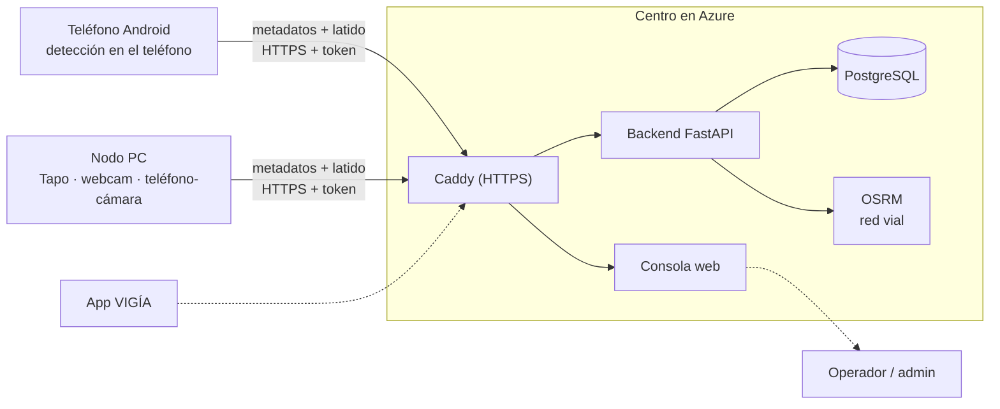

# VIGÍA

**Inteligencia vehicular colaborativa.** Una red de cámaras y teléfonos detecta vehículos en el propio dispositivo y, ante una consulta autorizada, VIGÍA reconstruye sus trayectorias probables sobre la red vial de Barranquilla, con un puntaje que se puede explicar.

[](https://github.com/cfvizcaino/py_vigia/actions/workflows/ci.yml) [](https://github.com/cfvizcaino/py_vigia/actions/workflows/movil.yml)

**Estado al 18 de noviembre de 2026 · App 1.5.0 (React Native)**

- [Sitio y consola del piloto](https://vigia-5dfe.mexicocentral.cloudapp.azure.com) · [Explorar la demo sin cuenta](https://vigia-5dfe.mexicocentral.cloudapp.azure.com/?demo=1)
- [Descargar la app para Android](https://vigia-5dfe.mexicocentral.cloudapp.azure.com/app)
- [Configurar un teléfono como cámara de la red](./docs/operations/phone-edges.md)

<!-- CAPTURAS -->

## El problema

Las cámaras residenciales y comunitarias funcionan como islas: graban mucho video, pero seguir un vehículo entre varias de ellas es un trabajo manual, lento y que no escala. Centralizar todo el video tampoco es la respuesta: consume red, cuesta y expone datos personales.

## Cómo lo resuelve VIGÍA

El video **se procesa donde se captura**. Cada cámara o teléfono detecta y sigue los vehículos, vota su color (y su placa, si la vista lo permite) y al centro solo envía metadatos: tipo, color, dirección y hora. Ante una consulta, el centro encadena las detecciones cercanas en tiempo y espacio siguiendo las calles (OSRM) y devuelve varias rutas candidatas, cada una con un puntaje explicable.

Una ruta **es una estimación, no una identificación**. Por eso un administrador puede revisar el recorte de cada paso y confirmar o descartar: las rutas se recalculan con esa respuesta.



Detalle: [arquitectura](./docs/architecture/overview.md) · [modelo de datos](./docs/architecture/data-model.md) · [rutas ponderadas](./docs/architecture/weighted-routes.md).

## Qué se puede hacer

| Quién | Dónde | Qué |
|---|---|---|
| Cualquiera | Web | Conocer el proyecto y recorrer una **demo guiada** con datos de ejemplo |
| Operador | Web y app | Ver la red de cámaras y su **estado real** (detectando, en segundo plano, detenido, sin señal); consultar por punto, radio, horario, tipo y color; comparar rutas sobre el mapa con la explicación de su puntaje; historial y exportación auditada |
| Admin | Web y app | Todo lo anterior, más buscar por placa, ver los recortes, confirmar o descartar cada paso, **etiquetar recortes para entrenamiento** (color y placa), dar de alta cámaras, emitir y revocar credenciales y revisar la auditoría |
| Teléfono fijo | App | **Edge autónomo**: detección, color, placas y recortes en el teléfono, cola sin red y latido cada 30 s. El video no sale del teléfono |
| Teléfono o cámara IP | App + PC | **Modo cámara**: el teléfono transmite por la red local o USB y un nodo PC hace la detección |

## Estado actual

| Componente | Estado |
|---|---|
| Centro en Azure | En operación desde el 10/10: Caddy con HTTPS y límite por IP, backend, web, PostgreSQL 17 y OSRM en Docker. Despliegue continuo con migración, verificación de salud y vuelta atrás automática |
| Consola web | Sitio público, demo guiada y consola fiel al diseño del Figma: mapa, consultas, rutas sobre calles, cámaras con estado real, confirmación y etiquetado de recortes, administración y auditoría |
| App móvil 1.5.0 | React Native (Expo 58) con el diseño morado del Figma, movimiento y respuesta táctil. Reemplaza a la app Flutter: se instala encima y conserva servidor, sesión y token. Android firmado; iOS compila sin firma en CI |
| Edge autónomo Android | YOLO26n TFLite a 320 px, tracker, color con compuertas, **placas** (detector + OCR votado por track), recortes y latido. ~6,6 análisis/s en un OPPO CPH2599 |
| Nodo de visión Python | Tapo C110 por RTSP, webcam o teléfono en modo cámara; YOLO + ByteTrack, color, placas, recortes y latido |
| Ingesta | Detection Envelope 1.1 con cola en disco, reintentos y deduplicación por evento y por track |
| Rutas | OSRM propio con el grafo del área metropolitana, alternativas ponderadas, top-k diversificado y consultas densas acotadas |
| Identidad y acceso | Token por cámara (hash, caducidad, rotación, revocación); personas con roles `operator`/`admin`, sesiones revocables y auditoría |
| Datos personales | Recortes y placas en contenedor privado, 7 días, solo admin y con cada vista auditada |
| Aprendizaje (fase 4) | Etiquetas explícitas de color y placa, almacén separado (180 días), exportación inmutable con prueba congelada y evaluación de candidatos |

## Resultados medidos

| Qué | Resultado | Evidencia |
|---|---|---|
| Edge en el teléfono | De 2,6 a **6,6 análisis/s** en el OPPO CPH2599 (06/11) | [phone-edges.md](./docs/operations/phone-edges.md) |
| Color del vehículo | **91,6 %** en la prueba de sitio, votado entre cuadros | [vehicle-color.md](./docs/modeling/vehicle-color.md) |
| Seguimiento | De 74 a **23 tracks/min** sin fragmentar; el color llega al 86 % de los vehículos | [tracking.md](./docs/modeling/tracking.md) |
| Carga en Azure | 25 msg/s (50 nodos) con **p95 de 152 ms**, 0 pérdidas y 0 duplicados; consultas con p95 de 1,0 s con 10 operadores | [benchmark](./docs/evidence/benchmark-azure-20261012.md) |
| Resiliencia | 248/248 eventos tras un corte, sin duplicados; la Tapo real corrió 8 h contra Azure | [resiliencia](./docs/evidence/p12-resiliencia-20261008.md) |
| Calidad de rutas | Top-k diversificado: **recall@3 de 0,429 a 0,571** y enlaces falsos de 0,24 a 0,167 | [top-k](./docs/evidence/topk-diversificado-20261102.md) |
| Consultas densas | **−43 %** de tiempo de reconstrucción con 220 candidatas, mismo resultado | [ROADMAP](./docs/ROADMAP.md) |

Los puntajes ordenan rutas; no son probabilidades calibradas de identificación.

## Usar el piloto

### Consola web y app

Abre la [consola](https://vigia-5dfe.mexicocentral.cloudapp.azure.com) o instala la [app para Android](https://vigia-5dfe.mexicocentral.cloudapp.azure.com/app). Ambas vienen configuradas con el servidor del piloto. Las cuentas las crea un administrador ([acceso de personas](./docs/operations/user-access.md)). **Explorar demo** usa datos de ejemplo y siempre se identifica como demostración. Los horarios se muestran en hora de Colombia (UTC−5).

Si ya tienes la app instalada, te avisará cuando haya una versión nueva.

### Un teléfono como cámara de la red

1. En la app, entra como **admin** y abre **Cámaras → Agregar edge**.
2. Registra la ubicación real y elige **Este teléfono · detección integrada (sin PC)**.
3. Al emitir el token, toca **Usar en este teléfono**.
4. Pulsa **Iniciar detección**, deja el teléfono conectado al cargador, con la app abierta y mirando hacia la vía.

La consola muestra si el teléfono está **detectando**, si quedó **en segundo plano**, si alguien lo **detuvo** o si está **sin señal** (app cerrada, sin red o sin batería), con su última batería y su cola. Ver [teléfonos como edges](./docs/operations/phone-edges.md).

### Una cámara con nodo PC

Para una Tapo, una webcam o un teléfono en **Modo cámara**, ejecuta el nodo de visión en un PC cercano después de registrar la cámara y emitir su token:

```bash
# Ejemplo: teléfono CEL-02 por USB, puerto local 8082.
bash infra/edges/install-node-token.sh CEL-02 8082 https://vigia-5dfe.mexicocentral.cloudapp.azure.com
bash infra/edges/run-phone-node.sh CEL-02
```

Fuentes RTSP, HTTP/MJPEG y webcam: [fuentes de video](./docs/operations/phone-edges.md#fuentes-de-video-admitidas) y [nodo de visión](./apps/vision/README.md).

## Estructura

```text
py_vigia/
├── apps/
│   ├── movil-rn/            # App VIGÍA (React Native): operador, admin, edge autónomo y modo cámara
│   ├── web/                 # Sitio público y consola (Next.js + MapLibre)
│   ├── backend/             # Centro: ingesta, rutas, auth, auditoría (FastAPI + SQLAlchemy + Alembic)
│   ├── vision/              # Nodo PC: RTSP/webcam/MJPEG, YOLO, tracking, color, placas, entrenamiento
│   ├── movil/               # App Flutter anterior (se conserva mientras haya teléfonos con ella)
│   └── intro-motion/        # Animación de apertura (Remotion)
├── infra/
│   ├── azure/               # Despliegue, Caddy, autodeploy y descarga del APK
│   ├── edges/               # Alta y ejecución de nodos PC
│   ├── osrm/                # Grafo vial
│   ├── postgres/            # Respaldos y restauración
│   └── wireguard/           # VPN para sedes remotas (preparada)
├── packages/contracts/      # Contratos versionados (Detection Envelope 1.1)
├── docs/                    # Arquitectura, operación, modelado, evidencias y ADR
├── PrimerInforme.md · SegundoInforme.md
└── compose.yaml
```

## Desarrollo local

El piloto compartido permite usar la web, la app y los edges sin levantar nada. Para desarrollar en una base local, usa Docker Compose o cada app por separado. Los comandos parten de la raíz del repositorio.

### Backend, PostgreSQL y web con Docker Compose

Necesitas Docker con Compose v2 y OpenSSL:

```bash
if [ ! -e .env ]; then
  (umask 077 && printf 'VIGIA_DB_PASSWORD=%s\n' "$(openssl rand -hex 24)" > .env)
fi
docker compose up -d db
docker compose build backend web
docker compose run --rm backend python -m vigia_backend.migrate upgrade
docker compose run --rm backend python -m vigia_backend.users create --email admin@ejemplo.org --name Admin --role admin
docker compose up -d backend web
```

La consola queda en [http://localhost:3000](http://localhost:3000) y el backend en `http://127.0.0.1:8000` (documentación interactiva en `/docs`). En el equipo del proyecto, el Docker rootless se usa con `bash infra/docker-local.sh compose`.

| Perfil | Uso | Preparación |
|---|---|---|
| `vision` | Nodo PC | Fuente y token en `apps/vision/.env` ([guía](./apps/vision/README.md)) |
| `routing` | OSRM local | [Grafo y enlaces de cámaras](./docs/operations/osrm-self-hosted.md) |
| `scoring` | Consola y base para evaluar rutas | [Dataset sintético](./docs/operations/scoring-dataset.md) |
| `resilience` | Backend aislado para pruebas de corte | [Procedimiento](./docs/operations/resilience.md) |

### Cada app por separado

| App | Comandos | Guía |
|---|---|---|
| Backend | `cd apps/backend && python3 -m venv venv && venv/bin/pip install -r requirements.txt && venv/bin/python -m pytest` | [README](./apps/backend/README.md) |
| Web | `cd apps/web && npm install && npm run dev` (Node 20.9+) | [README](./apps/web/README.md) |
| App móvil | `cd apps/movil-rn && npm ci && npx expo run:android` | [README](./apps/movil-rn/README.md) |
| Nodo PC | `cd apps/vision && python3 -m venv .venv && .venv/bin/pip install -r requirements.txt` | [README](./apps/vision/README.md) |

## Operación

- **Azure:** [guía del servidor](./docs/operations/azure.md) (despliegue, SSH, respaldos y acceso a la base por túnel SSH con DBeaver).
- **CI/CD:** [ci-cd.md](./docs/operations/ci-cd.md). Cada fusión a `main` publica imágenes en GHCR y el servidor se actualiza solo, con vuelta atrás si falla.
- **Publicar la app:** [apps/movil-rn/README.md](./apps/movil-rn/README.md#publicar-e-instalar).
- **Base de datos:** [PostgreSQL, respaldos y restauración](./docs/operations/postgres.md) · [migraciones](./docs/operations/database-migrations.md).

## Privacidad y seguridad

- El video no sale del sitio donde se captura; al centro llegan metadatos y, opcionalmente, un recorte pequeño por vehículo.
- Recortes y placas son datos personales (Ley 1581): contenedor privado, 7 días, solo admin y cada vista auditada. Las etiquetas de aprendizaje tienen su propio plazo y la auditoría nunca guarda textos de placa.
- Solo los puertos 80/443 están expuestos; HTTPS, límite de peticiones por IP y CSP. SSH solo con llave y desde la IP del administrador.
- Tokens por cámara y sesiones por persona, revocables; toda consulta, exportación y cambio queda auditado.

## Límites y próximos pasos

- **Evaluación:** faltan recorridos de campo independientes para medir las rutas reales y el primer reentrenamiento con las etiquetas de la fase 4.
- **Red vial:** el estimador descarta enlaces de más de 2 km; CEL-03 queda a 5–7 km del resto y hace falta una cámara intermedia o evidencia para recalibrar.
- **Teléfono:** la detección se pausa con la app en segundo plano o la pantalla apagada; la instalación de una versión nueva la confirma la persona.
- **Placas:** el recorte de 224 px no alcanza para entrenar el lector de placas; sirve para evaluarlo.
- **Infraestructura:** actualización automática del nodo PC, WireGuard entre redes, respaldos fuera de Azure y distribución firmada para iPhone.

Detalle y prioridades: [roadmap](./docs/ROADMAP.md).

## Documentación

| Tema | Documentos |
|---|---|
| Informes | [Primer informe](./PrimerInforme.md) · [Segundo informe](./SegundoInforme.md) · [Roadmap](./docs/ROADMAP.md) |
| Arquitectura | [Visión general](./docs/architecture/overview.md) · [Modelo de datos](./docs/architecture/data-model.md) · [Rutas ponderadas](./docs/architecture/weighted-routes.md) · [ADR-001](./docs/adr/001-hybrid-edge-architecture.md) · [ADR-002](./docs/adr/002-backend-central.md) · [ADR-003](./docs/adr/003-mobile-react-native-migration.md) |
| Operación | [Teléfonos como edges](./docs/operations/phone-edges.md) · [Recortes y aprendizaje](./docs/operations/recortes.md) · [Azure](./docs/operations/azure.md) · [CI/CD](./docs/operations/ci-cd.md) · [Credenciales de nodos](./docs/operations/device-credentials.md) · [Acceso de personas](./docs/operations/user-access.md) · [OSRM](./docs/operations/osrm-self-hosted.md) · [VPN](./docs/operations/remote-camera-vpn.md) |
| Modelos | [Color](./docs/modeling/vehicle-color.md) · [Seguimiento](./docs/modeling/tracking.md) · [Placas](./docs/modeling/license-plates.md) |
| Evidencias | [Carga en Azure](./docs/evidence/benchmark-azure-20261012.md) · [Resiliencia](./docs/evidence/p12-resiliencia-20261008.md) · [Sensibilidad del puntaje](./docs/evidence/sensibilidad-puntaje-20261012.md) · [Top-k diversificado](./docs/evidence/topk-diversificado-20261102.md) |
| Apps | [App móvil](./apps/movil-rn/README.md) · [Consola web](./apps/web/README.md) · [Backend](./apps/backend/README.md) · [Nodo de visión](./apps/vision/README.md) · [Contratos](./packages/contracts/README.md) |
| Validación | [Manual de arranque y validación](./docs/MANUAL_VALIDACION.md) |

## Equipo

| Nombre | GitHub |
|---|---|
| Cristian Vizcaíno | [@cfvizcaino](https://github.com/cfvizcaino) |
| Juan Delgado | [@Deelgado](https://github.com/Deelgado) |
| Daniel Castañeda | [@DanielCM21](https://github.com/DanielCM21) |

**Tutores:** Augusto Salazar y Diana Roca.
