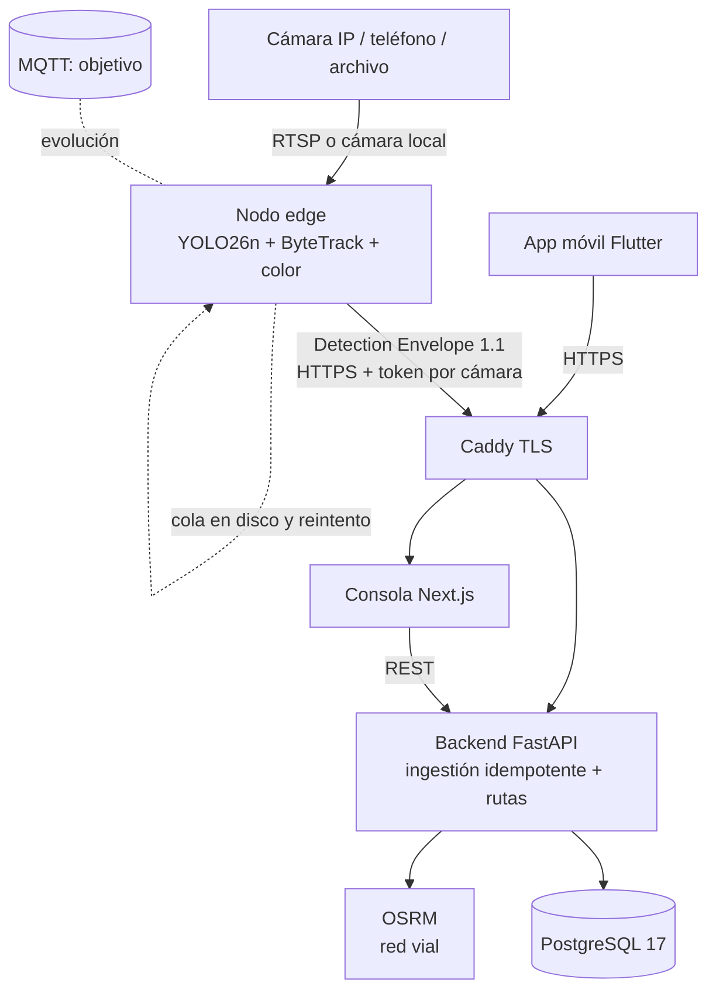
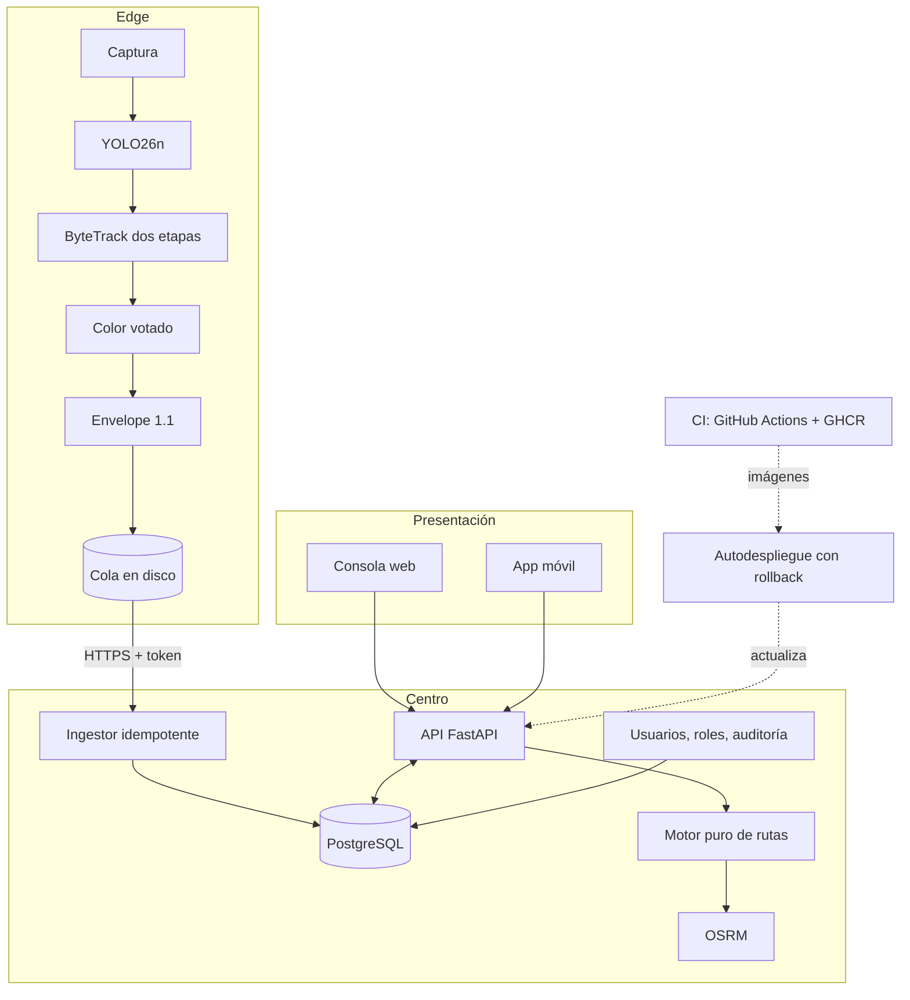
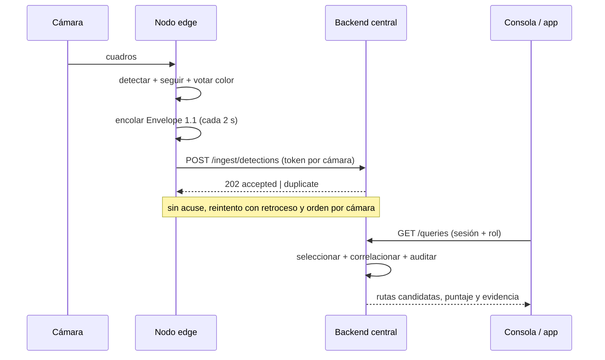
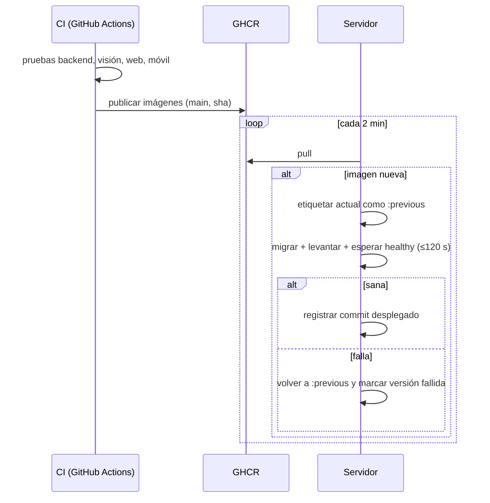

# Segundo informe - VIGIA

**Versión revisada: 12 de octubre de 2026.** Actualiza el corte del 23 de septiembre con lo implementado y medido hasta esta fecha, y atiende las observaciones de la revisión: citas internas para el contrato, el algoritmo y los componentes; justificación de los umbrales de 500 m, 2 km y 8–70 km/h; evidencia por fila en la tabla del estado del arte; y un benchmark bajo carga controlada de la alternativa seleccionada, con umbrales de aceptación. Lo que todavía no puede medirse se declara como tal en la sección 9.5.

## Resumen

VIGIA aborda la dificultad de reconstruir el recorrido probable de un vehículo cuando las cámaras residenciales o comunitarias funcionan como sistemas aislados. La consulta manual de múltiples grabaciones consume tiempo, mientras que la centralización permanente de video aumenta el uso de red, almacenamiento y exposición de datos personales. La propuesta adopta una arquitectura híbrida: cada nodo remoto procesa el video cerca de la cámara y la plataforma central recibe solo metadatos normalizados para consultar detecciones y estimar trayectorias, sin presentar el resultado como una identificación infalible.

Al 12 de octubre de 2026, el flujo vertical opera de extremo a extremo sobre un servidor central en Azure. Los nodos edge (un computador con una cámara Tapo C110 y teléfonos Android que detectan con YOLO26n en el propio dispositivo) siguen vehículos, estiman su color y publican un contrato versionado (`Detection Envelope 1.1`) por HTTPS con un token por cámara, una cola persistente y reintentos. El backend FastAPI sobre PostgreSQL ingiere de forma idempotente, autentica personas y roles, audita el uso y reconstruye rutas candidatas sobre la red vial de OSRM. Una consola web y una aplicación móvil consultan y explican los resultados. La plataforma central se actualiza sola desde integración continua y revierte a la versión anterior si la nueva no queda sana.

La validación ya es cuantitativa. En un benchmark controlado contra el servidor real, la alternativa seleccionada sostuvo 25 mensajes por segundo (50 nodos; 2,5 veces la carga exigida) con p95 de ingestión de 152 ms, sin eventos perdidos ni duplicados lógicos, y saturó en dos puntos: la latencia superó el umbral a 50 msg/s y el throughput máximo fue de unos 83 msg/s. A 200 msg/s el backend colapsó y necesitó un reinicio manual, un defecto que se documenta y se corregirá. Un reinicio del backend bajo carga no perdió eventos (12,8 s fuera de servicio y la cola drenada en 2,2 s). La alternativa C (DeepStream) se midió en una GPU de portátil: unos 580 cuadros por segundo, del orden de 50 veces lo que procesa la CPU. Eso muestra que centralizar con GPU es viable, y que lo que favorece a B es la red, la privacidad, el costo y la tolerancia a fallos; además, un edge con GPU cabe dentro de B. Las pruebas de resiliencia entregaron 248 de 248 eventos exactamente una vez tras un corte de red de 5 minutos. El clasificador de color alcanzó 91,6 % de exactitud en la prueba de sitio, y el nuevo seguimiento redujo la fragmentación de 106 a 35 tracks en un mismo video. Sobre un dataset sintético con verdad de terreno, el ranking obtiene recall@3 de 0,429; un análisis de sensibilidad sustenta los umbrales elegidos. Quedan pendientes la evaluación independiente con recorridos de campo, la lectura de placas, el agente de actualización de los nodos y la mensajería MQTT.

## Abstract

VIGIA addresses the difficulty of reconstructing a vehicle's likely path when residential or community cameras operate as isolated systems. Manually reviewing recordings is slow, whereas permanently centralizing video increases network usage, storage demands, and personal-data exposure. The proposed solution follows a hybrid architecture: each remote node processes video close to the camera, and a central platform receives only normalized metadata to query detections and estimate trajectories without presenting the result as definitive identification.

As of October 12, 2026, the vertical flow runs end to end on a central server in Azure. Edge nodes (a computer with a Tapo C110 camera and Android phones running YOLO26n on the device) track vehicles, estimate their color, and publish a versioned contract (`Detection Envelope 1.1`) over HTTPS with per-camera tokens, a persistent queue, and retries. A FastAPI backend on PostgreSQL ingests idempotently, authenticates users and roles, audits usage, and reconstructs candidate routes over the OSRM road network. A web console and a mobile app query and explain the results. The central platform deploys itself from continuous integration and rolls back when a new version is unhealthy.

Validation is now quantitative. In a controlled benchmark against the real server, the selected alternative sustained 25 messages per second (50 nodes, 2.5 times the required load) with a p95 ingestion latency of 152 ms, no lost events and no logical duplicates, saturating at two points: latency exceeded the threshold at 50 msg/s and throughput peaked at about 83 msg/s. At 200 msg/s the backend collapsed and needed a manual restart, a defect that is documented and will be fixed. A backend restart under load lost no events. Alternative C (DeepStream) was measured on a laptop GPU at about 580 frames per second, roughly 50 times the CPU; this shows that centralizing with a GPU is feasible, and that what favors B is bandwidth, privacy, cost and fault tolerance, while a GPU edge still fits inside B. Resilience tests delivered 248 of 248 events exactly once after a 5-minute network outage. The color classifier reached 91.6 % accuracy on the site test, and the new tracker reduced fragmentation from 106 to 35 tracks on the same video. On a synthetic dataset with ground truth, the ranking reaches recall@3 of 0.429, and a sensitivity analysis supports the chosen thresholds. Independent field evaluation, plate reading, the edge update agent, and MQTT messaging remain pending.

---

# 1. Introducción

La videovigilancia urbana y comunitaria suele crecer por agregación: cada vivienda, comercio o institución instala cámaras y conserva sus propios flujos. Aunque esta fragmentación distribuye el costo de captura, también dificulta responder una pregunta transversal, como determinar por cuáles puntos pudo pasar un vehículo dentro de una ventana temporal. Revisar cada cámara por separado no escala y, en ausencia de una identidad fuerte, cualquier correlación debe expresarse en términos de probabilidad y evidencia disponible.

VIGIA propone convertir cámaras heterogéneas en nodos remotos que producen observaciones normalizadas. El nodo identifica clases vehiculares, conserva un seguimiento local mientras el objeto permanece en la escena, estima su color y comunica metadatos mínimos. La plataforma central administra dispositivos, selecciona observaciones cercanas en espacio y tiempo y genera varias trayectorias candidatas, cada una con un puntaje explicable. Este enfoque se inspira en el procesamiento en el borde: la imagen se analiza cerca de la fuente y el centro coordina información estructurada, sin transmitir video de manera permanente.

Desde el corte anterior, el proyecto pasó de módulos conectados solo por la arquitectura documental a un piloto en operación. Los nodos publican al centro con cola local e idempotencia; la plataforma central corre en la nube con HTTPS, autenticación, auditoría y despliegue continuo con reversión; y existen dos clientes de operador (web y móvil). Este informe sigue tratando el sistema como un MVP académico: la meta verificable es la validación de nodos, comunicación y estimación de rutas en escenarios controlados, no el despliegue de una red urbana real.

# 2. Marco conceptual

El **procesamiento en el borde** o *edge computing* desplaza parte del cómputo desde un centro de datos hacia dispositivos cercanos a la fuente. En VIGIA, el borde recibe el video, ejecuta inferencia, seguimiento, clasificación de color y preparación de eventos; el centro persiste y correlaciona los resultados. La separación reduce el acoplamiento entre el video y la lógica global: el backend no necesita conocer la contraseña RTSP ni ejecutar el modelo de visión. También permite que una caída central no impida la captura local: el nodo conserva los eventos en una cola en disco y los reenvía cuando el centro vuelve [30], [36]. La sección 9.3 mide además el ahorro de red que justifica este principio: un sobre de metadatos ocupa unas 100 veces menos ancho de banda que el video de la misma cámara.

La **detección de objetos** localiza instancias en un fotograma y les asigna clase y confianza. El **seguimiento multiobjeto** relaciona detecciones consecutivas y mantiene un identificador temporal dentro de una cámara. VIGIA utiliza YOLO26n como detector [26] y ByteTrack como seguimiento. ByteTrack asocia primero las cajas de alta confianza y después las de baja confianza, que suelen corresponder a objetos parcialmente ocluidos, para no fragmentar trayectorias; sus autores reportan 80,3 MOTA y 77,3 IDF1 en MOT17 a 30 FPS en una GPU V100 [1]. En el nodo PC se usa la implementación de Ultralytics [8] con una configuración propia; en el teléfono se reimplementó la misma lógica de dos etapas. La medición de esa decisión está en [40]. El `trackId` resultante es local al flujo y no constituye una identidad global: la correlación entre cámaras requiere tiempo, ubicación, apariencia y red vial.

La **clasificación de color** se realiza sobre el recorte de cada vehículo con un clasificador `yolo26n-cls` ajustado a ocho colores, y se vota entre varios cuadros del mismo track. Un color solo se reporta con al menos dos votos y un promedio de 0,5 o más; si no, queda desconocido, porque un color equivocado ocultaría al vehículo en una consulta filtrada [39].

La **reconstrucción de trayectoria** se entiende como un problema de generación y ordenamiento de hipótesis. Una detección es compatible con otra si pertenece al mismo tipo, ocurre después, no contradice un color conocido y exige una velocidad plausible según la distancia vial entre cámaras [33]. Los candidatos se ordenan con un puntaje ponderado de calidad de detección, compatibilidad temporal, apariencia y costo vial [34]. Los umbrales que delimitan la búsqueda —penalización de tramos de 500 m o más, enlaces de hasta 2 km y velocidad implícita entre 8 y 70 km/h— son parámetros de laboratorio calibrables. La sección 3.2 justifica cada uno con fuentes externas y con un análisis de sensibilidad propio [38]. La distancia Haversine sirve para seleccionar cámaras alrededor de una consulta, mientras que la distancia por calles se obtiene de OSRM sobre OpenStreetMap [27]. PostGIS se reserva para una etapa posterior en la que el volumen justifique índices espaciales nativos [2].

El **contrato de captura** es la frontera técnica más importante del sistema. El nodo produce un `Detection Envelope 1.1` en JSON, definido en JSON Schema [31]. Contiene identificadores de evento (`eventId`), sesión del nodo (`sessionId`) y número de secuencia, cámara, instante UTC, versión del nodo y del modelo con su *digest*, número de fotograma y una lista de detecciones. Cada detección incluye `trackId`, tipo, confianza, primera y última observación, dirección, caja delimitadora, color y campos opcionales de marca, modelo y placa. El backend ingiere el sobre de forma idempotente: un `eventId` repetido no crea filas nuevas, y cada track se identifica por cámara, sesión, `trackId` y primera observación, de modo que los sobres sucesivos actualizan la misma detección lógica en lugar de duplicarla [32].

La **actualización remota** significa cambiar de forma controlada el software, el modelo o la configuración sin intervenir físicamente el equipo. Para la plataforma central ya está implementada como despliegue continuo por extracción: la integración continua publica imágenes versionadas y el servidor las descarga, migra, verifica su salud y vuelve a la versión anterior si fallan [41]. Para los nodos edge sigue pendiente un agente equivalente; hoy los teléfonos se actualizan instalando un APK firmado y el nodo PC desde el repositorio.

Finalmente, la privacidad no es una característica complementaria sino una restricción de diseño. La Ley 1581 de 2012 aplica a datos personales registrados en bases susceptibles de tratamiento y establece principios, derechos de titulares y deberes de responsables y encargados [3]. La Superintendencia de Industria y Comercio ha señalado que las reglas de protección de datos se aplican a cámaras y sistemas de videovigilancia [4]. En consecuencia, VIGIA limita la finalidad, restringe el acceso por roles, no transmite video al centro, audita consultas y exportaciones, y evita que una inferencia probabilística se presente como identificación cierta.

# 3. Planteamiento del problema

El problema central consiste en aprovechar observaciones distribuidas para estimar el recorrido probable de un vehículo sin exigir la centralización continua de todos los videos. Las cámaras disponibles no comparten necesariamente fabricante, resolución, reloj, orientación ni plataforma de gestión. A esa heterogeneidad se suma que dos vehículos pueden coincidir en tipo y color, que existen zonas sin cobertura y que el tiempo entre cámaras depende de la vía y del tráfico.

La relevancia del problema es técnica y organizacional. Técnicamente, exige integrar visión por computador, comunicación distribuida, persistencia geoespacial y una interfaz que comunique incertidumbre. Organizacionalmente, una comunidad o institución necesita consultar evidencias de varias fuentes sin administrar manualmente cada dispositivo. La solución solo es útil si conserva trazabilidad, diferencia datos reales de demostraciones y limita el tratamiento a un propósito autorizado.

El problema no se resuelve únicamente aumentando la precisión de un detector. Incluso una detección perfecta dentro de cada cámara deja abierta la asociación entre vistas no superpuestas. Por ello, el MVP valida tres capacidades separadas: que un nodo remoto produzca capturas normalizadas y pueda actualizarse; que exista comunicación observable y tolerante a desconexiones con la plataforma central; y que el estimador de rutas pueda compararse contra recorridos esperados de un dataset versionado.

## 3.1 Descripción del problema

La causa inmediata es la operación aislada de las cámaras. Cada sistema conserva grabaciones y estados en una interfaz propia, de modo que una búsqueda transversal obliga a conocer ubicaciones, solicitar acceso y revisar intervalos de video. El costo humano crece con el número de cámaras y con la amplitud de la ventana temporal. Si se intenta resolver el problema enviando todos los flujos a un servidor, aparecen costos de red, almacenamiento y protección de datos que no son razonables para el alcance académico (sección 9.3).

Los usuarios potencialmente afectados son operadores autorizados de una comunidad, personal de seguridad institucional y administradores de dispositivos. El operador necesita formular una consulta y entender por qué una ruta fue sugerida; el administrador necesita observar disponibilidad, versión y errores de los nodos; las personas captadas por las cámaras necesitan garantías sobre finalidad, acceso y conservación. El sistema debe equilibrar estas necesidades sin prometer identificación forense ni reemplazar procedimientos legales.

Las principales consecuencias de no resolver el problema son tiempos altos de análisis, resultados difíciles de auditar y decisiones basadas en evidencia incompleta. A su vez, una solución mal diseñada puede producir un riesgo mayor: correlacionar equivocadamente vehículos parecidos, exponer flujos privados o conservar información innecesaria. Por ello, VIGIA presenta varias rutas candidatas, explica el puntaje de cada una y permite rastrear cada resultado hasta las detecciones que lo originaron.

## 3.2 Restricciones y supuestos de diseño

El prototipo parte de cámaras físicas y simuladas en Barranquilla. La ubicación de una detección se aproxima mediante la ubicación fija de la cámara. El estimador de rutas usa tres umbrales que **no son normas universales sino parámetros de laboratorio**: configurables en `RoutingConfig` [33] y expuestos en la explicación de cada ruta. Se fijaron con fuentes externas y se contrastaron con un análisis de sensibilidad sobre el dataset sintético de puntajes [35], [38]. Ese dataset no se generó con los umbrales del algoritmo: sus tiempos de viaje son la duración de OSRM multiplicada por un factor de tráfico aleatorio U(1,05; 1,9).

**Velocidad implícita entre 8 y 70 km/h.** El límite legal en vías urbanas de Colombia es de 50 km/h, y de 30 km/h en zonas escolares y residenciales (Ley 2251 de 2022, art. 12, que modifica el art. 106 de la Ley 769 de 2002) [20]. El máximo de 70 km/h deja un margen del 40 % sobre ese límite para absorber el exceso de velocidad real, los errores de reloj entre cámaras y la diferencia entre la distancia OSRM y el camino recorrido; un enlace que exige más velocidad se considera físicamente implausible. En el extremo inferior, la velocidad media en hora pico en Barranquilla fue de 13,7 km/h en 2025 (14,9 km/h en la mañana y 13,0 km/h en la tarde) [21]. El mínimo de 8 km/h, alrededor del 60 % de esa media, admite congestión intensa sin aceptar como "trayecto continuo" un tramo con una parada prolongada. En el análisis de sensibilidad, subir el mínimo a 12 km/h baja el recall@3 de 0,429 a 0,357, y bajarlo a 3 km/h sube los enlaces falsos de 0,26 a 0,31. El máximo no cambia los resultados entre 50 y 120 km/h porque el dataset no contiene trayectos legítimos rápidos; solo el caso de control S06, equivalente a unos 127 km/h, debe rechazarse. Por eso el máximo se justifica por la norma y no por el dataset.

**Enlaces de hasta 2 km.** Con la velocidad media de la ciudad, 10 km toman 36 min 35 s [21], de modo que 2 km equivalen a unos 7 minutos sin observación. Más allá, el número de caminos y paradas posibles entre dos cámaras crece y la asociación pierde poder discriminante. En la sensibilidad, 2 km es el mejor valor medido: con 1 km el recall@1 cae de 0,286 a 0,143 porque se descartan tramos reales, y con 3 o 5 km baja a 0,214 y aumentan los enlaces falsos.

**Penalización de tramos de 500 m o más.** No es un filtro sino un factor de 0,85 sobre el puntaje del tramo, que representa la incertidumbre de un hueco largo entre observaciones. A 13,7 km/h, 500 m son unos 2 minutos sin observación. Con 250 m los enlaces falsos suben a 0,32; con 1000 m bajan a 0,22, pero el recall@3 cae a 0,357. 500 m es el punto de equilibrio medido.

Estos valores deberán recalibrarse con recorridos de campo (P1.1); el análisis sintético justifica su orden de magnitud, no su valor exacto.

La identidad vehicular disponible en el backend es un proxy compuesto por tipo y color. El color ya lo produce el borde, pero puede quedar desconocido; una consulta por color conserva esos pasos como evidencia débil y exige que cada ruta contenga el color pedido al menos una vez [33]. La placa se estudia en una tubería separada de detección y OCR [18] y no forma parte del criterio de éxito del MVP. Una coincidencia de `trackId` tampoco cruza cámaras, porque ese valor solo tiene sentido dentro del proceso local que sigue un flujo.

Se asume conectividad intermitente y capacidad de cómputo limitada en el borde. El diseño funciona con CPU como línea base (el teléfono usa LiteRT sobre CPU) y evita exponer RTSP a Internet. El MVP no asume alta disponibilidad, sincronización perfecta de relojes ni navegación vial exacta. Las pruebas con material real se realizaron en escenarios controlados, con cámaras propias y sin publicar imágenes.

## 3.3 Alcance actualizado

El alcance incluye nodos remotos ejecutables que capturen RTSP, la cámara de un teléfono o un video; detecten automóviles y motocicletas; mantengan seguimiento local; estimen color; y publiquen un formato normalizado. Incluye también una plataforma central modular para administrar dispositivos y detecciones, ejecutar consultas espaciales y temporales, persistir candidatos y exponerlos a una consola web y una aplicación móvil. La demostración funciona con varios nodos lógicos: dos físicos (Tapo y teléfono) y los simulados que se necesiten.

La actualización verificable se cumple hoy en la plataforma central: instalar una versión, comprobar su salud y revertir si no arranca [41]. Para los nodos edge, el mismo objetivo queda como pendiente declarado (sección 15). La comunicación se implementó sobre HTTPS con mensajes independientes del transporte, reintento e idempotencia; MQTT queda como evolución.

Quedan fuera del alcance el despliegue operativo de una red urbana, la identificación inequívoca de personas o vehículos, el reconocimiento garantizado de placas, la retención de video y la respuesta forense. También quedan fuera la alta disponibilidad multirregión y una certificación legal. PostGIS, MQTT y OCR siguen condicionados a cerrar primero el flujo medible.

# 4. Objetivos

El objetivo general actualizado es **diseñar, implementar y validar un MVP distribuido de VIGIA que permita a nodos remotos actualizables publicar detecciones vehiculares normalizadas, a una plataforma central recibirlas y supervisarlas, y a un modelo de correlación estimar rutas candidatas comparables con trayectorias esperadas de un escenario controlado**. La red física extensa deja de ser una promesa del proyecto y se convierte en un contexto futuro de aplicación.

El primer objetivo específico es **implementar y validar un nodo remoto actualizable que capture video, ejecute detección y seguimiento local, y publique snapshots conformes con un contrato versionado**. Su evidencia es una ejecución reproducible, la validación contra JSON Schema, la identificación de versión de software y modelo, y la actualización con reversión ante una versión inválida.

El segundo objetivo específico es **demostrar la comunicación entre nodos remotos y la plataforma central mediante mensajes de detección y estado, con trazabilidad, reintento e idempotencia**. La evidencia incluye varios nodos lógicos, desconexión y reconexión, medición de latencia de entrega y ausencia de duplicados lógicos aunque un mensaje se reenvíe.

El tercer objetivo específico es **estimar y ordenar rutas candidatas a partir de recorridos generados, evaluando la salida frente a trayectorias esperadas**. La evaluación reporta cobertura top-k, exactitud de secuencia, falsos enlaces y latencia de consulta, con generación y evaluación separadas para que las reglas del algoritmo no garanticen artificialmente el resultado.

El cuarto objetivo específico es **proporcionar una consola que permita consultar, inspeccionar y exportar resultados sin ocultar su incertidumbre**. La interfaz diferencia servicio central y demostración, permite filtros geográficos y temporales, muestra varias rutas con sus detecciones, explica el puntaje e informa tramos no observados. La exportación registra algoritmo, filtros y origen de datos.

El quinto objetivo específico es **incorporar controles básicos de seguridad, privacidad y mantenibilidad acordes con un prototipo académico**: no exponer credenciales RTSP, autenticar operadores, restringir vistas y descargas, registrar consultas, fijar retención y documentar licencias. No equivale a certificación, pero exige que los riesgos conocidos tengan una medida y un responsable.

El estado de cada objetivo al 12/10 se resume en la tabla 14.1.

# 5. Estado del arte / soluciones relacionadas

Los NVR tradicionales centralizan grabación y consulta, una solución adecuada cuando las cámaras pertenecen a la misma organización y existe infraestructura común. Frigate representa una variante local orientada a cámaras IP: ejecuta detección de objetos cerca del entorno doméstico, se integra con otros sistemas mediante MQTT [5] y, desde versiones recientes, lee placas con un detector YOLOv9 y PaddleOCR [23]. Su documentación recomienda aceleradores dedicados (Hailo, OpenVINO, GPU) con tiempos de inferencia de 5 a 18 ms y desaconseja la detección en CPU [22]. Su foco es la detección, grabación y automatización en un sitio, mientras que VIGIA correlaciona metadatos de nodos administrativamente distribuidos y explica rutas candidatas.

NVIDIA DeepStream ofrece una plataforma madura de analítica acelerada por GPU para fuentes RTSP, seguimiento y múltiples flujos [6]. NVIDIA reporta, por ejemplo, 642 FPS agregados con RT-DETR y su rastreador NvDCF en una GPU L40s, y 96 FPS en un Jetson AGX Orin, sobre video 1080p [24]. Su referencia multicámara genera metadatos (sensor, fotograma, tiempo, caja, identificador y vector de características) y usa un *broker* para alimentar la analítica central [7]. Esta arquitectura valida la pertinencia de separar percepción y correlación, pero exige GPU NVIDIA, calibración y una pila mayor que excede el MVP.

Los trabajos de seguimiento multiobjeto aportan técnicas para conservar identidades dentro de una cámara. ByteTrack asocia detecciones de alta y baja confianza para reducir trayectorias fragmentadas [1], y Ultralytics permite seleccionarlo y configurarlo [8]. No obstante, el seguimiento por cámara no resuelve la reidentificación entre cámaras. VIGIA reconoce esa frontera y no reutiliza el `trackId` local como identidad global.

En lectura de placas, servicios comerciales como Plate Recognizer declaran soporte para más de 90 países, ejecución en la nube o local y 50 a 100 ms por imagen [25]. Son cifras del propio fabricante, no verificadas de forma independiente. VIGIA no adopta un servicio externo porque enviar recortes de placas a terceros ampliaría el tratamiento de datos personales y porque la calidad de las placas en sus cámaras aún no se ha medido [18].

La tabla 5.1 resume la comparación. Cada fila cita su fuente y declara **qué tipo de evidencia** respalda la capacidad o el límite atribuido: documentación oficial del producto, artículo revisado por pares, declaración del fabricante sin verificación independiente, o medición propia de este proyecto.

**Tabla 5.1.** Soluciones relacionadas, con fuente y tipo de evidencia por fila.

| Solución | Enfoque | Capacidad atribuida | Límite atribuido | Fuente | Evidencia que la respalda |
|---|---|---|---|---|---|
| NVR tradicional | Grabación y consulta centralizadas | Revisión manual de video de un mismo propietario | No correlaciona cámaras de distintos dueños; transmite y almacena todo el video | [4], sección 9.3 | Análisis propio; costo de red **medido** en la sección 9.3 (1,10 Mbit/s por cámara) |
| Frigate | NVR local con detección y MQTT | Detección de objetos en tiempo real; LPR integrado (YOLOv9 + PaddleOCR) | Un sitio; recomienda acelerador dedicado; no reconstruye rutas entre sitios | [5], [22], [23] | Documentación oficial; tiempos de inferencia publicados por el proyecto, no medidos aquí |
| NVIDIA DeepStream / Metropolis | Analítica multicámara acelerada por GPU | Cientos de FPS por GPU; metadatos y *broker* para analítica central | Requiere GPU NVIDIA, TensorRT y calibración | [6], [7], [24] | Cifras del fabricante en otras GPU [24]; **medido aquí** en una RTX 5050 Laptop con DeepStream 8.0 (sección 9.4) |
| ByteTrack | Seguimiento multiobjeto (algoritmo) | 80,3 MOTA y 77,3 IDF1 en MOT17, 30 FPS en V100 | Identidad solo dentro de una cámara | [1], [8] | Artículo revisado por pares (ECCV 2022); su efecto en VIGIA está **medido** en [40] |
| Plate Recognizer | ALPR comercial (nube o local) | Más de 90 países; 50–100 ms por imagen | Servicio de terceros; costo por licencia; datos fuera del sistema | [25] | Declaración del fabricante, sin verificación independiente |
| **VIGIA (este trabajo)** | Edge + centro modular con correlación explicable | Ingestión idempotente, rutas candidatas sobre red vial y color en el borde | Sin placas aún; ranking calibrado solo con datos sintéticos | [30]–[41] | **Mediciones propias** (secciones 9.3 y 13) |

La propuesta se posiciona, por tanto, entre un NVR inteligente y una plataforma industrial de analítica multicámara. Comparte con Frigate el procesamiento local y el desacoplamiento por mensajes; comparte con DeepStream la idea de metadatos normalizados y analítica posterior; pero restringe el objetivo a vehículos y a una evaluación académica reproducible. Su contribución no es un detector nuevo, sino la integración trazable de captura, comunicación, correlación probabilística y visualización bajo restricciones de privacidad.

La elección de componentes abiertos también facilita la inspección y la sustitución. FastAPI se basa en OpenAPI y JSON Schema, e incorpora validación y documentación interactiva [9]; MapLibre GL JS renderiza mapas interactivos en el navegador [10]; los Route Handlers de Next.js permiten una capa servidor entre el navegador y los servicios privados [11]; OSRM calcula rutas y alternativas sobre OpenStreetMap [27]. Los contratos y el algoritmo de rutas permanecen independientes de estos frameworks.

# 6. Solución propuesta

La solución es una plataforma híbrida con nodos edge, backend central, consola web y aplicación móvil. Cada nodo obtiene video de una cámara, ejecuta inferencia, seguimiento y clasificación de color, y conserva solo el estado de los tracks activos. En lugar de entregar la URL RTSP, publica un `Detection Envelope 1.1` cada dos segundos —también cuando no hay vehículos, como latido— y, para supervisión autorizada, una vista procesada. La plataforma central filtra cámaras y observaciones, ejecuta la correlación y guarda consultas, resultados y auditoría.

Hay dos tipos de nodo:

- **Nodo PC** (`apps/vision`): FastAPI con YOLO26n y ByteTrack de Ultralytics, para cámaras RTSP como la Tapo C110 o para la cámara de un teléfono conectado por USB.
- **Edge autónomo en el teléfono** (`apps/movil`): la aplicación Flutter ejecuta YOLO26n exportado a TFLite (LiteRT) en el propio teléfono, sin computador [43].

Ambos generan el mismo contrato, de modo que el backend los trata igual.

Los usuarios objetivo son dos roles, aplicados por el backend [44]. El **operador** formula consultas por cámara o punto, radio, fecha, ventana horaria, tipo y color; compara rutas, puntaje y tramos distantes; y exporta resultados auditados. El **administrador** además registra nodos, emite y revoca sus credenciales y revisa la auditoría. Las contraseñas se guardan con `scrypt`, las sesiones son revocables y hay bloqueo por intentos fallidos.

La propuesta de valor es reducir el trabajo manual y el movimiento innecesario de video, manteniendo explícita la incertidumbre. Una ruta es una hipótesis respaldada por una secuencia de detecciones, no una declaración de identidad. El sistema permite inspeccionar qué cámaras y tiempos formaron el resultado, cuánto aportó cada señal al puntaje y qué pasos no tienen color confirmado.

**Puntaje de una ruta.** Cada tramo entre dos detecciones recibe la combinación `S = (0,35·D + 0,40·T + 0,15·A + 0,10·V) · G · F` [34]:

- `D`: confianza media del detector.
- `T`: compatibilidad temporal, `exp(−½·(ln(Δ/μ)/σ)²)`, con `μ = 1,35 ×` duración OSRM y `σ = 0,65`.
- `A`: apariencia; 1 si el color conocido coincide, 0,4 si falta.
- `V`: costo vial relativo de la alternativa.
- `G = 0,85` para tramos de 500 m o más.
- `F` penaliza las distancias sin duración vial validada.

La ruta usa la media geométrica de sus tramos, más 0,04 por cada observación adicional hasta 0,08, con tope de 0,99. Cada elección tiene una justificación verificable:

- **Tiempo con el peso mayor (0,40).** Es la única señal cuya ablación reduce el recall@1 (de 0,286 a 0,214) en el análisis de sensibilidad [38]. El factor 1,35 y σ = 0,65 hacen que una desviación estándar cubra tiempos entre 0,70 y 2,59 veces la duración de OSRM: desde el flujo libre hasta la congestión de la hora pico nocturna en Barranquilla, del 103 % [21].
- **Apariencia con peso bajo (0,15).** El color es una identidad débil: muchos vehículos comparten color y el clasificador acierta el 91,6 % en el sitio [39]. La falta de color vale 0,4 y no 0, para no descartar la ruta.
- **Media geométrica en lugar de suma.** Un solo tramo implausible baja todo el puntaje, en lugar de quedar oculto tras tramos fuertes.
- **Tope de 0,99.** Nunca se presenta certeza.

Con pesos iguales (0,25 cada uno), el dataset sintético da las mismas métricas. Por eso, salvo el del tiempo, los pesos siguen siendo hipótesis a calibrar con recorridos de campo (P1.1), no valores aprendidos.

La comunicación se define por mensajes independientes del transporte. Hoy se implementan `detection.snapshot`, que también funciona como latido, y el estado del nodo; la configuración deseada y reportada, y las órdenes de actualización a los nodos, quedan propuestas. HTTPS sirve el flujo actual con idempotencia por `eventId`. MQTT 5 se mantiene como evolución para publicación/suscripción con QoS: el estándar lo caracteriza como un protocolo ligero de publicación/suscripción apropiado para entornos M2M e IoT [12]. El benchmark de la sección 9.3 muestra que HTTP es suficiente para la carga del MVP, por lo que MQTT no es una necesidad inmediata.

# 7. Metodología de desarrollo

El proyecto siguió una estrategia incremental orientada a reducir incertidumbre técnica, con un incremento verificable por semana y un pull request revisado por cada uno (ROADMAP [45]).

1. **Base (hasta el 23/09).** Validó RTSP con la Tapo, separó el nodo en FastAPI, construyó el modelo central, el algoritmo puro de rutas, la consola web y sus pruebas.
2. **Flujo vertical (28/09–09/10).** Agregó el contrato 1.1, la ingestión idempotente, la cola local y la resiliencia medida (P1.2), credenciales por cámara, migraciones Alembic, PostgreSQL, rutas viales ponderadas con OSRM, usuarios, roles, auditoría y la pantalla de administración.
3. **Operación (10/10–11/10).** Llevó el centro a Azure con HTTPS, construyó la aplicación móvil y el edge autónomo en el teléfono, y automatizó pruebas, publicación y despliegue con reversión.
4. **Visión y evaluación (12/10).** Agregó color, seguimiento sin fragmentar, el análisis de sensibilidad del ranking y el benchmark de carga.

Las decisiones arquitectónicas se documentaron como ADR [15], [16]. Se eligieron una arquitectura híbrida y un monolito modular porque los microservicios introducirían fallos distribuidos antes de validar el caso de uso. SQLite se reemplazó por PostgreSQL 17 al iniciar el piloto, por concurrencia y respaldos; PostGIS sigue condicionado al volumen. El algoritmo se mantuvo como función pura, probada sin base de datos.

La validación combina pruebas automatizadas en CI, mediciones reproducibles y pruebas en vivo. Cada pull request ejecuta:

- **Backend:** 81 pruebas, más 4 contra PostgreSQL real en CI.
- **Nodo de visión:** 33 pruebas.
- **Web:** lint, tipos, 12 pruebas unitarias y compilación de producción.
- **Aplicación móvil:** analizador y 60 pruebas, con compilación Android e iOS.

La deuda de entorno del corte anterior —pruebas HTTP del backend bloqueadas con Python 3.14— se resolvió fijando Python 3.12 en CI y en las imágenes.

Cada experimento declara su escenario, su métrica, su umbral y un artefacto reproducible en `docs/evidence`. Los resultados negativos se conservan, como la falta de diversidad del top-k en hora pico (sección 13.3). Antes de usar video real se trabajó con cámaras propias y sin publicar imágenes; los datasets de terceros se usan solo para investigación y no se redistribuyen [39].

# 8. Requerimientos

Los requerimientos se derivan del problema, los objetivos actualizados y la implementación existente. Se redactan de forma verificable, con un criterio de aceptación cada uno. Su estado al 12/10 se marca entre corchetes.

Los requerimientos no funcionales se aplican de manera proporcional a un prototipo académico. No se exige disponibilidad de producción, pero sí recuperación observable; no se exige una auditoría de seguridad, pero sí secretos fuera del repositorio y control de acceso; no se exige carga masiva, pero sí medir la carga esperada y documentar el punto de saturación (sección 9.3).

## 8.1 Funcionales

**RF-01 Captura y detección.** [Cumplido] El nodo acepta RTSP, la cámara del teléfono o un archivo; detecta `car` y `motorcycle`; mantiene un `trackId` local; estima dirección y color; y genera sobres conformes con el contrato versionado, en UTC con milisegundos. Criterio: el 100 % de los sobres de prueba validan contra el esquema [31]; el backend rechaza con 422 los que no lo cumplen.

**RF-02 Estado y comunicación.** [Cumplido en lo esencial] El nodo publica un latido cada 2 s y su estado operativo (`stopped`, `loading-model`, `connecting`, `running`, `reconnecting`, `error`, FPS, cola, versión). Criterio: una desconexión se refleja y una reconexión no duplica detecciones lógicas (verificado en P1.2 y en la sección 9.3). Pendiente: el estado `stale`/`offline` derivado del último latido en la consola.

**RF-03 Actualización remota.** [Cumplido en la central; pendiente en los nodos] La plataforma central instala versiones publicadas por CI, verifica su salud y revierte ante error [41]. Criterio: una versión válida queda activa y una defectuosa produce rollback comprobable (probado con versión sana, versión que no queda sana, migración rota y recuperación). Falta el agente equivalente en los nodos edge.

**RF-04 Persistencia.** [Cumplido] El backend administra dispositivos y detecciones, registra consultas y persiste rutas con su secuencia de observaciones. Cada mensaje tiene una clave idempotente. Criterio: reenviar el mismo evento no aumenta el conteo lógico (0 duplicados en P1.2 y en el benchmark) y toda ruta se traza hasta sus detecciones.

**RF-05 Consulta.** [Cumplido] El operador consulta por ubicación o cámara, radio, intervalo, tipo y color. El sistema devuelve cámaras cercanas, conteo de candidatos y hasta diez rutas ordenadas, y rechaza una ventana invertida o coordenadas inválidas con un mensaje comprensible.

**RF-06 Estimación.** [Cumplido; calibración pendiente] El motor excluye pares con tiempos no crecientes, cámaras iguales, tipos distintos, colores conocidos contradictorios, enlaces inexistentes o velocidades fuera de rango; marca huecos distantes; y nunca presenta la primera ruta como certeza. Criterio: el dataset sintético reporta top-k y falsos enlaces (sección 13.3).

**RF-07 Visualización y exportación.** [Cumplido] La consola web y la aplicación móvil representan dispositivos, radio, ruta seleccionada sobre calles, puntaje, secuencia temporal, origen de datos, advertencias y pasos sin color confirmado. La exportación JSON se genera en el servidor con parámetros y versión del algoritmo, y queda auditada.

**RF-08 Administración y auditoría.** [Cumplido] La plataforma autentica operadores y administradores, aplica roles en el backend y registra inicios de sesión, consultas, exportaciones, vistas previas, cambios y credenciales. Criterio: un operador no puede emitir credenciales y un usuario no autenticado no accede a vistas previas ni resultados (pruebas HTTP negativas en CI).

## 8.2 No funcionales

**RNF-01 Rendimiento.** Para la carga esperada de 4 a 10 nodos y un sobre cada 1 a 5 s, la plataforma debe sostener al menos 10 mensajes por segundo con p95 de ingestión menor de 500 ms en la red de prueba, y las consultas deben responder con p95 menor de 2 s con hasta 10 operadores concurrentes. [Cumplido y medido (sección 9.3): 25 msg/s con p95 de 152 ms y consultas con p95 de 1,0 s. Con 10 operadores y 25 nodos a la vez, la ingestión sube a 614 ms.]

**RNF-02 Resiliencia.** El nodo almacena los mensajes cuando el centro no está disponible, reintenta con retroceso y conserva el orden por cámara; el backend acepta reenvíos idempotentes. Una caída central no debe perder eventos dentro de la capacidad configurada. [Cumplido: P1.2 y prueba de fallo de la sección 9.3.]

**RNF-03 Seguridad y privacidad.** Las credenciales RTSP y los secretos no llegan al navegador ni al repositorio. El tráfico remoto usa TLS; las vistas previas requieren autenticación; las consultas y exportaciones quedan auditadas; el centro no recibe video. [Cumplido en lo verificado; pendientes en la sección 15.]

**RNF-04 Mantenibilidad.** Los contratos se versionan y los cambios incompatibles crean una nueva versión. El algoritmo de rutas permanece separado del ORM y la interfaz. Toda entrega supera pruebas, lint y compilación en CI. [Cumplido.]

**RNF-05 Portabilidad.** El nodo se ejecuta en Linux, en contenedor o entorno virtual, con CPU como línea base; el edge autónomo corre en Android. La plataforma central se levanta con Docker Compose sin servicios externos obligatorios. [Cumplido.]

**RNF-06 Usabilidad y explicabilidad.** La interfaz muestra estados vacíos, de carga y de error; diferencia demostración de datos centrales; y acompaña todo puntaje con las observaciones y contribuciones que lo sustentan. [Cumplido en diseño; prueba con usuarios pendiente.]

**RNF-07 Observabilidad.** Cada servicio expone salud; el nodo reporta FPS, cola, último error y versión; los despliegues quedan registrados con su commit. [Parcial: faltan métricas agregadas y un tablero.]

**RNF-08 Compatibilidad legal y de licencia.** El piloto debe documentar base y finalidad del tratamiento, responsables, avisos, retención y atención a titulares, y revisar las licencias de Ultralytics, modelos, datasets y mapas antes de distribuir. [Parcial: la atribución de OpenStreetMap está en web y móvil; la licencia del repositorio y la política de datos siguen pendientes (sección 15).]

# 9. Evaluación de alternativas

Se compararon tres alternativas: **A)** centralización de video en un servidor; **B)** arquitectura híbrida con nodos edge y backend modular, seleccionada por VIGIA; y **C)** plataforma industrial GPU multiflujo, representada por DeepStream. En el corte anterior la comparación era solo analítica. En este corte, la alternativa seleccionada se midió bajo carga controlada sobre su despliegue real. De A se midió lo que puede medirse con el hardware disponible (ancho de banda y costo de inferencia por flujo). C se midió en un segundo portátil con GPU NVIDIA (sección 9.4); las cifras del fabricante siguen citadas aparte porque corresponden a otra GPU y a otro modelo.

## 9.1 Métricas y umbrales de aceptación

Las métricas se fijaron antes de medir, a partir de RNF-01 y RNF-02:

| Métrica | Definición | Umbral de aceptación |
|---|---|---|
| Throughput sostenido | Mensajes aceptados por segundo con la carga ofrecida | ≥ 10 msg/s (10 nodos a 1 msg/s) |
| Latencia de ingestión | p95 de la petición HTTPS de un sobre, medida en el cliente | < 500 ms |
| Latencia de entrega | p95 desde que el nodo genera el sobre hasta que el centro lo acepta (incluye cola) | < 1 s sin fallas |
| Saturación | Primer escalón en que el p95 supera 500 ms, la entrega queda por debajo de lo ofrecido o hay errores | Debe estar por encima de la carga esperada |
| Pérdida | Sobres generados que no quedaron aceptados al final | 0 |
| Duplicación lógica | Reenvíos deliberados que crearon filas nuevas | 0 |
| Impacto de un fallo | Pérdida y tiempo de recuperación al reiniciar el backend bajo carga | 0 eventos perdidos; cola drenada en < 60 s |
| Latencia de consulta | p95 de una consulta con reconstrucción de rutas | < 2 s con 10 operadores |

## 9.2 Montaje del benchmark

El benchmark se ejecutó el 12/10/2026 contra el servidor del piloto, es decir, la alternativa B tal como opera:

- **Servidor:** VM Azure Standard_B2ats_v2 (2 vCPU AMD, ~0,9 GB de RAM más 2 GB de swap) en México Central.
- **Pila:** Caddy con TLS, un proceso Uvicorn del backend y PostgreSQL 17 en la misma máquina.
- **Generador:** el portátil de desarrollo en Barranquilla, por Internet residencial; la latencia incluye la red real.

La herramienta `apps/backend/tools/load_bench.py` [37] simula nodos que se comportan como el edge real:

- generan un sobre 1.1 cada intervalo, con vehículos que aparecen, se siguen y se van;
- usan su propio token por cámara y una sesión con número de secuencia;
- encolan los sobres y los envían en orden, con retroceso exponencial ante errores;
- reenvían a propósito el 5 % de los sobres ya aceptados, para comprobar la idempotencia.

Se crearon 100 cámaras simuladas `BENCH-001` a `BENCH-100` con enlaces viales entre vecinas, y un operador temporal. Al terminar se eliminaron con `tools/bench_setup.py`, después de tomar un respaldo; los conteos de la base volvieron a los valores previos.

El experimento tuvo tres fases:

1. **Escalada:** de 4 a 100 nodos con un sobre cada 2 s (la frecuencia real del edge), y luego 100 nodos con intervalos de 1, 0,5 y 0,25 s, para buscar la saturación. Cada escalón dura 60 s.
2. **Consultas:** 1, 5 y 10 operadores concurrentes durante 60 s cada uno, mientras 25 nodos siguen publicando.
3. **Fallo:** 25 nodos durante 180 s, con un reinicio del contenedor del backend en el segundo 60.

Se muestreó el uso de CPU y memoria de cada contenedor cada 5 s.

## 9.3 Resultados

**Tabla 9.2.** Escalada de ingestión contra el servidor real (60 s por escalón). La CPU del backend se expresa en % de una vCPU (media / máximo).

| Nodos × intervalo | Ofrecido → aceptado (msg/s) | p50 / p95 | p95 entrega | Errores | Pendientes al cierre | Duplicados reconocidos | CPU backend | Veredicto |
|---|---:|---:|---:|---:|---:|---:|---:|---|
| 4 × 2 s | 2 → 2 | 127 / 217 ms | 258 ms | 0 % | 0 | 8/8 | 1 / 3 % | Cumple |
| 10 × 2 s | 5 → 5 | 123 / 205 ms | 226 ms | 0 % | 0 | 10/10 | 2 / 7 % | Cumple |
| 25 × 2 s | 12,5 → 12,5 | 125 / 146 ms | 183 ms | 0 % | 0 | 36/36 | 11 / 39 % | Cumple |
| 50 × 2 s | 25 → 25 | 127 / 152 ms | 190 ms | 0 % | 0 | 79/79 | 17 / 26 % | Cumple |
| 100 × 2 s | 50 → 50 | 131 / 1336 ms | 1584 ms | 0 % | 0 | 149/149 | 37 / 108 % | No cumple (latencia) |
| 100 × 1 s | 100 → 82,8 | 448 / 836 ms | 902 ms | 7,1 % | 1025 | 257/261 | 71 / 142 % | No cumple |
| 100 × 0,5 s | 200 → 0 | — | — | 100 % | 11 943 | — | 2 / 17 % (bloqueado) | Colapso |

La carga esperada del MVP (4 a 10 nodos, entre 2 y 5 msg/s) cumple todos los umbrales, y el margen llega hasta 50 nodos (25 msg/s, 2,5 veces el mínimo exigido) con p95 de 152 ms. En todos los escalones, la base guardó cada evento exactamente una vez: 15 255 eventos únicos y 5 405 detecciones lógicas para 5 405 tracks. Los "pendientes al cierre" son sobres que seguían en la cola del nodo al terminar la ventana de drenaje; no se perdieron, y un edge real los enviaría después.

**Hallazgo negativo.** A 200 msg/s, unas 20 veces la carga esperada, se agotó el pool de conexiones del backend. Las peticiones esperaban hasta 30 s por una conexión, el cliente cortaba a los 10 s y reintentaba, y los reintentos mantenían el pool agotado. El backend no se recuperó al retirar la carga y hubo que reiniciarlo a mano: la API estuvo unos 10 minutos sin servicio, sin pérdida de datos. La corrección (fallar rápido con 503, limitar la concurrencia al pool, varios procesos y reinicio automático ante un chequeo de salud fallido) se agrega como P0 en la sección 15.

**Tabla 9.3.** Consultas con reconstrucción de rutas mientras 25 nodos publican (radio de 600 m, ventana de 3 minutos; 60 s por escalón).

| Operadores | Consultas | Consultas/s | p50 | p95 | p99 | Detecciones candidatas (media) | Errores | Veredicto (p95 < 2 s) |
|---:|---:|---:|---:|---:|---:|---:|---:|---|
| 1 | 379 | 6,3 | 128 ms | 204 ms | 599 ms | 5,6 | 0 | Cumple |
| 5 | 1 563 | 26,1 | 160 ms | 331 ms | 583 ms | 14,6 | 0 | Cumple |
| 10 | 1 319 | 22,0 | 372 ms | 1 014 ms | 1 358 ms | 20,9 | 0 | Cumple |

Mientras tanto, la ingestión de fondo entregó todo, sin errores, pero con p95 de 614 ms: por encima del umbral de 500 ms. Consultas e ingestión comparten un único proceso del backend; la separación de trabajadores forma parte de la misma corrección.

**Tabla 9.4.** Reinicio del backend bajo carga (25 nodos durante 180 s; `docker compose restart backend` en el segundo 60).

| Medida | Resultado | Umbral |
|---|---|---|
| Sobres generados / aceptados | 2 249 / 2 249 | — |
| Perdidos | **0** | 0 |
| Backend fuera de servicio | 12,8 s (100 respuestas 502, todas reintentadas por los nodos) | — |
| Cola drenada tras volver | 2,2 s | < 60 s |
| Entrega p95 / máxima | 2,7 s / 10,3 s | — |
| Reenvíos reconocidos como `duplicate` | 106/106 | Todos |

**Alternativa A, lo que sí se midió.** La Tapo C110 transmite su flujo principal (2304×1296) a 1,10 Mbit/s, unos 0,5 GB por hora. Es un valor bajo: se midió durante 90 s de una escena nocturna casi estática, y una escena diurna con movimiento eleva la tasa del códec. Los metadatos de la misma cámara, con la media real de 8,8 detecciones por sobre registrada en producción, ocupan unos 2,7 KB cada 2 s, es decir, unos 11 kbit/s: **unas 100 veces menos**. En cómputo, YOLO26n en CPU procesó un cuadro cada 96 ms a 640 px usando los 8 hilos del portátil de desarrollo (AMD Ryzen 7 3700U, sin GPU), unos 10 cuadros por segundo. A 8 análisis por segundo por cámara, un servidor de la alternativa A necesitaría unas 8 veces la capacidad total de ese procesador solo para inferir 10 cámaras. En la alternativa B, la central dedicó un 2 % de una vCPU a 10 nodos y un 17 % a 50 nodos (tabla 9.2).

**Comparación de las tres alternativas.** La tabla 9.5 resume la comparación y marca de dónde viene cada valor.

**Tabla 9.5.** Comparación de las tres alternativas. El origen de cada valor se indica entre paréntesis.

| Criterio | A. Video centralizado | B. Edge + centro (seleccionada) | C. DeepStream (GPU) |
|---|---|---|---|
| Red por cámara | ≥ 1,10 Mbit/s (**medido**: Tapo, escena nocturna) | ≈ 11 kbit/s (**medido**: 2,7 KB cada 2 s) | Igual que A si la inferencia es central (no medido) |
| Cómputo central para 10 cámaras a 8 análisis/s | ≈ 8 veces un Ryzen 7 3700U completo (**derivado** de 96 ms/cuadro medido) | 2 % de una vCPU (**medido**) | Una RTX 5050 Laptop sostiene ~74 FPS por flujo con 8 flujos 1080p (**medido**, sección 9.4). 96–642 FPS del fabricante son otra GPU y otro modelo [24] |
| Throughput central | Limitado por la inferencia, ≈ 10 cuadros/s por CPU de portátil (**medido**) | 25 msg/s con p95 de 152 ms; máximo ≈ 83 msg/s (**medido**) | ~570–595 FPS agregados hasta 16 flujos 1080p (**medido**, sección 9.4) |
| Latencia | Red de video más cola de inferencia (no medido) | p95 de 146–217 ms hasta 25 msg/s; consulta p95 de 1,0 s con 10 operadores (**medido**) | Con 16 flujos, cada uno sigue a ~36 FPS (**medido**, sección 9.4) |
| Saturación | Al superar la inferencia disponible (derivado) | Latencia desde 50 msg/s; colapso a 200 msg/s sin recuperación automática (**medido**) | El agregado se estanca cerca de 580 FPS; el FPS por flujo baja al repartir la GPU (**medido**, sección 9.4) |
| Fallo del centro | Se pierde la captura durante la caída (análisis) | 0 eventos perdidos; cola drenada en 2,2 s (**medido**) | Depende de la orquestación (no medido) |
| Costo para el MVP | Servidor con mucha CPU o GPU, más almacenamiento de video | VM de 2 vCPU y 1 GB dentro del crédito académico (**operando**) | GPU NVIDIA, fuera del crédito |
| Privacidad | Todo el video sale de cada sitio | Solo salen metadatos | Igual que A si es central |

## 9.4 Alternativa C medida en local (DeepStream)

La VM del piloto no tiene GPU, así que la corrida se hizo en un segundo portátil, distinto del de desarrollo, con una NVIDIA GeForce RTX 5050 Laptop (8 GB), controlador 610.74, CUDA 13.3. DeepStream 8.0.0 en Docker Desktop sobre WSL2, con TensorRT 10.9, CUDA runtime 12.9 y cuDNN 9.8. El pipeline es el de referencia del SDK, no el RT-DETR de la nota de NVIDIA [24]: decodificación del video de muestra 1080p H.264 incluido en el SDK, detector TrafficCamNet (ResNet18 podado) en FP16 con motor TensorRT construido en esta GPU, y rastreador NvDCF en modo rendimiento. Sin clasificadores secundarios y sin pantalla. El sumidero no espera al reloj del archivo (`sync=0`), así que el número es el caudal máximo del pipeline, no una reproducción a 30 FPS. Cada escalón repite el mismo archivo; no son cámaras físicas distintas. NVIDIA advierte que el multiflujo en WSL rinde por debajo de un Ubuntu nativo; esta corrida está en ese caso.

**Tabla 9.6.** DeepStream 8.0 en la RTX 5050 Laptop. FPS por flujo es la media que imprime `deepstream-app` al cierre de la ventana; el agregado es esa media por el número de flujos.

| Flujos 1080p | FPS por flujo | FPS agregados |
|---:|---:|---:|
| 1 | 344 | 344 |
| 4 | 145 | 580 |
| 8 | 74 | 595 |
| 16 | 36 | 570 |

El procedimiento reproducible está en `docs/evidence/deepstream-local-bench.sh`.

**Cómo leer la tabla 9.6:**

- **Qué mide un FPS.** Es la cantidad de cuadros que el pipeline completo —decodificar, detectar y seguir— procesa por segundo. Mide caudal, no latencia: con `sync=0` el sistema procesa tan rápido como puede, y la cifra no dice cuánto tarda un cuadro en atravesar el pipeline.
- **Un flujo: 344 FPS.** Un solo video no llena la GPU. El límite está en la cadena de ese flujo (se decodifica un video a la vez y se infiere en lotes de un cuadro), no en la capacidad de cómputo.
- **Desde 4 flujos: techo de unos 580 FPS.** El agregado deja de crecer (580, 595 y 570 FPS con 4, 8 y 16 flujos). Ese es el techo de esa GPU para este pipeline; agregar flujos solo reparte la misma capacidad, y por eso el ritmo por flujo cae a la mitad cada vez que se duplican los flujos.
- **Cuántas cámaras caben.**
    - A 30 FPS por cámara, unas 19; la corrida con 16 flujos lo confirma, con 36 FPS cada uno.
    - Al ritmo de análisis que usa VIGIA (6 a 10 análisis por segundo por cámara), del orden de 58 a 97 cámaras en esa sola GPU, en teoría. No incluye el costo de recibir y decodificar flujos RTSP reales.
- **Frente a la CPU.** YOLO26n en el Ryzen 7 3700U, con sus 8 hilos, procesó unos 10 cuadros por segundo (sección 9.3). La GPU procesa del orden de **50 a 60 veces más**. La comparación es de orden de magnitud, no exacta: los modelos son distintos (TrafficCamNet podado frente a YOLO26n a 640 px).
- **Frente a la alternativa B.** Las unidades no son comparables:
    - el centro de C procesa **cuadros de video**, entre 8 y 30 por segundo por cámara;
    - el centro de B procesa **mensajes de metadatos**, 0,5 por segundo por cámara, y cada uno resume unos 16 cuadros ya analizados en el borde.
  
    Por eso los FPS de la tabla 9.6 no se suman ni se restan de los msg/s de la sección 9.3. Las 642 FPS de RT-DETR en una L40s [24] tampoco se comparan con esta corrida: son otro modelo y otra GPU.

**Cautelas.**

- **Video repetido:** todos los flujos repiten el mismo archivo. No hay cámaras distintas, ni recepción RTSP, ni cortes de red.
- **WSL2:** rinde por debajo de un Ubuntu nativo, así que las cifras son conservadoras.
- **Precisión no medida:** TrafficCamNet podado es más liviano que el modelo de VIGIA, y se midió la velocidad, no la calidad de detección.
- **Solo percepción:** la medición no incluye correlación de rutas, base de datos ni consultas.

**Qué concluye esta medición:**

1. **Centralizar con GPU es técnicamente viable.** Con una GPU, la alternativa A deja de estar limitada por cómputo: una sola GPU de portátil procesaría decenas de cámaras. Por tanto, **la alternativa B no puede justificarse por rendimiento bruto**, y este informe no lo hace.
2. **Lo que decide la arquitectura no son los FPS.** Para 60 cámaras:

    | Factor | Video centralizado con GPU (A con la capacidad de C) | Edge + centro (B) |
    |---|---|---|
    | Red hacia el centro | ≈ 66 Mbit/s (≥ 1,1 Mbit/s por cámara, **medido**) | ≈ 0,66 Mbit/s (≈ 11 kbit/s por cámara, **medido**) |
    | Datos personales | Todo el video sale de cada vivienda o comunidad | Solo salen metadatos (Ley 1581 [3]) |
    | Costo del centro | Servidor con GPU NVIDIA, fuera del crédito académico | VM de 2 vCPU y 1 GB (≈ 6 USD/mes) |
    | Fallo del centro | Se pierde la captura durante la caída | Los nodos encolan; 0 pérdidas medidas (sección 9.3) |

3. **B y C no son excluyentes: C cabe dentro de B.** En la arquitectura B, un edge es cualquier componente que publique el `Detection Envelope 1.1` [31]. Un sitio con muchas cámaras (un conjunto residencial o un campus) puede tener **un solo nodo edge con GPU** que ejecute DeepStream, o YOLO sobre TensorRT, y publique el mismo contrato. Así se suma al sistema sin cambiar el centro, la base de datos ni las consultas. C queda como la ruta de escalamiento para sitios con muchas cámaras dentro de la arquitectura seleccionada, no como su reemplazo.

    Para usarla falta:

    - un adaptador de los metadatos de DeepStream al contrato 1.1;
    - medir su precisión con las cámaras del sitio.

## 9.5 Lo que sigue sin medirse

- **Alternativa A completa.** No se montó un servidor central que decodifique e infiera los flujos de varias cámaras: la VM de 1 GB no puede ejecutar PyTorch de forma útil. Se midieron sus dos costos dominantes (red e inferencia por flujo en CPU), y la sección 9.4 muestra la capacidad que tendría con una GPU.
- **Carga de 25 cámaras físicas.** El escalón de carga se hizo con nodos simulados que generan el mismo contrato. La inferencia real solo se midió en dos nodos físicos: el teléfono, con unos 6 análisis/s, y la Tapo con el nodo PC, con 6 a 10 análisis/s.
- **DeepStream con cámaras reales.** La corrida de la sección 9.4 repite un archivo; faltan flujos RTSP reales y la precisión del detector en las cámaras del sitio.
- **Red entre sedes.** Las mediciones usan Internet residencial; la VPN WireGuard entre sedes está preparada pero no activada.

## 9.6 Selección y conclusión

La alternativa B se mantiene. Ahora la respaldan mediciones de las tres alternativas:

- **Cumple todos los umbrales** de la sección 9.1 con la carga esperada (4 a 10 nodos) y hasta 50 nodos (sección 9.3). Por encima de 50 msg/s se degrada, y a 200 msg/s mostró un defecto de recuperación que debe corregirse antes de crecer.
- **Red:** transmite unas 100 veces menos datos por cámara que centralizar el video, sea en CPU (A) o en GPU (C).
- **Privacidad:** el video nunca sale del sitio; al centro solo llegan metadatos.
- **Resiliencia:** un fallo del centro no pierde eventos, porque cada nodo los encola.
- **Costo:** opera en una VM de 2 vCPU y 1 GB dentro del crédito académico. A necesitaría inferir todos los flujos en el centro (unas 8 veces una CPU de portátil para 10 cámaras), y C exige una GPU NVIDIA en el centro.
- **Escalamiento:** para sitios con muchas cámaras, un edge con GPU (DeepStream) se integra sin cambiar el centro (sección 9.4).

**Conclusión.** La medición de DeepStream muestra que la GPU procesa del orden de 50 veces más video que la CPU, así que **el rendimiento bruto no es lo que separa a las alternativas**: con una GPU, centralizar es viable. B se elige porque es la única que, con los recursos del proyecto, cumple a la vez los umbrales de rendimiento medidos, la minimización de datos personales, el costo y la tolerancia a fallos. Además, no cierra la puerta a la aceleración por GPU: la incorpora en el borde, donde está el video.

# 10. Diseño y arquitectura

El diseño adopta separación por responsabilidades y contratos explícitos. El nodo de visión posee la conexión a la cámara, el estado de seguimiento y la votación de color; el backend posee el historial, la identidad de las personas y la correlación global; la web y la aplicación móvil poseen la interacción del operador. Ningún componente asume una identidad vehicular que no esté respaldada por datos.

La arquitectura implementada combina comunicación asíncrona en el borde (cola en disco con reintento) y peticiones síncronas HTTPS. El canal de eventos por publicación/suscripción (MQTT) sigue siendo objetivo, y los diagramas distinguen lo implementado de lo pendiente.

La consistencia se gestiona de forma pragmática. El tiempo se normaliza a UTC, los identificadores internos usan UUID y las interfaces convierten horarios de Colombia de forma explícita. `eventId`, `sessionId` y `sequenceNumber` garantizan deduplicación y orden por cámara [31], [32].

## 10.1 Descripción general de la arquitectura

VIGIA es una arquitectura híbrida cliente-servidor con procesamiento edge. El cliente web no se conecta a RTSP: consume una capa servidor de Next.js que valida y reenvía las solicitudes, y guarda la sesión en una cookie `HttpOnly`, `SameSite=Strict` y `Secure`. La aplicación móvil consume la API pública con su sesión. El backend FastAPI centraliza metadatos, no video. Caddy termina TLS con certificados automáticos y solo publica los puertos 80 y 443 [42].

## 10.2 Componentes del sistema

`apps/vision` es el nodo PC. Configura credenciales desde el entorno, abre el flujo por TCP, carga el detector, usa ByteTrack con la configuración `vigia-bytetrack.yaml`, clasifica el color de los tracks y publica sobres a la central con cola en disco y reintentos. Expone `/health`, `/api/v1/status`, `/api/v1/detections`, `/api/v1/preview.jpg` y `/api/v1/stream.mjpg`, solo en la máquina local.

`apps/movil` es la aplicación Flutter. Ofrece la consola del operador (mapa, consultas, rutas, historial y exportación), el alta de cámaras y la emisión de sus tokens para administradores, y dos modos de edge: el teléfono como cámara IP de un nodo PC y el **edge autónomo**, que detecta, sigue, clasifica el color y publica desde el teléfono [43].

`apps/backend` es la plataforma central modular. Sus modelos representan personas, sesiones, dispositivos, credenciales, enlaces viales con alternativas OSRM, detecciones, eventos ingeridos, observaciones de borde, consultas, rutas y auditoría [17]. La API incluye la ingestión `POST /api/v1/ingest/detections`, la consulta `GET /api/v1/queries` con reconstrucción de rutas, la exportación auditada y la administración. El esquema evoluciona con migraciones Alembic que solo amplían, compatibles con la reversión.

`apps/web` es la consola Next.js: mapa de Barranquilla, filtros, rutas sobre calles, explicación del puntaje, historial, exportación, modo demo identificado y administración (auditoría y credenciales).

`packages/contracts` contiene los esquemas `detection-snapshot-1.0` y `detection-envelope-1.1` [19], [31]. `docs/architecture`, `docs/adr`, `docs/modeling`, `docs/operations` y `docs/evidence` registran decisiones, procedimientos y mediciones.

## 10.3 Interacción entre módulos

En el flujo de visión, el worker procesa los cuadros fuera del ciclo HTTP, actualiza tracks y votos de color, y cada 2 s construye un sobre que guarda en la cola. Un publicador independiente lo envía en orden; si no recibe confirmación, reintenta con retroceso. El backend responde `accepted` o `duplicate`, y en ambos casos el nodo lo retira de la cola [30], [32].

En el flujo de consulta, la consola envía filtros a un Route Handler, que valida, convierte la hora de Colombia a UTC y reenvía al backend con la sesión del usuario. El backend comprueba el rol, busca dispositivos dentro del radio, carga enlaces y detecciones, ejecuta el algoritmo, persiste la consulta y su auditoría en la misma transacción, y devuelve rutas con su geometría vial y la contribución de cada señal.

## 10.4 Comportamiento

El cuello de botella del borde es la inferencia: unos 170 ms por cuadro en el teléfono y 6 a 10 análisis/s en el nodo PC con CPU. Por eso la vista previa es solo de supervisión y la publicación de metadatos no depende de ella. En el centro, la ingestión es liviana (sección 9.3); el costo lo domina la reconstrucción de rutas, que usa búsqueda por haces (200 estados por profundidad, seis observaciones por ruta, diez resultados) y un máximo de 500 detecciones por consulta [34].

La actualización de la central sigue este flujo, implementado en `infra/azure/autodeploy.sh` [41]:

# 11. Implementación y avance actual

El repositorio contiene cuatro aplicaciones (visión, backend, web y móvil), contratos, infraestructura y documentación. Este informe describe el sistema al 12/10/2026, después de 23 pull requests integrados en `main` y uno más en revisión (búsqueda por color tolerante a desconocidos). El sistema corre en producción académica en <https://vigia-5dfe.mexicocentral.cloudapp.azure.com>.

## 11.1 Stack tecnológico

- **Nodo de visión y backend:** Python 3.12 (fijado en CI e imágenes), FastAPI y Pydantic 2 [9], SQLAlchemy 2, Alembic, psycopg 3 y PostgreSQL 17. El nodo usa OpenCV y Ultralytics (YOLO26n, YOLO26n-cls y ByteTrack) [8], [26].
- **Rutas:** OSRM v6 sobre un extracto de OpenStreetMap [27].
- **Consola:** Next.js 16.3.1, React 19.2.8, TypeScript 5 y MapLibre GL JS 6 [10], [11].
- **Aplicación móvil:** Flutter 3.47 (Dart 3.13), `flutter_map` con teselas de OpenStreetMap y atribución, `camera` y `tflite_flutter` (LiteRT) para inferir en el dispositivo.
- **Infraestructura:** Docker Compose, Caddy (TLS automático), GitHub Actions y GitHub Container Registry, y Azure for Students.

## 11.2 Componentes implementados

- **Nodo PC.** Implementa:
    - configuración segura y fuentes RTSP, HTTP o cámara local;
    - reconexión, YOLO26n y ByteTrack con detecciones débiles;
    - dirección y color votado;
    - sobres 1.1 con cola en disco y retroceso exponencial;
    - vista previa, MJPEG y estado con códigos de error;
    - la etapa opcional de detección de placas (sin OCR).
- **Edge autónomo en el teléfono.** Implementa:
    - YOLO26n en TFLite float32 a 320 px, en un *isolate* aparte;
    - rastreador de dos etapas con confirmación y predicción por velocidad;
    - clasificador de color con el mismo redimensionado bilineal que el entrenamiento;
    - cola en disco y verificación del token antes de guardarlo.
- **Backend.** Implementa:
    - ingestión idempotente;
    - credenciales por cámara con hash, caducidad y revocación;
    - usuarios con `scrypt`, sesiones revocables, bloqueo por intentos, roles y auditoría;
    - consultas con rutas viales ponderadas y búsqueda tolerante a color desconocido;
    - exportación generada en el servidor;
    - dataset sintético de puntajes con evaluador, y herramientas de sensibilidad y benchmark.
- **Consola web y aplicación móvil.** Implementan mapa, consultas, rutas sobre calles, explicación del puntaje, historial, exportación auditada, modo demo identificado, administración y estados de error.

## 11.3 Integraciones realizadas

- **Cámara → nodo → centro.** Se validó con la Tapo C110 por RTSP: una sesión continua de 8 horas publicó a Azure sin errores del publicador, con unos 8 análisis por segundo. También se validó con un teléfono como edge autónomo (CEL-02, OPPO CPH2599, Android 16): unos 6,2 análisis/s y 0,12 s desde el teléfono hasta el centro.
- **Nodo → centro bajo fallas.** Se validó con corte de red, acuses perdidos y caídas del backend y de PostgreSQL (P1.2 [36]), y con reinicio del backend bajo carga (sección 9.3).
- **Web/móvil → centro.** Usa sesiones reales y roles. El proxy web normaliza fechas, aplica una lista permitida de parámetros y transforma errores sin filtrar trazas.
- **Centro → OSRM.** Se sincronizan alternativas dirigidas por par de cámaras con geometría; la consola dibuja exactamente la geometría elegida por el correlador [34].
- **CI → servidor.** Cada merge a `main` se despliega solo en 2 a 4 minutos, con registro del commit y reversión automática [41].

## 11.4 Pendientes para la entrega final

Se resumen en la sección 15. Los principales son:

- la evaluación independiente del ranking con recorridos de campo y la diversificación del top-k;
- el agente de actualización de los nodos;
- la lectura de placas;
- la retención de eventos crudos;
- el servicio en segundo plano en Android;
- la licencia del repositorio y la política de datos personales.

# 12. Despliegue y operación preliminar

La plataforma central opera en una VM de Azure for Students (Standard_B2ats_v2, Ubuntu 24.04, México Central). Es la región permitida por la suscripción más cercana a Barranquilla, y mantiene los datos en Latinoamérica [42].

- **Servicios:** Caddy, backend, consola, PostgreSQL y OSRM, con Docker Compose.
- **Red:** solo los puertos 80 y 443 están abiertos; SSH solo acepta llaves y solo desde la IP del administrador; PostgreSQL escucha únicamente en la máquina.
- **Respaldos:** un `pg_dump` diario con 14 copias y una prueba semanal de restauración en una base temporal.
- **Costo:** la VM entra en las horas gratuitas del plan de estudiante; la IP estática y el disco se pagan con el crédito.

El despliegue es continuo y por extracción [41]. CI ejecuta las pruebas, construye imágenes versionadas con el commit y las publica en GHCR. Cada 2 minutos, el servidor descarga las imágenes nuevas, migra, reinicia y espera a que queden sanas; si no, vuelve a la versión anterior y no la reintenta. El servidor no recibe órdenes de GitHub, lo que evita ejecutar código de pull requests ajenos en un repositorio público.

Los edges se instalan así:

- **Teléfonos:** con el APK firmado (versión 1.2.0) desde la página `/descargar`; el token de cada cámara se emite desde la app o la consola y se verifica antes de guardarlo [43], [44].
- **Nodo PC:** con un archivo de entorno por cámara, de permisos 0600.

La cámara Tapo permanece en la red local y su puerto 554 no se expone a Internet.

Antes de un piloto con terceros sigue haciendo falta: la autorización de los tutores sobre el alojamiento de datos fuera de Colombia, cuentas reales de operador, una política de retención, avisos de videovigilancia y respaldos fuera de Azure.

# 13. Validación

## 13.1 Pruebas por componentes

Todas se ejecutan en CI en cada pull request; ninguna se cuenta si no se ejecutó.

| Componente | Pruebas | Qué cubren |
|---|---:|---|
| Backend | 81 (+4 contra PostgreSQL en CI) | Ingestión idempotente, carreras de reintento, credenciales, roles y auditoría, rutas (incluye color desconocido), migraciones, dataset de puntajes |
| Nodo de visión | 33 | Credenciales RTSP, contrato, publicador, color votado, seguimiento con detecciones débiles, herramientas de dataset |
| Web | 12 unitarias + lint, tipos y compilación | Zona horaria, validación, proxy, modo demo, nota de color desconocido |
| Aplicación móvil | 60 + analizador; compilación Android e iOS | Preprocesado (verificado contra PIL), decodificación YOLO, rastreador, color, sobre, cola, verificación del token |

## 13.2 Pruebas de integración y resiliencia

**P1.2** [36] usó el stack Compose real con PostgreSQL y el publicador real del nodo. Los 248 eventos generados se guardaron exactamente una vez y las 115 observaciones sin duplicados. Ante 4 acuses perdidos, el backend respondió `duplicate` las 4 veces. Los tiempos de drenaje fueron:

| Falla | Drenaje tras volver el servicio |
|---|---:|
| Corte de red de 300 s con reinicio del nodo | 19,1 s |
| Backend detenido | 13,0 s |
| PostgreSQL detenido | 4,5 s |

La sección 9.3 repite la prueba de fallo contra el servidor real y bajo carga.

**En vivo (12/10):**

- **Tapo:** publicó a Azure durante 8 horas.
- **Teléfono frente a un video de tráfico:** 23 tracks por minuto, con color en el 86 % de ellos, después del nuevo rastreador [40].

## 13.3 Evaluación del ranking

El dataset sintético `scoring-v1` [35] tiene 8 cámaras sobre calles reales, 56 enlaces OSRM dirigidos, 18 vehículos con verdad de terreno, 111 detecciones con ruido y 10 escenarios difíciles. Sus tiempos de viaje no salen de las constantes del algoritmo: son la duración de OSRM multiplicada por un factor de tráfico aleatorio.

**Resultados con la configuración por defecto:**

- recall@1 de 0,286 y recall@3 de 0,429;
- Jaccard medio de 0,576 y tasa de enlaces falsos de 0,26;
- los casos de control funcionan: el recorrido limpio y el de baja confianza salen primeros; el salto imposible y el ruido no producen rutas; la moto sin color se reconstruye.

El hallazgo negativo principal se conserva: en hora pico, el top-10 se llena con variaciones del par más fuerte y ninguna de las seis trayectorias aparece completa. Hace falta diversificar el top-k.

El **análisis de sensibilidad** [38] varía un parámetro a la vez:

| Variante | recall@1 | recall@3 | Enlaces falsos |
|---|---:|---:|---:|
| **Por defecto (8–70 km/h, 2 km, 500 m)** | **0,286** | **0,429** | **0,26** |
| Velocidad 3–70 km/h | 0,286 | 0,357 | 0,31 |
| Velocidad 12–70 km/h | 0,286 | 0,357 | 0,27 |
| Velocidad 8–50 / 8–120 km/h | 0,286 | 0,429 | 0,26 |
| Enlace máximo 1 km | 0,143 | 0,214 | 0,25 |
| Enlace máximo 3 km | 0,214 | 0,357 | 0,28 |
| Hueco distante desde 250 m | 0,286 | 0,357 | 0,32 |
| Hueco distante desde 1000 m | 0,286 | 0,357 | 0,22 |
| Sin la señal de tiempo | 0,214 | 0,429 | 0,28 |
| Sin detección / apariencia / vía | 0,286 | 0,429 | 0,24–0,27 |
| Pesos iguales | 0,286 | 0,429 | 0,26 |
| σ = 0,35 | 0,357 | 0,429 | 0,26 |

Con 14 trayectorias, cada una vale 0,071 de recall, así que las diferencias pequeñas no son concluyentes.

- **Umbrales:** ninguna variante supera a la configuración por defecto en las tres métricas a la vez.
- **σ = 0,35:** mejora el recall@1, pero no se adopta: ajustarla con el único dataset disponible y reportar sobre ese mismo dataset sería sobreajuste. Queda como hipótesis para P1.1.

## 13.4 Visión en el borde

- **Color** [39]: clasificador `yolo26n-cls`, entrenado con datos públicos, VCoR y recortes revisados de las cámaras propias. Exactitud por recorte:

    | Prueba | Exactitud |
    |---|---:|
    | Prueba pública | 87,7 % |
    | VCoR | 94,5 % |
    | Prueba de sitio (46 vehículos que el modelo no vio) | 91,6 % (63,2 % antes del ajuste) |

    El gris o plateado del sitio pasó del 25 % al 94 %. En el teléfono, con el preprocesado de la app, el modelo convertido rinde igual (90,5 % en el sitio).

- **Seguimiento** [40]: con las mismas detecciones grabadas, el teléfono pasó de 106 tracks (80 fragmentos) a 35 tracks (2 fragmentos), cubriendo el 98,3 % de las detecciones fuertes. En el parqueadero, el nodo PC pasó de 41 a 12 tracks para 9 autos estacionados, sin perder ninguno.

## 13.5 Pruebas de usabilidad

Siguen pendientes. Las medidas de usabilidad están implementadas: etiquetas, estados de carga y error, modo demo identificado, navegación por teclado, diseño adaptable, reducción de movimiento y explicaciones del puntaje. Pero no se ha hecho una prueba con usuarios ajenos al desarrollo, y los escenarios Playwright definidos no se ejecutan en CI.

La prueba propuesta es con al menos cinco participantes y tres tareas: encontrar cámaras en un radio, comparar dos rutas y exportar la evidencia. Medirá el éxito sin ayuda, el tiempo, los errores y la comprensión del puntaje, en particular si el usuario interpreta la línea del mapa como la calle exacta recorrida.

# 14. Resultados parciales y discusión

El proyecto pasó de factibilidad técnica a un piloto operable y medido. Los resultados más relevantes son:

- **El flujo vertical opera en la nube**, de la cámara a la consulta, con idempotencia demostrada (0 duplicados en P1.2 y en el benchmark) y sin pérdidas ante fallos.
- **La alternativa B cumple sus umbrales** con la carga esperada y hasta 50 nodos (sección 9.3) en una VM de 1 GB. Con eso, la decisión arquitectónica deja de ser solo analítica. El benchmark también expuso un defecto real: bajo una sobrecarga de 20 veces, el backend no se recupera solo.
- **La alternativa C, medida en GPU (unos 580 cuadros/s en una RTX 5050 de portátil), cambió el argumento de la selección:** con una GPU, el rendimiento bruto deja de ser un límite. B se justifica por red, privacidad, costo y resiliencia, y admite un edge con GPU para sitios con muchas cámaras (sección 9.4).
- **La visión en el borde mejoró con datos del sitio:** el color pasó del 63 % al 92 % en la prueba de sitio y la fragmentación del seguimiento bajó a la tercera parte. Las métricas públicas o de laboratorio no bastan: el ajuste con datos de las cámaras reales fue lo que más mejoró los resultados.
- **El ranking es explicable y sus umbrales están sustentados,** pero su calidad sigue limitada: recall@3 de 0,429 en un dataset sintético, y un top-k que no se diversifica en hora pico. Es el principal frente técnico para el cierre.

**Tabla 14.1.** Estado de los objetivos al 12/10/2026.

| Objetivo | Estado | Evidencia |
|---|---|---|
| 1. Nodo remoto actualizable con contrato versionado | Nodo y contrato cumplidos; actualización con reversión cumplida en la central, pendiente en los nodos | [30], [31], [41] |
| 2. Comunicación edge–centro con reintento e idempotencia | Cumplido y medido | P1.2 [36], sección 9.3 |
| 3. Rutas candidatas evaluadas frente a trayectorias esperadas | Implementado y evaluado en datos sintéticos; evaluación independiente pendiente | [35], [38] |
| 4. Consola que no oculta la incertidumbre | Cumplido en web y móvil; prueba con usuarios pendiente | Sección 13.5 |
| 5. Seguridad, privacidad y mantenibilidad | Controles técnicos cumplidos; licencia y política de datos pendientes | Secciones 8.2 y 15 |

La evidencia permite afirmar que la arquitectura, la comunicación y la visión en el borde funcionan y escalan holgadamente para el alcance del MVP. No permite afirmar la precisión del ranking sobre recorridos reales, el desempeño con decenas de cámaras físicas ni el cumplimiento legal integral; esas afirmaciones siguen siendo trabajo de cierre.

# 15. Plan de cierre hacia la entrega final

| Prioridad | Entregable | Evidencia de aceptación |
|---|---|---|
| P0 | Robustez del backend ante sobrecarga | Pool que falla rápido con 503, concurrencia acotada, varios procesos y reinicio automático ante un chequeo de salud fallido; repetir la escalada de la sección 9.3 sin colapso a 200 msg/s |
| P0 | Evaluación independiente del ranking (P1.1) | Recorridos de campo con verdad de terreno, separados de la calibración; top-k, secuencia y enlaces falsos |
| P0 | Diversificación del top-k | Recall en el escenario de hora pico sin empeorar los controles |
| P0 | Licencia y datos personales | Licencia del repositorio compatible con AGPL-3.0 (Ultralytics) o licencia comercial; política de tratamiento, retención y avisos; autorización de los tutores |
| P1 | Agente de actualización de los nodos | Versión válida aplicada y versión defectuosa revertida en un nodo |
| P1 | Placas (detección y OCR) | Detector medido con datos del sitio; OCR votado por track; decisión basada en la calidad de los recortes |
| P1 | Retención de eventos crudos y latido espaciado | Crecimiento de la base acotado (hoy ≈ 160 MB/día proyectados con 10 cámaras) |
| P1 | Prueba con usuarios | Cinco participantes, tres tareas, métricas de la sección 13.5 |
| P2 | Servicio en segundo plano en Android | Detección con la pantalla apagada |
| P2 | Endurecimiento | Límite de peticiones por IP y CSP en Caddy; respaldos fuera de Azure |
| P2 | Edge con GPU (DeepStream o TensorRT) | Adaptador de metadatos DeepStream → Envelope 1.1; precisión y FPS con flujos RTSP reales de un sitio con muchas cámaras |
| P2 | MQTT / PostGIS | Solo si la carga medida lo exige (hoy no: sección 9.3) |

Los riesgos principales son el tiempo para obtener recorridos de campo con verdad de terreno, la calidad de las placas en las cámaras disponibles y la ampliación de alcance. La mitigación es priorizar la evaluación del ranking, mantener las placas como etapa condicionada a la calidad medida y conservar el transporte intercambiable.

# 16. Referencias

1. Zhang, Y. et al. (2022). *ByteTrack: Multi-Object Tracking by Associating Every Detection Box*. ECCV. <https://arxiv.org/abs/2110.06864>
2. PostGIS Project. (2026). *PostGIS Manual - Spatial Indexes*. <https://postgis.net/docs/postgis-en.html#id-1.5.6.12>
3. Congreso de Colombia. (2012). *Ley 1581 de 2012: disposiciones generales para la protección de datos personales*. <https://www.funcionpublica.gov.co/eva/gestornormativo/norma.php?i=49981>
4. Superintendencia de Industria y Comercio. (2023). *Tratamiento de datos personales a través de cámaras de videovigilancia*. <https://sedeelectronica.sic.gov.co/publicaciones/boletin-juridico/concepto/tratamiento-de-datos-personales-traves-de-camaras-de-videovigilancia>
5. Frigate. (2026). *Introduction*. <https://docs.frigate.video/>
6. NVIDIA. (2026). *DeepStream Overview*. <https://docs.nvidia.com/metropolis/deepstream/8.0/text/DS_Overview.html>
7. NVIDIA. (2026). *Multi-Camera Tracking Reference Application*. <https://docs.nvidia.com/mms/text/MDX_Multi_Camera_Tracking_App.html>
8. Ultralytics. (2026). *Multi-Object Tracking with Ultralytics YOLO*. <https://docs.ultralytics.com/modes/track/>
9. FastAPI. (2026). *Features*. <https://fastapi.tiangolo.com/features/>
10. MapLibre. (2026). *MapLibre GL JS Documentation*. <https://maplibre.org/maplibre-gl-js/docs/>
11. Next.js. (2026). *Route Handlers*. <https://nextjs.org/docs/app/getting-started/route-handlers>
12. OASIS. (2019). *MQTT Version 5.0*. <https://docs.oasis-open.org/mqtt/mqtt/v5.0/mqtt-v5.0.html>
13. VIGIA. (2026). [Primer informe](./PrimerInforme.md).
14. VIGIA. (2026). [Arquitectura del sistema](./docs/architecture/overview.md).
15. VIGIA. (2026). [ADR-001: plataforma central modular y nodos edge](./docs/adr/001-hybrid-edge-architecture.md).
16. VIGIA. (2026). [ADR-002: backend central, modelo de datos y reconstrucción de rutas](./docs/adr/002-backend-central.md).
17. VIGIA. (2026). [Modelo de datos del backend](./docs/architecture/data-model.md).
18. VIGIA. (2026). [Estrategia para detectar y leer placas](./docs/modeling/license-plates.md).
19. VIGIA. (2026). [Contrato Detection Snapshot 1.0](./packages/contracts/detection-snapshot.schema.json).
20. Congreso de Colombia. (2022). *Ley 2251 de 2022 ("Ley Julián Esteban"), art. 12: límites de velocidad en vías urbanas*. <https://www.funcionpublica.gov.co/eva/gestornormativo/norma.php?i=189806>
21. TomTom. (2026). *TomTom Traffic Index: Barranquilla (datos de 2025)*. <https://www.tomtom.com/traffic-index/barranquilla-traffic/>
22. Frigate. (2026). *Recommended hardware*. <https://docs.frigate.video/frigate/hardware>
23. Frigate. (2026). *License Plate Recognition (LPR)*. <https://docs.frigate.video/configuration/license_plate_recognition>
24. NVIDIA. (2026). *DeepStream Performance*. <https://docs.nvidia.com/metropolis/deepstream/dev-guide/text/DS_Performance.html>
25. Plate Recognizer. (2026). *License Plate Recognition* (información del fabricante). <https://platerecognizer.com/lpr/>
26. Ultralytics. (2026). *YOLO26*. <https://docs.ultralytics.com/models/yolo26/>
27. Project OSRM. (2026). *OSRM API documentation (v5.24)*. <https://project-osrm.org/docs/v5.24.0/api/>
28. Kezebou, L. (2021). *VCoR: Vehicle Color Recognition Dataset*. Kaggle. <https://www.kaggle.com/datasets/landrykezebou/vcor-vehicle-color-recognition-dataset>
29. WandererGuy. (2025). *Vehicle color classification dataset*. Hugging Face. <https://huggingface.co/datasets/WandererGuy/vehicle-color-classification-dataset>
30. VIGIA. (2026). [Nodo de visión: publicador con cola en disco](./apps/vision/vigia_vision/publisher.py).
31. VIGIA. (2026). [Contrato Detection Envelope 1.1](./packages/contracts/detection-envelope-1.1.schema.json).
32. VIGIA. (2026). [Ingestión idempotente](./apps/backend/vigia_backend/ingestion.py).
33. VIGIA. (2026). [Motor de reconstrucción de rutas y `RoutingConfig`](./apps/backend/vigia_backend/routing.py).
34. VIGIA. (2026). [Cómo se ordenan las rutas candidatas](./docs/architecture/weighted-routes.md).
35. VIGIA. (2026). [Dataset sintético de puntajes y rutas](./docs/operations/scoring-dataset.md).
36. VIGIA. (2026). [Evidencia P1.2: resiliencia edge → centro](./docs/evidence/p12-resiliencia-20261008.md).
37. VIGIA. (2026). [Evidencia: benchmark de carga en Azure](./docs/evidence/benchmark-azure-20261012.md).
38. VIGIA. (2026). [Evidencia: sensibilidad del puntaje](./docs/evidence/sensibilidad-puntaje-20261012.md).
39. VIGIA. (2026). [Color del vehículo](./docs/modeling/vehicle-color.md).
40. VIGIA. (2026). [Seguimiento sin fragmentar](./docs/modeling/tracking.md).
41. VIGIA. (2026). [CI/CD y despliegue con reversión](./docs/operations/ci-cd.md).
42. VIGIA. (2026). [Servidor central en Azure](./docs/operations/azure.md).
43. VIGIA. (2026). [Teléfonos como edges](./docs/operations/phone-edges.md).
44. VIGIA. (2026). [Credenciales de dispositivos](./docs/operations/device-credentials.md) y [acceso de personas](./docs/operations/user-access.md).
45. VIGIA. (2026). [Roadmap de cierre](./docs/ROADMAP.md).
