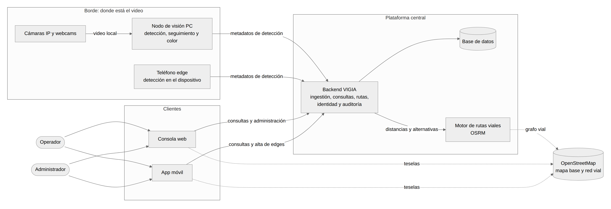
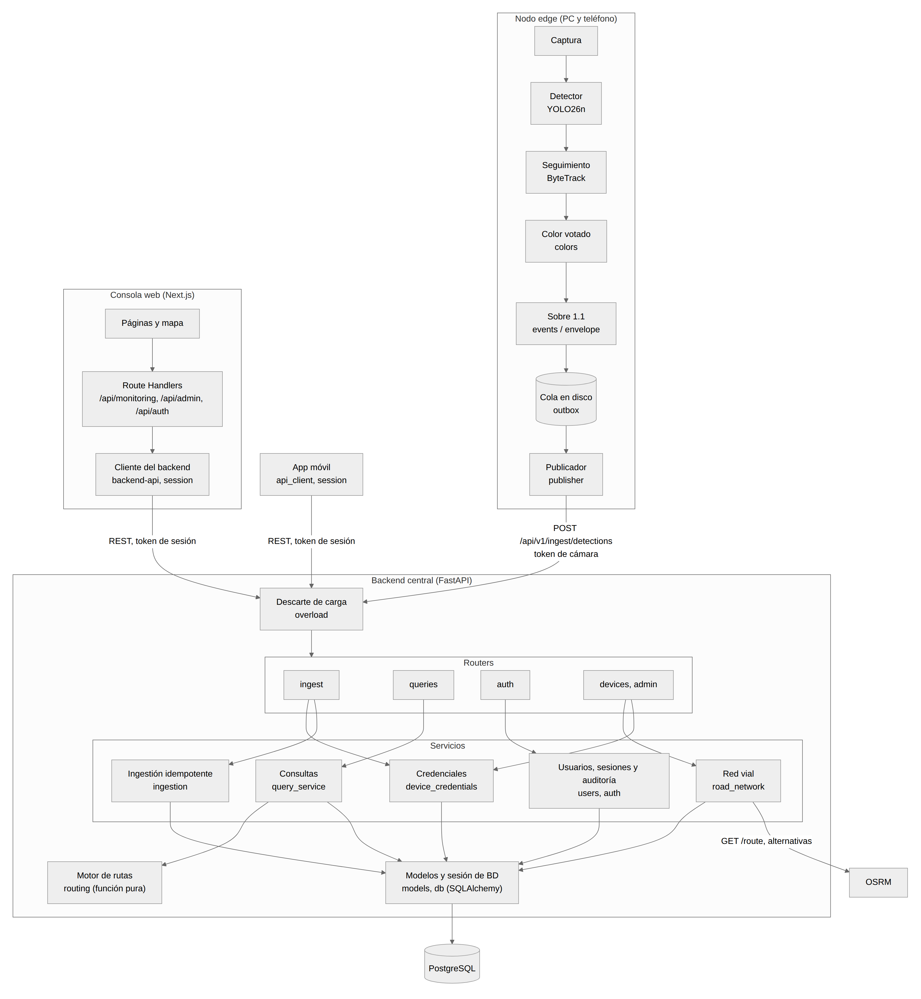
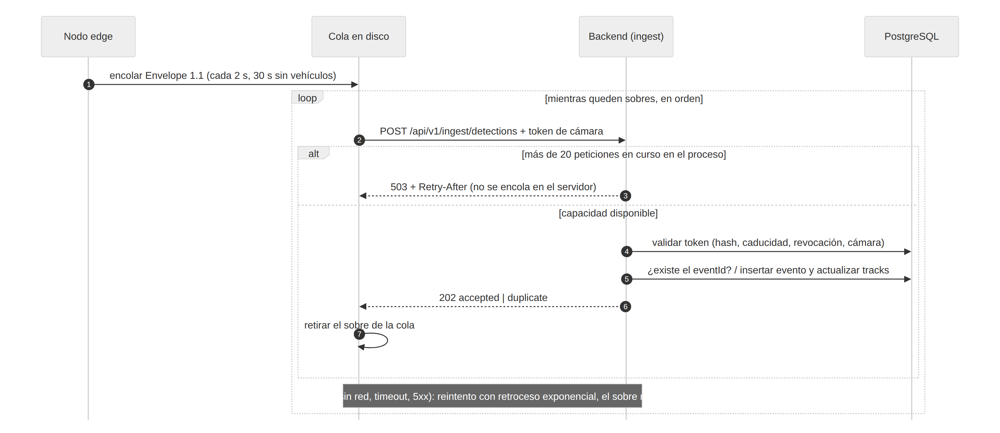
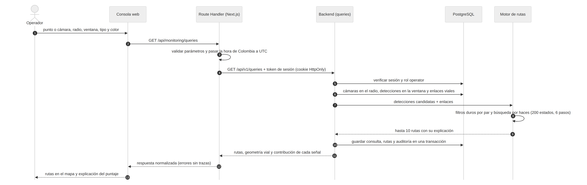
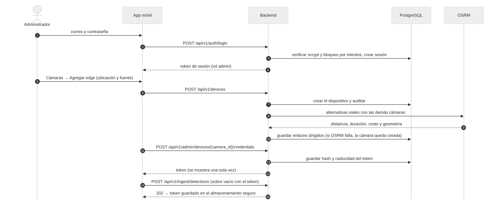
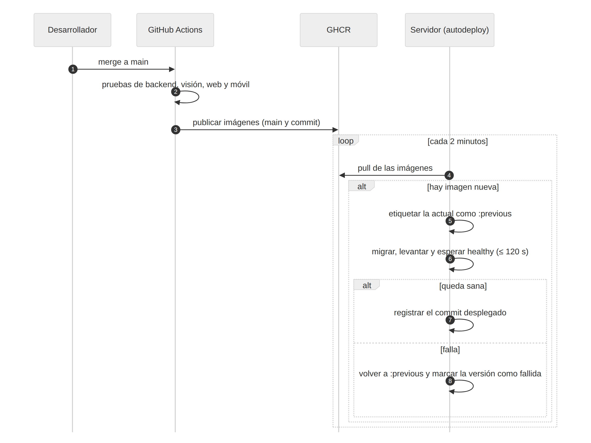
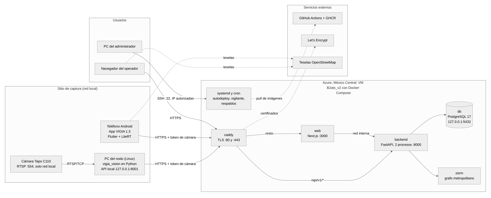

# Segundo informe - VIGIA

## Resumen / Abstract

### Resumen

VIGIA aborda la dificultad de reconstruir el recorrido probable de un vehículo cuando las cámaras residenciales o comunitarias funcionan como sistemas aislados. La consulta manual de múltiples grabaciones consume tiempo, mientras que la centralización permanente de video aumenta el uso de red, almacenamiento y exposición de datos personales. La propuesta adopta una arquitectura híbrida: cada nodo remoto procesa el video cerca de la cámara y la plataforma central recibe solo metadatos normalizados para consultar detecciones y estimar trayectorias, sin presentar el resultado como una identificación infalible.

Al 19 de octubre de 2026, el flujo vertical opera de extremo a extremo sobre un servidor central en Azure. Los nodos edge (un computador con una cámara Tapo C110 y teléfonos Android que detectan con YOLO26n en el propio dispositivo) siguen vehículos, estiman su color y publican un contrato versionado (`Detection Envelope 1.1`) por HTTPS con un token por cámara, una cola persistente y reintentos. El backend FastAPI sobre PostgreSQL ingiere de forma idempotente, autentica personas y roles, audita el uso y reconstruye rutas candidatas sobre la red vial del área metropolitana de Barranquilla, servida con OSRM. Una consola web y una aplicación móvil consultan y explican los resultados. La plataforma central se actualiza sola desde integración continua y revierte a la versión anterior si la nueva no queda sana.

La validación es cuantitativa. En un benchmark controlado contra el servidor real, la alternativa seleccionada sostuvo 25 mensajes por segundo (50 nodos, 2,5 veces la carga exigida) con p95 de ingestión de 152 ms y sin eventos perdidos ni duplicados lógicos. A 200 msg/s el backend colapsó y necesitó un reinicio manual; el defecto se corrigió (descarte de carga con 503, pool que falla rápido, dos procesos y un vigilante) y la repetición aceptó 184 de 200 msg/s sin bloquearse. Una corrida del 19/10 con la carga esperada midió una latencia media de 132 a 173 ms y una máxima de 1,5 s. Entre el 11 y el 19 de octubre el servicio central estuvo disponible al menos el 99,8 % del tiempo. La alternativa C (DeepStream) se midió en una GPU de portátil: unos 580 cuadros por segundo, del orden de 50 veces lo que procesa la CPU. Eso muestra que centralizar con GPU es viable, y que lo que favorece a B es la red, la privacidad, el costo y la tolerancia a fallos. Las pruebas de resiliencia entregaron 248 de 248 eventos exactamente una vez tras un corte de red de 5 minutos. El color alcanzó 91,6 % de exactitud en la prueba de sitio, y el nuevo seguimiento redujo la fragmentación de 106 a 35 tracks en un mismo video. Sobre un dataset sintético con verdad de terreno, el ranking obtiene recall@3 de 0,429.

Quedan pendientes hacia la entrega final la evaluación independiente con recorridos de campo, acotar las consultas en zonas densas, diversificar las rutas propuestas, la lectura de placas (detector entrenado y OCR integrado en el nodo PC, en revisión), el agente de actualización de los nodos, la prueba con usuarios y la política de datos personales.

### Abstract

VIGIA addresses the difficulty of reconstructing a vehicle's likely path when residential or community cameras operate as isolated systems. Manually reviewing recordings is slow, whereas permanently centralizing video increases network usage, storage demands, and personal-data exposure. The proposed solution follows a hybrid architecture: each remote node processes video close to the camera, and a central platform receives only normalized metadata to query detections and estimate trajectories without presenting the result as definitive identification.

As of October 19, 2026, the vertical flow runs end to end on a central server in Azure. Edge nodes (a computer with a Tapo C110 camera and Android phones running YOLO26n on the device) track vehicles, estimate their color, and publish a versioned contract (`Detection Envelope 1.1`) over HTTPS with per-camera tokens, a persistent queue, and retries. A FastAPI backend on PostgreSQL ingests idempotently, authenticates users and roles, audits usage, and reconstructs candidate routes over the road network of the Barranquilla metropolitan area, served by OSRM. A web console and a mobile app query and explain the results. The central platform deploys itself from continuous integration and rolls back when a new version is unhealthy.

Validation is quantitative. In a controlled benchmark against the real server, the selected alternative sustained 25 messages per second (50 nodes, 2.5 times the required load) with a p95 ingestion latency of 152 ms, no lost events and no logical duplicates. At 200 msg/s the backend collapsed and needed a manual restart; the defect was fixed (load shedding with 503, fail-fast pool, two workers, a watchdog) and a rerun accepted 184 of 200 msg/s without locking up. A run on October 19 at the expected load measured a mean latency of 132–173 ms and a maximum of 1.5 s. Between October 11 and 19 the central service was available at least 99.8 % of the time. Alternative C (DeepStream) was measured on a laptop GPU at about 580 frames per second, roughly 50 times the CPU; centralizing with a GPU is feasible, so what favors B is bandwidth, privacy, cost and fault tolerance. Resilience tests delivered 248 of 248 events exactly once after a 5-minute network outage. Color reached 91.6 % accuracy on the site test, and the new tracker reduced fragmentation from 106 to 35 tracks on the same video. On a synthetic dataset with ground truth, the ranking reaches recall@3 of 0.429.

Pending for the final delivery are an independent field evaluation, bounded queries in dense areas, diversified route candidates, plate reading (detector trained and OCR integrated in the PC node, under review), the edge update agent, a user study, and the personal-data policy.

---

## 1. Introducción

La videovigilancia urbana y comunitaria suele crecer por agregación: cada vivienda, comercio o institución instala cámaras y conserva sus propios flujos. Aunque esta fragmentación distribuye el costo de captura, también dificulta responder una pregunta transversal, como determinar por cuáles puntos pudo pasar un vehículo dentro de una ventana temporal. Revisar cada cámara por separado no escala y, en ausencia de una identidad fuerte, cualquier correlación debe expresarse en términos de probabilidad y evidencia disponible.

VIGIA propone convertir cámaras heterogéneas en nodos remotos que producen observaciones normalizadas. El nodo identifica clases vehiculares, conserva un seguimiento local mientras el objeto permanece en la escena, estima su color y comunica metadatos mínimos. La plataforma central administra dispositivos, selecciona observaciones cercanas en espacio y tiempo y genera varias trayectorias candidatas, cada una con un puntaje explicable. Este enfoque se inspira en el procesamiento en el borde: la imagen se analiza cerca de la fuente y el centro coordina información estructurada, sin transmitir video de manera permanente.

Desde el corte anterior, el proyecto pasó de módulos conectados solo por la arquitectura documental a un piloto en operación. Los nodos publican al centro con cola local e idempotencia; la plataforma central corre en la nube con HTTPS, autenticación, auditoría y despliegue continuo con reversión; y existen dos clientes de operador (web y móvil). Este informe sigue tratando el sistema como un MVP académico: la meta verificable es la validación de nodos, comunicación y estimación de rutas en escenarios controlados, no el despliegue de una red urbana real.

Ver detalle completo en el [Primer Informe](./PrimerInforme.md#1-introducción).

## 2. Marco conceptual

El **procesamiento en el borde** o *edge computing* desplaza parte del cómputo desde un centro de datos hacia dispositivos cercanos a la fuente. En VIGIA, el borde recibe el video, ejecuta inferencia, seguimiento, clasificación de color y preparación de eventos; el centro persiste y correlaciona los resultados. La separación reduce el acoplamiento entre el video y la lógica global: el backend no necesita conocer la contraseña RTSP ni ejecutar el modelo de visión. También permite que una caída central no impida la captura local: el nodo conserva los eventos en una cola en disco y los reenvía cuando el centro vuelve [30], [36]. La sección 9 mide además el ahorro de red que justifica este principio: un sobre de metadatos ocupa unas 100 veces menos ancho de banda que el video de la misma cámara.

La **detección de objetos** localiza instancias en un fotograma y les asigna clase y confianza. El **seguimiento multiobjeto** relaciona detecciones consecutivas y mantiene un identificador temporal dentro de una cámara. VIGIA utiliza YOLO26n como detector [26] y ByteTrack como seguimiento. ByteTrack asocia primero las cajas de alta confianza y después las de baja confianza, que suelen corresponder a objetos parcialmente ocluidos, para no fragmentar trayectorias; sus autores reportan 80,3 MOTA y 77,3 IDF1 en MOT17 a 30 FPS en una GPU V100 [1]. En el nodo PC se usa la implementación de Ultralytics [8] con una configuración propia; en el teléfono se reimplementó la misma lógica de dos etapas. La medición de esa decisión está en [40]. El `trackId` resultante es local al flujo y no constituye una identidad global: la correlación entre cámaras requiere tiempo, ubicación, apariencia y red vial.

La **clasificación de color** se realiza sobre el recorte de cada vehículo con un clasificador `yolo26n-cls` ajustado a ocho colores, y se vota entre varios cuadros del mismo track. Un color solo se reporta con al menos dos votos y un promedio de 0,5 o más; si no, queda desconocido, porque un color equivocado ocultaría al vehículo en una consulta filtrada [39].

La **reconstrucción de trayectoria** se entiende como un problema de generación y ordenamiento de hipótesis. Una detección es compatible con otra si pertenece al mismo tipo, ocurre después, no contradice un color conocido y exige una velocidad plausible según la distancia vial entre cámaras [33]. Los candidatos se ordenan con un puntaje ponderado de calidad de detección, compatibilidad temporal, apariencia y costo vial [34]. Los umbrales que delimitan la búsqueda —penalización de tramos de 500 m o más, enlaces de hasta 2 km y velocidad implícita entre 8 y 70 km/h— son parámetros de laboratorio calibrables. La sección 3.2 justifica cada uno con fuentes externas y con un análisis de sensibilidad propio [38]. La distancia Haversine sirve para seleccionar cámaras alrededor de una consulta, mientras que la distancia por calles se obtiene de OSRM sobre OpenStreetMap [27]. PostGIS se reserva para una etapa posterior en la que el volumen justifique índices espaciales nativos [2].

El **contrato de captura** es la frontera técnica más importante del sistema. El nodo produce un `Detection Envelope 1.1` en JSON, definido en JSON Schema [31]. Contiene identificadores de evento (`eventId`), sesión del nodo (`sessionId`) y número de secuencia, cámara, instante UTC, versión del nodo y del modelo con su *digest*, número de fotograma y una lista de detecciones. Cada detección incluye `trackId`, tipo, confianza, primera y última observación, dirección, caja delimitadora, color y campos opcionales de marca, modelo y placa. El backend ingiere el sobre de forma idempotente: un `eventId` repetido no crea filas nuevas, y cada track se identifica por cámara, sesión, `trackId` y primera observación, de modo que los sobres sucesivos actualizan la misma detección lógica en lugar de duplicarla [32].

La **actualización remota** significa cambiar de forma controlada el software, el modelo o la configuración sin intervenir físicamente el equipo. Para la plataforma central ya está implementada como despliegue continuo por extracción: la integración continua publica imágenes versionadas y el servidor las descarga, migra, verifica su salud y vuelve a la versión anterior si fallan [41]. Para los nodos edge sigue pendiente un agente equivalente; hoy los teléfonos se actualizan instalando un APK firmado y el nodo PC desde el repositorio.

Finalmente, la privacidad no es una característica complementaria sino una restricción de diseño. La Ley 1581 de 2012 aplica a datos personales registrados en bases susceptibles de tratamiento y establece principios, derechos de titulares y deberes de responsables y encargados [3]. La Superintendencia de Industria y Comercio ha señalado que las reglas de protección de datos se aplican a cámaras y sistemas de videovigilancia [4]. En consecuencia, VIGIA limita la finalidad, restringe el acceso por roles, no transmite video al centro, audita consultas y exportaciones, y evita que una inferencia probabilística se presente como identificación cierta.

## 3. Planteamiento del problema

El problema central consiste en aprovechar observaciones distribuidas para estimar el recorrido probable de un vehículo sin exigir la centralización continua de todos los videos. Las cámaras disponibles no comparten necesariamente fabricante, resolución, reloj, orientación ni plataforma de gestión. A esa heterogeneidad se suma que dos vehículos pueden coincidir en tipo y color, que existen zonas sin cobertura y que el tiempo entre cámaras depende de la vía y del tráfico.

La relevancia del problema es técnica y organizacional. Técnicamente, exige integrar visión por computador, comunicación distribuida, persistencia geoespacial y una interfaz que comunique incertidumbre. Organizacionalmente, una comunidad o institución necesita consultar evidencias de varias fuentes sin administrar manualmente cada dispositivo. La solución solo es útil si conserva trazabilidad, diferencia datos reales de demostraciones y limita el tratamiento a un propósito autorizado.

El problema no se resuelve únicamente aumentando la precisión de un detector. Incluso una detección perfecta dentro de cada cámara deja abierta la asociación entre vistas no superpuestas. Por ello, el MVP valida tres capacidades separadas: que un nodo remoto produzca capturas normalizadas y pueda actualizarse; que exista comunicación observable y tolerante a desconexiones con la plataforma central; y que el estimador de rutas pueda compararse contra recorridos esperados de un dataset versionado.

Ver detalle completo en el [Primer Informe](./PrimerInforme.md#2-planteamiento-del-problema).

### 3.1 Descripción del problema

La causa inmediata es la operación aislada de las cámaras. Cada sistema conserva grabaciones y estados en una interfaz propia, de modo que una búsqueda transversal obliga a conocer ubicaciones, solicitar acceso y revisar intervalos de video. El costo humano crece con el número de cámaras y con la amplitud de la ventana temporal. Si se intenta resolver el problema enviando todos los flujos a un servidor, aparecen costos de red, almacenamiento y protección de datos que no son razonables para el alcance académico (sección 9).

Los usuarios potencialmente afectados son operadores autorizados de una comunidad, personal de seguridad institucional y administradores de dispositivos. El operador necesita formular una consulta y entender por qué una ruta fue sugerida; el administrador necesita observar disponibilidad, versión y errores de los nodos; las personas captadas por las cámaras necesitan garantías sobre finalidad, acceso y conservación. El sistema debe equilibrar estas necesidades sin prometer identificación forense ni reemplazar procedimientos legales.

Las principales consecuencias de no resolver el problema son tiempos altos de análisis, resultados difíciles de auditar y decisiones basadas en evidencia incompleta. A su vez, una solución mal diseñada puede producir un riesgo mayor: correlacionar equivocadamente vehículos parecidos, exponer flujos privados o conservar información innecesaria. Por ello, VIGIA presenta varias rutas candidatas, explica el puntaje de cada una y permite rastrear cada resultado hasta las detecciones que lo originaron.

### 3.2 Restricciones y supuestos de diseño

El prototipo parte de cámaras físicas y simuladas en Barranquilla. La ubicación de una detección se aproxima mediante la ubicación fija de la cámara. El estimador de rutas usa tres umbrales que **no son normas universales sino parámetros de laboratorio**: configurables en `RoutingConfig` [33] y expuestos en la explicación de cada ruta. Se fijaron con fuentes externas y se contrastaron con un análisis de sensibilidad sobre el dataset sintético de puntajes [35], [38]. Ese dataset no se generó con los umbrales del algoritmo: sus tiempos de viaje son la duración de OSRM multiplicada por un factor de tráfico aleatorio U(1,05; 1,9).

**Velocidad implícita entre 8 y 70 km/h.** El límite legal en vías urbanas de Colombia es de 50 km/h, y de 30 km/h en zonas escolares y residenciales (Ley 2251 de 2022, art. 12, que modifica el art. 106 de la Ley 769 de 2002) [20]. El máximo de 70 km/h deja un margen del 40 % sobre ese límite para absorber el exceso de velocidad real, los errores de reloj entre cámaras y la diferencia entre la distancia OSRM y el camino recorrido; un enlace que exige más velocidad se considera físicamente implausible. En el extremo inferior, la velocidad media en hora pico en Barranquilla fue de 13,7 km/h en 2025 (14,9 km/h en la mañana y 13,0 km/h en la tarde) [21]. El mínimo de 8 km/h, alrededor del 60 % de esa media, admite congestión intensa sin aceptar como "trayecto continuo" un tramo con una parada prolongada. En el análisis de sensibilidad, subir el mínimo a 12 km/h baja el recall@3 de 0,429 a 0,357, y bajarlo a 3 km/h sube los enlaces falsos de 0,26 a 0,31. El máximo no cambia los resultados entre 50 y 120 km/h porque el dataset no contiene trayectos legítimos rápidos; solo el caso de control S06, equivalente a unos 127 km/h, debe rechazarse. Por eso el máximo se justifica por la norma y no por el dataset.

**Enlaces de hasta 2 km.** Con la velocidad media de la ciudad, 10 km toman 36 min 35 s [21], de modo que 2 km equivalen a unos 7 minutos sin observación. Más allá, el número de caminos y paradas posibles entre dos cámaras crece y la asociación pierde poder discriminante. En la sensibilidad, 2 km es el mejor valor medido: con 1 km el recall@1 cae de 0,286 a 0,143 porque se descartan tramos reales, y con 3 o 5 km baja a 0,214 y aumentan los enlaces falsos.

**Penalización de tramos de 500 m o más.** No es un filtro sino un factor de 0,85 sobre el puntaje del tramo, que representa la incertidumbre de un hueco largo entre observaciones. A 13,7 km/h, 500 m son unos 2 minutos sin observación. Con 250 m los enlaces falsos suben a 0,32; con 1000 m bajan a 0,22, pero el recall@3 cae a 0,357. 500 m es el punto de equilibrio medido.

Estos valores deberán recalibrarse con recorridos de campo (P1.1); el análisis sintético justifica su orden de magnitud, no su valor exacto.

La identidad vehicular disponible en el backend es un proxy compuesto por tipo y color. El color ya lo produce el borde, pero puede quedar desconocido; una consulta por color conserva esos pasos como evidencia débil y exige que cada ruta contenga el color pedido al menos una vez [33]. La placa se estudia en una tubería separada de detección y OCR [18] y no forma parte del criterio de éxito del MVP. Una coincidencia de `trackId` tampoco cruza cámaras, porque ese valor solo tiene sentido dentro del proceso local que sigue un flujo.

Se asume conectividad intermitente y capacidad de cómputo limitada en el borde. El diseño funciona con CPU como línea base (el teléfono usa LiteRT sobre CPU) y evita exponer RTSP a Internet. El MVP no asume alta disponibilidad, sincronización perfecta de relojes ni navegación vial exacta. Las pruebas con material real se realizaron en escenarios controlados, con cámaras propias y sin publicar imágenes.

### 3.3 Alcance actualizado

El alcance incluye nodos remotos ejecutables que capturen RTSP, la cámara de un teléfono o un video; detecten automóviles y motocicletas; mantengan seguimiento local; estimen color; y publiquen un formato normalizado. Incluye también una plataforma central modular para administrar dispositivos y detecciones, ejecutar consultas espaciales y temporales, persistir candidatos y exponerlos a una consola web y una aplicación móvil. La demostración funciona con varios nodos lógicos: dos físicos (Tapo y teléfono) y los simulados que se necesiten.

La actualización verificable se cumple hoy en la plataforma central: instalar una versión, comprobar su salud y revertir si no arranca [41]. Para los nodos edge, el mismo objetivo queda como pendiente declarado (sección 15). La comunicación se implementó sobre HTTPS con mensajes independientes del transporte, reintento e idempotencia; MQTT queda como evolución.

Quedan fuera del alcance el despliegue operativo de una red urbana, la identificación inequívoca de personas o vehículos, el reconocimiento garantizado de placas, la retención de video y la respuesta forense. También quedan fuera la alta disponibilidad multirregión y una certificación legal. PostGIS, MQTT y OCR siguen condicionados a cerrar primero el flujo medible.

Ver detalle completo en el [Primer Informe](./PrimerInforme.md#3-alcance-del-proyecto).

## 4. Objetivos

El objetivo general actualizado es **diseñar, implementar y validar un MVP distribuido de VIGIA que permita a nodos remotos actualizables publicar detecciones vehiculares normalizadas, a una plataforma central recibirlas y supervisarlas, y a un modelo de correlación estimar rutas candidatas comparables con trayectorias esperadas de un escenario controlado**. La red física extensa deja de ser una promesa del proyecto y se convierte en un contexto futuro de aplicación.

El primer objetivo específico es **implementar y validar un nodo remoto actualizable que capture video, ejecute detección y seguimiento local, y publique snapshots conformes con un contrato versionado**. Su evidencia es una ejecución reproducible, la validación contra JSON Schema, la identificación de versión de software y modelo, y la actualización con reversión ante una versión inválida.

El segundo objetivo específico es **demostrar la comunicación entre nodos remotos y la plataforma central mediante mensajes de detección y estado, con trazabilidad, reintento e idempotencia**. La evidencia incluye varios nodos lógicos, desconexión y reconexión, medición de latencia de entrega y ausencia de duplicados lógicos aunque un mensaje se reenvíe.

El tercer objetivo específico es **estimar y ordenar rutas candidatas a partir de recorridos generados, evaluando la salida frente a trayectorias esperadas**. La evaluación reporta cobertura top-k, exactitud de secuencia, falsos enlaces y latencia de consulta, con generación y evaluación separadas para que las reglas del algoritmo no garanticen artificialmente el resultado.

El cuarto objetivo específico es **proporcionar una consola que permita consultar, inspeccionar y exportar resultados sin ocultar su incertidumbre**. La interfaz diferencia servicio central y demostración, permite filtros geográficos y temporales, muestra varias rutas con sus detecciones, explica el puntaje e informa tramos no observados. La exportación registra algoritmo, filtros y origen de datos.

El quinto objetivo específico es **incorporar controles básicos de seguridad, privacidad y mantenibilidad acordes con un prototipo académico**: no exponer credenciales RTSP, autenticar operadores, restringir vistas y descargas, registrar consultas, fijar retención y documentar licencias. No equivale a certificación, pero exige que los riesgos conocidos tengan una medida y un responsable.

El estado de cada objetivo al 19/10 se resume en la tabla 14.1.

Ver detalle completo en el [Primer Informe](./PrimerInforme.md#4-objetivos).

## 5. Estado del arte / soluciones relacionadas

Los NVR tradicionales centralizan grabación y consulta, una solución adecuada cuando las cámaras pertenecen a la misma organización y existe infraestructura común. Frigate representa una variante local orientada a cámaras IP: ejecuta detección de objetos cerca del entorno doméstico, se integra con otros sistemas mediante MQTT [5] y, desde versiones recientes, lee placas con un detector YOLOv9 y PaddleOCR [23]. Su documentación recomienda aceleradores dedicados (Hailo, OpenVINO, GPU) con tiempos de inferencia de 5 a 18 ms y desaconseja la detección en CPU [22]. Su foco es la detección, grabación y automatización en un sitio, mientras que VIGIA correlaciona metadatos de nodos administrativamente distribuidos y explica rutas candidatas.

NVIDIA DeepStream ofrece una plataforma madura de analítica acelerada por GPU para fuentes RTSP, seguimiento y múltiples flujos [6]. NVIDIA reporta, por ejemplo, 642 FPS agregados con RT-DETR y su rastreador NvDCF en una GPU L40s, y 96 FPS en un Jetson AGX Orin, sobre video 1080p [24]. Su referencia multicámara genera metadatos (sensor, fotograma, tiempo, caja, identificador y vector de características) y usa un *broker* para alimentar la analítica central [7]. Esta arquitectura valida la pertinencia de separar percepción y correlación, pero exige GPU NVIDIA, calibración y una pila mayor que excede el MVP.

Los trabajos de seguimiento multiobjeto aportan técnicas para conservar identidades dentro de una cámara. ByteTrack asocia detecciones de alta y baja confianza para reducir trayectorias fragmentadas [1], y Ultralytics permite seleccionarlo y configurarlo [8]. No obstante, el seguimiento por cámara no resuelve la reidentificación entre cámaras. VIGIA reconoce esa frontera y no reutiliza el `trackId` local como identidad global.

En lectura de placas, servicios comerciales como Plate Recognizer declaran soporte para más de 90 países, ejecución en la nube o local y 50 a 100 ms por imagen [25]. Son cifras del propio fabricante, no verificadas de forma independiente. VIGIA no adopta un servicio externo porque enviar recortes de placas a terceros ampliaría el tratamiento de datos personales y porque la lectura propia, en evaluación, muestra que la calidad depende sobre todo del tamaño de la placa en la imagen, algo que ningún servicio externo resuelve (sección 11.2, [18]).

La tabla 5.1 resume la comparación. Cada fila cita su fuente y declara **qué tipo de evidencia** respalda la capacidad o el límite atribuido: documentación oficial del producto, artículo revisado por pares, declaración del fabricante sin verificación independiente, o medición propia de este proyecto.

**Tabla 5.1.** Soluciones relacionadas, con fuente y tipo de evidencia por fila.

| Solución | Enfoque | Capacidad atribuida | Límite atribuido | Fuente | Evidencia que la respalda |
|---|---|---|---|---|---|
| NVR tradicional | Grabación y consulta centralizadas | Revisión manual de video de un mismo propietario | No correlaciona cámaras de distintos dueños; transmite y almacena todo el video | [4], sección 9 | Análisis propio; costo de red **medido** en la sección 9 (1,10 Mbit/s por cámara) |
| Frigate | NVR local con detección y MQTT | Detección de objetos en tiempo real; LPR integrado (YOLOv9 + PaddleOCR) | Un sitio; recomienda acelerador dedicado; no reconstruye rutas entre sitios | [5], [22], [23] | Documentación oficial; tiempos de inferencia publicados por el proyecto, no medidos aquí |
| NVIDIA DeepStream / Metropolis | Analítica multicámara acelerada por GPU | Cientos de FPS por GPU; metadatos y *broker* para analítica central | Requiere GPU NVIDIA, TensorRT y calibración | [6], [7], [24] | Cifras del fabricante en otras GPU [24]; **medido aquí** en una RTX 5050 Laptop con DeepStream 8.0 (sección 9) |
| ByteTrack | Seguimiento multiobjeto (algoritmo) | 80,3 MOTA y 77,3 IDF1 en MOT17, 30 FPS en V100 | Identidad solo dentro de una cámara | [1], [8] | Artículo revisado por pares (ECCV 2022); su efecto en VIGIA está **medido** en [40] |
| Plate Recognizer | ALPR comercial (nube o local) | Más de 90 países; 50–100 ms por imagen | Servicio de terceros; costo por licencia; datos fuera del sistema | [25] | Declaración del fabricante, sin verificación independiente |
| **VIGIA (este trabajo)** | Edge + centro modular con correlación explicable | Ingestión idempotente, rutas candidatas sobre red vial y color en el borde | Lectura de placas aún en revisión; ranking calibrado solo con datos sintéticos | [30]–[41] | **Mediciones propias** (secciones 9 y 13) |

La propuesta se posiciona, por tanto, entre un NVR inteligente y una plataforma industrial de analítica multicámara. Comparte con Frigate el procesamiento local y el desacoplamiento por mensajes; comparte con DeepStream la idea de metadatos normalizados y analítica posterior; pero restringe el objetivo a vehículos y a una evaluación académica reproducible. Su contribución no es un detector nuevo, sino la integración trazable de captura, comunicación, correlación probabilística y visualización bajo restricciones de privacidad.

La elección de componentes abiertos también facilita la inspección y la sustitución. FastAPI se basa en OpenAPI y JSON Schema, e incorpora validación y documentación interactiva [9]; MapLibre GL JS renderiza mapas interactivos en el navegador [10]; los Route Handlers de Next.js permiten una capa servidor entre el navegador y los servicios privados [11]; OSRM calcula rutas y alternativas sobre OpenStreetMap [27]. Los contratos y el algoritmo de rutas permanecen independientes de estos frameworks.

Ver detalle completo en el [Primer Informe](./PrimerInforme.md#6-estado-del-arte--soluciones-relacionadas).

## 6. Solución propuesta

La solución es una plataforma híbrida con nodos edge, backend central, consola web y aplicación móvil. Cada nodo obtiene video de una cámara, ejecuta inferencia, seguimiento y clasificación de color, y conserva solo el estado de los tracks activos. En lugar de entregar la URL RTSP, publica un `Detection Envelope 1.1` cada dos segundos mientras ve vehículos, y cada 30 s como latido cuando no ve ninguno, y, para supervisión autorizada, una vista procesada. La plataforma central filtra cámaras y observaciones, ejecuta la correlación y guarda consultas, resultados y auditoría.

Hay dos tipos de nodo:

- **Nodo PC** (`apps/vision`): FastAPI con YOLO26n y ByteTrack de Ultralytics, para cámaras RTSP como la Tapo C110 o para la cámara de un teléfono conectado por USB.
- **Edge autónomo en el teléfono** (`apps/movil`): la aplicación Flutter ejecuta YOLO26n exportado a TFLite (LiteRT) en el propio teléfono, sin computador [43].

Ambos generan el mismo contrato, de modo que el backend los trata igual.

Los usuarios objetivo son dos roles, aplicados por el backend [44]. El **operador** formula consultas por cámara o punto, radio, fecha, ventana horaria, tipo y color; compara rutas, puntaje y tramos distantes; y exporta resultados auditados. El **administrador** además registra nodos, emite y revoca sus credenciales y revisa la auditoría. Las contraseñas se guardan con `scrypt`, las sesiones son revocables y hay bloqueo por intentos fallidos.

La propuesta de valor es reducir el trabajo manual y el movimiento innecesario de video, manteniendo explícita la incertidumbre. Una ruta es una hipótesis respaldada por una secuencia de detecciones, no una declaración de identidad. El sistema permite inspeccionar qué cámaras y tiempos formaron el resultado, cuánto aportó cada señal al puntaje y qué pasos no tienen color confirmado.

**Puntaje de una ruta.** Cada tramo entre dos detecciones recibe la combinación `S = (0,35·D + 0,40·T + 0,15·A + 0,10·V) · G · F` [34]:

- `D`: confianza media del detector.
- `T`: compatibilidad temporal, `exp(−½·(ln(Δ/μ)/σ)²)`, con `μ = 1,35 ×` duración OSRM y `σ = 0,65`.
- `A`: apariencia; 1 si el color conocido coincide, 0,4 si falta.
- `V`: costo vial relativo de la alternativa.
- `G = 0,85` para tramos de 500 m o más.
- `F` penaliza las distancias sin duración vial validada.

La ruta usa la media geométrica de sus tramos, más 0,04 por cada observación adicional hasta 0,08, con tope de 0,99. Cada elección tiene una justificación verificable:

- **Tiempo con el peso mayor (0,40).** Es la única señal cuya ablación reduce el recall@1 (de 0,286 a 0,214) en el análisis de sensibilidad [38]. El factor 1,35 y σ = 0,65 hacen que una desviación estándar cubra tiempos entre 0,70 y 2,59 veces la duración de OSRM: desde el flujo libre hasta la congestión de la hora pico nocturna en Barranquilla, del 103 % [21].
- **Apariencia con peso bajo (0,15).** El color es una identidad débil: muchos vehículos comparten color y el clasificador acierta el 91,6 % en el sitio [39]. La falta de color vale 0,4 y no 0, para no descartar la ruta.
- **Media geométrica en lugar de suma.** Un solo tramo implausible baja todo el puntaje, en lugar de quedar oculto tras tramos fuertes.
- **Tope de 0,99.** Nunca se presenta certeza.

Con pesos iguales (0,25 cada uno), el dataset sintético da las mismas métricas. Por eso, salvo el del tiempo, los pesos siguen siendo hipótesis a calibrar con recorridos de campo (P1.1), no valores aprendidos.

La comunicación se define por mensajes independientes del transporte. Hoy se implementan `detection.snapshot`, que también funciona como latido, y el estado del nodo; la configuración deseada y reportada, y las órdenes de actualización a los nodos, quedan propuestas. HTTPS sirve el flujo actual con idempotencia por `eventId`. MQTT 5 se mantiene como evolución para publicación/suscripción con QoS: el estándar lo caracteriza como un protocolo ligero de publicación/suscripción apropiado para entornos M2M e IoT [12]. El benchmark de la sección 9 muestra que HTTP es suficiente para la carga del MVP, por lo que MQTT no es una necesidad inmediata.

## 7. Metodología de desarrollo

El proyecto siguió una estrategia incremental orientada a reducir incertidumbre técnica, con un incremento verificable por semana y un pull request revisado por cada uno (ROADMAP [45]).

1. **Base (hasta el 23/09).** Validó RTSP con la Tapo, separó el nodo en FastAPI, construyó el modelo central, el algoritmo puro de rutas, la consola web y sus pruebas.
2. **Flujo vertical (28/09–09/10).** Agregó el contrato 1.1, la ingestión idempotente, la cola local y la resiliencia medida (P1.2), credenciales por cámara, migraciones Alembic, PostgreSQL, rutas viales ponderadas con OSRM, usuarios, roles, auditoría y la pantalla de administración.
3. **Operación (10/10–11/10).** Llevó el centro a Azure con HTTPS, construyó la aplicación móvil y el edge autónomo en el teléfono, y automatizó pruebas, publicación y despliegue con reversión.
4. **Visión y evaluación (12/10).** Agregó color, seguimiento sin fragmentar, el análisis de sensibilidad del ranking, el benchmark de carga, la corrección contra la sobrecarga y el grafo vial del área metropolitana.
5. **Cierre de pendientes (13/10–19/10).** Agregó el aviso de actualización de la app (1.3.0), la sincronización automática de los enlaces viales, la retención de eventos crudos y el latido espaciado; entrenó el detector de placas con recortes de vehículos e integró el OCR en el nodo PC (en revisión); y midió la latencia media y máxima y la disponibilidad del piloto.

Las decisiones arquitectónicas se documentaron como ADR [15], [16]. Se eligieron una arquitectura híbrida y un monolito modular porque los microservicios introducirían fallos distribuidos antes de validar el caso de uso. SQLite se reemplazó por PostgreSQL 17 al iniciar el piloto, por concurrencia y respaldos; PostGIS sigue condicionado al volumen. El algoritmo se mantuvo como función pura, probada sin base de datos.

La validación combina pruebas automatizadas en CI, mediciones reproducibles y pruebas en vivo. Cada pull request ejecuta:

- **Backend:** 98 pruebas, 4 de ellas contra PostgreSQL real.
- **Nodo de visión:** 34 pruebas.
- **Web:** lint, tipos, 12 pruebas unitarias y compilación de producción.
- **Aplicación móvil:** analizador y 62 pruebas, con compilación Android e iOS.

La deuda de entorno del corte anterior —pruebas HTTP del backend bloqueadas con Python 3.14— se resolvió fijando Python 3.12 en CI y en las imágenes.

Cada experimento declara su escenario, su métrica, su umbral y un artefacto reproducible en `docs/evidence`. Los resultados negativos se conservan, como la falta de diversidad del top-k en hora pico (sección 13.1). Antes de usar video real se trabajó con cámaras propias y sin publicar imágenes; los datasets de terceros se usan solo para investigación y no se redistribuyen [39]. Las placas son datos personales: ningún fotograma, etiqueta ni número de placa se publica; los documentos reportan solo exactitudes y tamaños.

Los hallazgos de cada iteración cambiaron el plan. El benchmark del 12/10 mostró que el backend se bloqueaba bajo sobrecarga; el mismo día se agregaron el descarte de carga, el pool que falla rápido, el segundo proceso y el vigilante, y la repetición lo verificó. La prueba de sitio mostró que el clasificador de color entrenado con datos públicos acertaba solo el 63 % en las cámaras propias; se reentrenó con recortes del sitio y llegó al 92 %. La medición del seguimiento mostró que el teléfono fragmentaba los vehículos (106 tracks, 80 de ellos fragmentos); se reimplementó el rastreador de dos etapas y el mismo video bajó a 35 tracks. El detector de placas entrenado con fotogramas completos no encontraba placas en los recortes de vehículos que usa la inferencia; se reentrenó con recortes. Y las consultas densas del benchmark convirtieron el acotamiento de la búsqueda en una prioridad P0. En los cinco casos el ajuste se decidió con una medición, no con una suposición.

Ver detalle completo en el [Primer Informe](./PrimerInforme.md#7-metodología-de-desarrollo-y-plan-de-trabajo).

## 8. Requerimientos

Los requerimientos guían el desarrollo y son también la base de la validación: cada uno tiene un criterio verificable y su estado se marca entre corchetes. Los funcionales (RF) describen lo que el sistema hace para el operador, el administrador y los nodos; los no funcionales (RNF) fijan atributos de calidad medibles.

Los requerimientos no funcionales se aplican de manera proporcional a un prototipo académico. No se exige disponibilidad de producción, pero sí recuperación observable; no se exige una auditoría de seguridad, pero sí secretos fuera del repositorio y control de acceso; no se exige carga masiva, pero sí medir la carga esperada y documentar el punto de saturación (sección 9).

La relación entre requerimientos y componentes está en la tabla 10.1, y la relación entre requerimientos y pruebas, en la sección 13. Los requerimientos no cambiaron respecto al primer informe en su intención; se precisaron sus criterios con lo aprendido en el piloto, por ejemplo los umbrales de latencia de RNF-01, fijados antes del benchmark.

### 8.1 Funcionales

**RF-01 Captura y detección.** [Cumplido] El nodo acepta RTSP, la cámara del teléfono o un archivo; detecta `car` y `motorcycle`; mantiene un `trackId` local; estima dirección y color; y genera sobres conformes con el contrato versionado, en UTC con milisegundos. Criterio: el 100 % de los sobres de prueba validan contra el esquema [31]; el backend rechaza con 422 los que no lo cumplen.

**RF-02 Estado y comunicación.** [Cumplido en lo esencial] El nodo publica un sobre cada 2 s mientras ve vehículos, un latido cada 30 s cuando no ve ninguno, y su estado operativo (`stopped`, `loading-model`, `connecting`, `running`, `reconnecting`, `error`, FPS, cola, versión). Criterio: una desconexión se refleja y una reconexión no duplica detecciones lógicas (verificado en P1.2 y en la sección 9). Pendiente: el estado `stale`/`offline` derivado del último latido en la consola.

**RF-03 Actualización remota.** [Cumplido en la central; pendiente en los nodos] La plataforma central instala versiones publicadas por CI, verifica su salud y revierte ante error [41]. Criterio: una versión válida queda activa y una defectuosa produce rollback comprobable (probado con versión sana, versión que no queda sana, migración rota y recuperación). En la app, el backend publica la versión vigente y la mínima, y la app avisa al usuario de forma opcional u obligatoria. Falta el agente equivalente que actualice solos los nodos edge.

**RF-04 Persistencia.** [Cumplido] El backend administra dispositivos y detecciones, registra consultas y persiste rutas con su secuencia de observaciones. Cada mensaje tiene una clave idempotente. Criterio: reenviar el mismo evento no aumenta el conteo lógico (0 duplicados en P1.2 y en el benchmark) y toda ruta se traza hasta sus detecciones.

**RF-05 Consulta.** [Cumplido] El operador consulta por ubicación o cámara, radio, intervalo, tipo y color. El sistema devuelve cámaras cercanas, conteo de candidatos y hasta diez rutas ordenadas, y rechaza una ventana invertida o coordenadas inválidas con un mensaje comprensible.

**RF-06 Estimación.** [Cumplido; calibración pendiente] El motor excluye pares con tiempos no crecientes, cámaras iguales, tipos distintos, colores conocidos contradictorios, enlaces inexistentes o velocidades fuera de rango; marca huecos distantes; y nunca presenta la primera ruta como certeza. Criterio: el dataset sintético reporta top-k y falsos enlaces (sección 13.1).

**RF-07 Visualización y exportación.** [Cumplido] La consola web y la aplicación móvil representan dispositivos, radio, ruta seleccionada sobre calles, puntaje, secuencia temporal, origen de datos, advertencias y pasos sin color confirmado. La exportación JSON se genera en el servidor con parámetros y versión del algoritmo, y queda auditada.

**RF-08 Administración y auditoría.** [Cumplido] La plataforma autentica operadores y administradores, aplica roles en el backend y registra inicios de sesión, consultas, exportaciones, vistas previas, cambios y credenciales. Criterio: un operador no puede emitir credenciales y un usuario no autenticado no accede a vistas previas ni resultados (pruebas HTTP negativas en CI).

### 8.2 No funcionales

**RNF-01 Rendimiento.** Para la carga esperada de 4 a 10 nodos y un sobre cada 1 a 5 s, la plataforma debe sostener al menos 10 mensajes por segundo con p95 de ingestión menor de 500 ms en la red de prueba, y las consultas deben responder con p95 menor de 2 s con hasta 10 operadores concurrentes. [Cumplido y medido (sección 9): 25 msg/s con p95 de 152 ms y latencia media de 132–173 ms; consultas con p95 de 1,0 a 1,5 s con 10 operadores. Con 10 operadores y 25 nodos a la vez, la ingestión supera los 500 ms (p95 de 614 ms el 12/10 y de 2,5 s con consultas densas el 19/10), sin perder eventos.]

**RNF-02 Resiliencia.** El nodo almacena los mensajes cuando el centro no está disponible, reintenta con retroceso y conserva el orden por cámara; el backend acepta reenvíos idempotentes. Una caída central no debe perder eventos dentro de la capacidad configurada. [Cumplido: P1.2 y prueba de fallo de la sección 9. La central estuvo disponible al menos el 99,8 % del tiempo entre el 11 y el 19/10.]

**RNF-03 Seguridad y privacidad.** Las credenciales RTSP y los secretos no llegan al navegador ni al repositorio. El tráfico remoto usa TLS; las vistas previas requieren autenticación; las consultas y exportaciones quedan auditadas; el centro no recibe video. [Cumplido en lo verificado; pendientes en la sección 15.]

**RNF-04 Mantenibilidad.** Los contratos se versionan y los cambios incompatibles crean una nueva versión. El algoritmo de rutas permanece separado del ORM y la interfaz. Toda entrega supera pruebas, lint y compilación en CI. [Cumplido.]

**RNF-05 Portabilidad.** El nodo se ejecuta en Linux, en contenedor o entorno virtual, con CPU como línea base; el edge autónomo corre en Android. La plataforma central se levanta con Docker Compose sin servicios externos obligatorios. [Cumplido.]

**RNF-06 Usabilidad y explicabilidad.** La interfaz muestra estados vacíos, de carga y de error; diferencia demostración de datos centrales; y acompaña todo puntaje con las observaciones y contribuciones que lo sustentan. [Cumplido en diseño; prueba con usuarios pendiente.]

**RNF-07 Observabilidad.** Cada servicio expone salud; el nodo reporta FPS, cola, último error y versión; los despliegues quedan registrados con su commit. [Parcial: faltan métricas agregadas y un tablero.]

**RNF-08 Compatibilidad legal y de licencia.** El piloto debe documentar base y finalidad del tratamiento, responsables, avisos, retención y atención a titulares, y revisar las licencias de Ultralytics, modelos, datasets y mapas antes de distribuir. [Parcial: la atribución de OpenStreetMap está en web y móvil; la licencia del repositorio y la política de datos siguen pendientes (sección 15).]

## 9. Evaluación de alternativas

Se compararon tres alternativas arquitectónicas. **A) Video centralizado:** cada cámara transmite su video a un servidor central que decodifica, detecta, sigue y correlaciona. **B) Edge + centro modular**, la seleccionada por VIGIA: cada nodo procesa el video junto a la cámara y publica metadatos a una central que los guarda y correlaciona. **C) Plataforma industrial con GPU**, representada por NVIDIA DeepStream: un servidor con GPU procesa muchos flujos de video a la vez y entrega metadatos a una analítica central. A y C comparten la idea de llevar el video al centro; difieren en el hardware.

La comparación responde las tres preguntas de la guía: desempeño bajo la carga esperada, grado de acoplamiento, y disponibilidad y tolerancia a fallos. Para cada pregunta se fijaron los criterios antes de medir. La alternativa seleccionada, B, se midió sobre su despliegue real en Azure con una herramienta de carga que se comporta como el edge [37]. De A se midieron sus dos costos dominantes con el hardware disponible (ancho de banda e inferencia por flujo). C se midió en un portátil con GPU NVIDIA; las cifras del fabricante se citan aparte porque corresponden a otra GPU y otro modelo [24].

Cada valor indica su origen: **medido** (en este proyecto, con artefacto reproducible), **derivado** (calculado a partir de una medición) o **analítico** (razonamiento sin medición). Las mediciones de B corresponden a tres corridas: la escalada del 12/10 con su repetición tras corregir un defecto, y una corrida corta del 19/10 para obtener la latencia media y la máxima, que la primera no guardó [37].

### Pregunta: ¿Cuál alternativa ofrece mejor desempeño bajo carga esperada?

**Criterios de comparación:**

- **Latencia promedio y máxima**: tiempo de respuesta de operaciones críticas.
- **Throughput (capacidad de procesamiento)**: número de solicitudes que el sistema puede manejar por unidad de tiempo.
- **Comportamiento bajo carga concurrente**: degradación del sistema cuando aumenta el número de usuarios simultáneos.

Las operaciones críticas son dos: la **ingestión** de un sobre de detecciones y la **consulta** de rutas. La carga esperada del MVP es de 4 a 10 nodos con un sobre cada 1 a 5 s (entre 1 y 10 mensajes por segundo) y hasta 10 operadores concurrentes. Los umbrales de aceptación se fijaron antes de medir, a partir de RNF-01 y RNF-02 (tabla 9.1). La latencia media y la máxima no tenían umbral previo; se reportan para caracterizar la dispersión.

**Tabla 9.1.** Métricas y umbrales de aceptación.

| Métrica | Definición | Umbral de aceptación |
|---|---|---|
| Throughput sostenido | Mensajes aceptados por segundo con la carga ofrecida | ≥ 10 msg/s (10 nodos a 1 msg/s) |
| Latencia de ingestión | p95 de la petición HTTPS de un sobre, medida en el cliente | < 500 ms |
| Latencia media y máxima | Media y máximo de la misma petición | Sin umbral previo; se reporta |
| Latencia de entrega | p95 desde que el nodo genera el sobre hasta que el centro lo acepta (incluye cola) | < 1 s sin fallas |
| Saturación | Primer escalón en que el p95 supera 500 ms, la entrega queda por debajo de lo ofrecido o hay errores | Por encima de la carga esperada |
| Pérdida y duplicación | Sobres no aceptados al final; reenvíos que crearon filas nuevas | 0 y 0 |
| Latencia de consulta | p95 de una consulta con reconstrucción de rutas | < 2 s con 10 operadores |

#### Montaje del benchmark

El benchmark se ejecutó contra el servidor del piloto, es decir, la alternativa B tal como opera: una VM Azure Standard_B2ats_v2 (2 vCPU AMD, ~0,9 GB de RAM más 2 GB de swap) en México Central, con Caddy, el backend y PostgreSQL 17 en la misma máquina. El generador fue el portátil de desarrollo en Barranquilla, por Internet residencial, de modo que la latencia incluye la red real. La herramienta `apps/backend/tools/load_bench.py` [37] simula nodos que se comportan como el edge real: generan un sobre 1.1 cada intervalo con vehículos que aparecen, se siguen y se van; usan su propio token por cámara y una sesión con número de secuencia; encolan los sobres y los envían en orden, con retroceso exponencial ante errores; y reenvían a propósito el 5 % de los sobres ya aceptados para comprobar la idempotencia.

Se crearon 100 cámaras simuladas `BENCH-001` a `BENCH-100` con enlaces viales entre vecinas y un operador temporal; al terminar se eliminaron con `tools/bench_setup.py`, después de tomar un respaldo, y los conteos de la base volvieron a los previos. Las fases fueron: **escalada** de 4 a 100 nodos con un sobre cada 2 s (la frecuencia real del edge) y luego 100 nodos con intervalos de 1, 0,5 y 0,25 s para buscar la saturación, 60 s por escalón; **consultas** con 1, 5 y 10 operadores concurrentes durante 60 s cada uno, mientras 25 nodos siguen publicando; y **fallo**, con 25 nodos durante 180 s y un reinicio del backend en el segundo 60 (este último se presenta en la pregunta de disponibilidad).

#### Resultados de la alternativa B

**Tabla 9.2.** Escalada de ingestión contra el servidor real, 12/10 (60 s por escalón). La CPU del backend se expresa en % de una vCPU (media / máximo).

| Nodos × intervalo | Ofrecido → aceptado (msg/s) | p50 / p95 | p95 entrega | Errores | Pendientes al cierre | Duplicados reconocidos | CPU backend | Veredicto |
|---|---:|---:|---:|---:|---:|---:|---:|---|
| 4 × 2 s | 2 → 2 | 127 / 217 ms | 258 ms | 0 % | 0 | 8/8 | 1 / 3 % | Cumple |
| 10 × 2 s | 5 → 5 | 123 / 205 ms | 226 ms | 0 % | 0 | 10/10 | 2 / 7 % | Cumple |
| 25 × 2 s | 12,5 → 12,5 | 125 / 146 ms | 183 ms | 0 % | 0 | 36/36 | 11 / 39 % | Cumple |
| 50 × 2 s | 25 → 25 | 127 / 152 ms | 190 ms | 0 % | 0 | 79/79 | 17 / 26 % | Cumple |
| 100 × 2 s | 50 → 50 | 131 / 1336 ms | 1584 ms | 0 % | 0 | 149/149 | 37 / 108 % | No cumple (latencia) |
| 100 × 1 s | 100 → 82,8 | 448 / 836 ms | 902 ms | 7,1 % | 1025 | 257/261 | 71 / 142 % | No cumple |
| 100 × 0,5 s | 200 → 0 | — | — | 100 % | 11 943 | — | 2 / 17 % (bloqueado) | Colapso |

La carga esperada cumple todos los umbrales, y el margen llega hasta 50 nodos (25 msg/s, 2,5 veces el mínimo exigido) con p95 de 152 ms. En todos los escalones la base guardó cada evento exactamente una vez: 15 255 eventos únicos y 5 405 detecciones lógicas para 5 405 tracks. Los "pendientes al cierre" son sobres que seguían en la cola del nodo al terminar la ventana de drenaje; no se perdieron, y un edge real los enviaría después.

**Hallazgo negativo y corrección.** A 200 msg/s, unas 20 veces la carga esperada, se agotó el pool de conexiones del backend: las peticiones esperaban hasta 30 s por una conexión, el cliente cortaba a los 10 s y reintentaba, y los reintentos mantenían el pool agotado. El backend no se recuperó al retirar la carga y hubo que reiniciarlo a mano (unos 10 minutos sin servicio, sin pérdida de datos). El mismo día se corrigió (`vigia_backend/overload.py`): cada proceso atiende a lo sumo 20 peticiones y responde **503 con `Retry-After`** a las demás; el pool espera como máximo 5 s; el backend corre en **dos procesos**; y un **vigilante** reinicia cada minuto los servicios que Docker marque no sanos. La tabla 9.3 repite la escalada.

**Tabla 9.3.** Escalada repetida tras la corrección, 12/10.

| Nodos × intervalo | Ofrecido → aceptado (msg/s) | p50 / p95 | 503 / 502 | Pendientes al cierre | Antes de la corrección |
|---|---:|---:|---:|---:|---|
| 25 × 2 s | 12,5 → 12,5 | 125 / 171 ms | 0 / 0 | 0 | 125 / 146 ms |
| 50 × 2 s | 25 → 25 | 126 / 160 ms | 0 / 0 | 0 | 127 / 152 ms |
| 100 × 2 s | 50 → 50 | 131 / **377 ms** | 0 / 0 | 0 | 1 336 ms (no cumplía) |
| 100 × 1 s | 100 → **99,8** | 253 / 970 ms | 1 476 / 22 | **0** | 82,8 msg/s y 1 025 pendientes |
| 100 × 0,5 s | 200 → **184,3** | 329 / 531 ms | 4 311 / 0 | 870 | **colapso: 0 msg/s** |

Ya no hay bloqueo: `/health` respondió en las 129 sondas de la corrida, sin reinicios manuales ni del vigilante, y el umbral de latencia se cumple hasta 50 msg/s, el doble que antes. Con sobrecarga entran 184 de 200 msg/s y el resto se reintenta, a costa de un retraso de entrega de decenas de segundos en la cola de los nodos. La base guardó exactamente los 25 028 eventos aceptados, todos únicos. Los 22 errores 502 fueron reinicios de un proceso por el chequeo interno de Uvicorn (5 s) con la CPU saturada; ese plazo se amplió a 30 s.

**Latencia promedio y máxima.** La corrida del 19/10 midió la media y el máximo con la carga esperada (tabla 9.4). La mediana se mantiene cerca de 125 ms, que es sobre todo la ida y vuelta por Internet entre Barranquilla y México; la media está entre 132 y 173 ms hasta 50 nodos. Las máximas son casos aislados (hasta 1,5 s) que, con pocas peticiones por escalón, también suben el p95 del primero a 512 ms, en el límite del umbral; se atribuyen, sin haberlo aislado, a la apertura de las conexiones TLS de cada nodo al empezar. A 50 msg/s el descarte de carga ya actúa sobre el 2,3 % de las peticiones, que se reintentan y se entregan todas.

**Tabla 9.4.** Latencia media y máxima de la ingestión con la carga esperada, 19/10 [37].

| Nodos × intervalo | msg/s | Media | p50 | p95 | Máxima | 503 | Perdidos |
|---|---:|---:|---:|---:|---:|---:|---:|
| 4 × 2 s | 2 | 173 ms | 126 ms | 512 ms | 1 538 ms | 0 | 0 |
| 10 × 2 s | 5 | 138 ms | 124 ms | 181 ms | 1 504 ms | 0 | 0 |
| 25 × 2 s | 12,5 | 132 ms | 123 ms | 139 ms | 463 ms | 0 | 0 |
| 50 × 2 s | 25 | 136 ms | 123 ms | 153 ms | 742 ms | 0 | 0 |
| 100 × 2 s | 50 | 193 ms | 128 ms | 397 ms | 3 512 ms | 2,3 % | 0 |

**Consultas concurrentes.** La tabla 9.5 mide las consultas con reconstrucción de rutas mientras 25 nodos publican. El 12/10, con pocas detecciones por consulta (6 a 21 candidatas), el p95 fue de 0,2 a 1,0 s. El 19/10, con la zona más densa (36 a 73 candidatas), el p95 siguió por debajo de 2 s con 1, 5 y 10 operadores, pero la media subió a 0,64 s, el máximo llegó a 7,5 s y con 10 operadores el 9 % de las consultas recibió 503. En la repetición del 12/10, con 140 a 220 candidatas por consulta, el p95 llegó a 6–8 s. El costo de la consulta crece con fuerza con el número de candidatas porque hoy evalúa todos los pares.

**Tabla 9.5.** Consultas con reconstrucción de rutas mientras 25 nodos publican (radio de 600 m, ventana de 3 minutos; 60 s por escalón).

| Fecha | Operadores | Consultas/s | Media | p50 | p95 | Máxima | Candidatas (media) | Errores | Veredicto (p95 < 2 s) |
|---|---:|---:|---:|---:|---:|---:|---:|---:|---|
| 12/10 | 1 | 6,3 | — | 128 ms | 204 ms | — | 5,6 | 0 | Cumple |
| 12/10 | 5 | 26,1 | — | 160 ms | 331 ms | — | 14,6 | 0 | Cumple |
| 12/10 | 10 | 22,0 | — | 372 ms | 1 014 ms | — | 20,9 | 0 | Cumple |
| 19/10 | 1 | 4,0 | 253 ms | 177 ms | 358 ms | 7 479 ms | 73,2 | 0 | Cumple |
| 19/10 | 5 | 7,9 | 425 ms | 431 ms | 677 ms | 951 ms | 61,6 | 5 sin respuesta en 30 s | Cumple |
| 19/10 | 10 | 15,6 | 640 ms | 438 ms | 1 543 ms | 6 469 ms | 35,9 | 87 × 503 | Cumple, con rechazos |

**Comportamiento bajo carga concurrente.** Consultas e ingestión comparten los procesos del backend. El 12/10, con 10 operadores, la ingestión de fondo entregó todo pero con p95 de 614 ms, por encima de su umbral. El 19/10, con consultas más densas, empeoró: media de 554 ms, p95 de 2,5 s y entregas de hasta 45 s, aunque sin perder ningún evento gracias a la cola de los nodos. La degradación es gradual y no hay pérdida, pero muestra el siguiente límite de B en esta VM: acotar las consultas en zonas densas (P0) y separar los procesos de ingestión de los de consulta.

#### Alternativa A: lo que sí se midió

La Tapo C110 transmite su flujo principal (2304×1296) a 1,10 Mbit/s, unos 0,5 GB por hora. Es un valor bajo: se midió durante 90 s de una escena nocturna casi estática, y una escena diurna con movimiento eleva la tasa del códec. Los metadatos de la misma cámara, con la media real de 8,8 detecciones por sobre registrada en producción, ocupan unos 2,7 KB cada 2 s, es decir, unos 11 kbit/s: **unas 100 veces menos**.

En cómputo, YOLO26n en CPU procesó un cuadro cada 96 ms a 640 px usando los 8 hilos del portátil de desarrollo (AMD Ryzen 7 3700U, sin GPU), unos 10 cuadros por segundo. A 8 análisis por segundo por cámara, un servidor de la alternativa A necesitaría unas 8 veces la capacidad total de ese procesador solo para inferir 10 cámaras. En la alternativa B, la central dedicó un 2 % de una vCPU a 10 nodos y un 17 % a 50 nodos (tabla 9.2), porque la inferencia ya ocurrió en el borde.

No se montó un servidor A completo: la VM de 1 GB no puede ejecutar PyTorch de forma útil. Por eso la latencia y la saturación de A se derivan de las dos mediciones anteriores: su latencia es la de la red de video más la cola de inferencia, y su saturación llega cuando la inferencia disponible no alcanza para todos los flujos.

#### Alternativa C: medida en local (DeepStream)

La VM del piloto no tiene GPU, así que la corrida se hizo en un segundo portátil con una NVIDIA GeForce RTX 5050 Laptop (8 GB), controlador 610.74, CUDA 13.3, y DeepStream 8.0.0 en Docker Desktop sobre WSL2, con TensorRT 10.9, CUDA runtime 12.9 y cuDNN 9.8. El pipeline es el de referencia del SDK, no el RT-DETR de la nota de NVIDIA [24]: decodificación del video de muestra 1080p H.264 incluido en el SDK, detector TrafficCamNet (ResNet18 podado) en FP16 con motor TensorRT construido en esta GPU, y rastreador NvDCF en modo rendimiento, sin clasificadores secundarios y sin pantalla. El sumidero no espera al reloj del archivo (`sync=0`), así que el número es el caudal máximo del pipeline. Cada escalón repite el mismo archivo; no son cámaras físicas distintas. El procedimiento está en `docs/evidence/deepstream-local-bench.sh`.

**Tabla 9.6.** DeepStream 8.0 en la RTX 5050 Laptop. FPS por flujo es la media que imprime `deepstream-app` al cierre de la ventana; el agregado es esa media por el número de flujos.

| Flujos 1080p | FPS por flujo | FPS agregados |
|---:|---:|---:|
| 1 | 344 | 344 |
| 4 | 145 | 580 |
| 8 | 74 | 595 |
| 16 | 36 | 570 |

Un FPS es la cantidad de cuadros que el pipeline completo (decodificar, detectar y seguir) procesa por segundo; mide caudal, no latencia. Un solo flujo no llena la GPU (344 FPS); desde 4 flujos el agregado se estanca cerca de **580 FPS**, que es el techo de esa GPU para este pipeline, y el ritmo por flujo cae a la mitad cada vez que se duplican los flujos. A 30 FPS por cámara caben unas 19; al ritmo de análisis de VIGIA (6 a 10 por segundo), del orden de 58 a 97 cámaras, en teoría y sin contar la recepción de flujos RTSP reales. Frente a YOLO26n en el Ryzen 7 3700U (unos 10 cuadros por segundo), la GPU procesa del orden de **50 a 60 veces más**, aunque los modelos no son iguales. Las cautelas son: video repetido sin cámaras ni red reales, WSL2 (cifras conservadoras), precisión no medida, y solo percepción, sin correlación ni base de datos.

#### Respuesta

La tabla 9.7 resume los tres criterios. **B ofrece el mejor desempeño para la carga esperada con los recursos del proyecto**: con 2 a 25 msg/s, la latencia media de ingestión está entre 132 y 173 ms y el p95 por debajo de 500 ms; las consultas cumplen su umbral con 10 operadores; y la central usa una fracción mínima de su CPU porque la inferencia ocurre en el borde. A no alcanza esa carga sin un servidor central varias veces más potente que el disponible. C tiene el mayor caudal bruto de percepción, pero exige una GPU NVIDIA en el centro y no reduce la red.

**Tabla 9.7.** Desempeño de las tres alternativas.

| Criterio | A. Video centralizado | B. Edge + centro (seleccionada) | C. DeepStream (GPU) |
|---|---|---|---|
| Latencia promedio y máxima | Red de video más cola de inferencia (analítico) | Media de 132–173 ms y máxima de 0,46–1,5 s de 2 a 25 msg/s; consulta con media de 0,25–0,64 s (**medido**) | Caudal de ~36 FPS por flujo con 16 flujos; latencia por cuadro no medida |
| Throughput | ≈ 10 cuadros/s por CPU de portátil; 10 cámaras exigirían ≈ 8 de esas CPU (**medido** y **derivado**) | 25 msg/s dentro de umbral en una VM de 2 vCPU; 184 de 200 msg/s aceptados en sobrecarga (**medido**) | ~570–595 FPS agregados hasta 16 flujos 1080p (**medido**) |
| Carga concurrente | Se satura al superar la inferencia disponible (derivado) | Degradación gradual: 503 reintentables y entrega más lenta, sin pérdidas; las consultas densas afectan la ingestión (**medido**) | El agregado se estanca; el FPS por flujo baja al repartir la GPU (**medido**) |
| Red por cámara | ≥ 1,10 Mbit/s (**medido**) | ≈ 11 kbit/s (**medido**) | Igual que A si la inferencia es central |

Que B gane en esta pregunta no se debe al rendimiento bruto, sino a dónde ocurre el trabajo pesado. Con una GPU, centralizar es técnicamente viable (C), así que la elección no puede apoyarse solo en el desempeño; las dos preguntas siguientes completan el argumento.

### Pregunta: ¿Qué grado de acoplamiento introduce cada opción?

**Criterios de comparación:**

- **Dependencia de servicios externos**: nivel en que el sistema depende de plataformas como APIs externas.
- **Interdependencia entre módulos internos**: qué tanto un cambio en un módulo afecta a otros.
- **Facilidad de sustitución de componentes**: capacidad de reemplazar una tecnología (ej: backend) sin rediseñar todo el sistema.

**Dependencia de servicios externos.** B no usa ninguna API externa en su operación: OSRM y PostgreSQL corren en el propio servidor, los modelos se ejecutan en el borde y la ingestión y las consultas no salen de la VM. Las dependencias externas son de construcción y presentación: GitHub Actions y GHCR para desplegar (si fallan, el servidor sigue con la versión vigente), Let's Encrypt para renovar certificados, las teselas de OpenStreetMap para dibujar el mapa base en los clientes, y Azure como proveedor de la máquina, sustituible por cualquier servidor con Docker. A tiene las mismas dependencias más una propia: necesita acceso permanente a los flujos de cada cámara, lo que la ata a los protocolos, códecs y credenciales de cada fabricante. C añade una dependencia fuerte de proveedor: GPU NVIDIA, controladores, CUDA, TensorRT y el SDK DeepStream, cuyas versiones deben coincidir.

**Interdependencia entre módulos internos.** En B el borde y el centro solo comparten el contrato `Detection Envelope 1.1` [31]: el nodo en Python y el edge en Dart no comparten código, y el backend los trata igual. Un cambio interno de un nodo (otro detector, otro rastreador, otro clasificador) no toca el centro mientras respete el contrato; esto ya ocurrió varias veces (YOLO11 a YOLO26n, el rastreador de dos etapas, el color) sin cambiar el backend. Dentro del centro, el motor de rutas es una función pura sin dependencias de base de datos ni de red [33], y los clientes solo conocen la API. El acoplamiento más alto está entre los servicios del backend y sus modelos ORM, aceptable en un monolito modular y controlado con migraciones que solo amplían el esquema. En A, en cambio, captura, inferencia y correlación viven en el mismo servidor y comparten recursos: un cambio de modelo o de resolución afecta la capacidad de todas las cámaras a la vez. En C el pipeline de DeepStream acopla decodificación, inferencia y seguimiento en una sola configuración del SDK.

**Facilidad de sustitución.** B ya demostró varias sustituciones sin rediseño: SQLite por PostgreSQL al iniciar el piloto; el grafo vial del centro de Barranquilla por el del área metropolitana, cambiando solo la *release* de OSRM; el nodo PC por el teléfono como edge, con el mismo contrato. El transporte HTTPS puede cambiarse por MQTT porque los mensajes son independientes del transporte, y un edge con GPU (C) puede entrar como un nodo más con un adaptador al contrato. En A, sustituir el motor de inferencia o el servidor implica migrar todos los flujos de video a la vez. En C, cambiar de proveedor de GPU implica rehacer el pipeline. La tabla 9.8 resume la comparación.

**Tabla 9.8.** Acoplamiento de las tres alternativas.

| Criterio | A. Video centralizado | B. Edge + centro (seleccionada) | C. DeepStream (GPU) |
|---|---|---|---|
| Servicios externos en la operación | Flujos de todas las cámaras, con sus protocolos y credenciales | Ninguno; solo para desplegar, certificados y mapa base (analítico, verificado en el despliegue) | GPU y pila de software de NVIDIA |
| Interdependencia interna | Alta: captura, inferencia y correlación comparten servidor | Baja entre borde y centro (solo el contrato); moderada dentro del backend (modelos ORM) | Alta dentro del pipeline del SDK |
| Sustitución de componentes | Difícil: todo cambio afecta a todas las cámaras | Demostrada: SQLite → PostgreSQL, grafo vial, nodo PC ↔ teléfono | Atada al proveedor de GPU |

La respuesta es que **B introduce el menor acoplamiento**, y lo concentra en un punto explícito y versionado: el contrato. Ese mismo punto es el que permite que C se integre dentro de B si un sitio con muchas cámaras lo necesita.

### Pregunta: ¿Qué nivel de disponibilidad y tolerancia a fallos ofrece cada alternativa?

**Criterios de comparación:**

- **Tiempo de disponibilidad (uptime esperado)**: porcentaje de tiempo en que el sistema está operativo.
- **Mecanismos de recuperación ante fallos**: existencia de redundancia, backups o reintentos automáticos.
- **Impacto de fallos parciales**: qué ocurre si un componente falla (¿cae todo el sistema o solo una parte?).

**Disponibilidad esperada y medida.** La central de B corre en una sola VM sin réplica, de modo que su disponibilidad esperada la acota el acuerdo de servicio de Azure para una máquina virtual de instancia única con disco SSD estándar: 99,5 % mensual, unas 3,6 horas de caída al mes en el peor caso cubierto [46]. La disponibilidad medida en el piloto fue mayor. Entre el 11/10 (último arranque de la VM) y el 19/10, la VM no se reinició, ningún contenedor se reinició por fallo y el vigilante nunca tuvo que actuar. Las interrupciones fueron los 11 despliegues automáticos, que reiniciaron el servicio entre 12 y 42 s cada uno (285 s en total), el bloqueo del benchmark del 12/10 (unos 10 minutos) y un mantenimiento manual de menos de 2 minutos. Sumadas como cota superior, dan unos 17 minutos sin servicio en 8 días: una **disponibilidad de al menos 99,8 %** (derivado de los registros de despliegue y del estado de los contenedores). A y C, con un único servidor central, tendrían una disponibilidad esperada del mismo orden, pero con una diferencia de fondo: lo que se interrumpe es la captura, no solo la consulta.

**Mecanismos de recuperación.** B tiene recuperación en las dos mitades. En el borde, cada nodo guarda los sobres en una cola en disco (hasta 10 000, unas 5,5 horas de caída central a un sobre cada 2 s), reintenta con retroceso exponencial y el backend acepta reenvíos idempotentes. En el centro, el descarte de carga evita el bloqueo por sobrecarga, el vigilante reinicia servicios no sanos, el despliegue continuo vuelve a la versión anterior si la nueva falla, y la base tiene un respaldo diario con prueba semanal de restauración. Las pruebas lo confirman: tras un reinicio del backend bajo carga se perdieron 0 eventos y la cola se vació en 2,2 s (tabla 9.9); tras un corte de red de 5 minutos, 248 de 248 eventos llegaron exactamente una vez (P1.2 [36], sección 13.2). A no tiene un equivalente: si el servidor cae, el video de ese intervalo no se analiza, salvo que cada cámara grabe localmente, lo que en la práctica reintroduce un nodo en el borde. C depende de cómo se orqueste; DeepStream no aporta por sí mismo colas persistentes ni reintentos hacia la analítica central.

**Tabla 9.9.** Reinicio del backend bajo carga (25 nodos durante 180 s; `docker compose restart backend` en el segundo 60), 12/10.

| Medida | Resultado | Umbral |
|---|---|---|
| Sobres generados / aceptados | 2 249 / 2 249 | — |
| Perdidos | **0** | 0 |
| Backend fuera de servicio | 12,8 s (100 respuestas 502, todas reintentadas por los nodos) | — |
| Cola drenada tras volver | 2,2 s | < 60 s |
| Entrega p95 / máxima | 2,7 s / 10,3 s | — |
| Reenvíos reconocidos como `duplicate` | 106/106 | Todos |

**Impacto de fallos parciales.** En B, un fallo afecta solo a su parte. Si cae un nodo, se pierde la captura de esa cámara y las demás siguen. Si cae la central o la red, los nodos siguen detectando y encolando, y al volver entregan todo; lo único que se interrumpe es la consulta. Si cae OSRM, las consultas siguen funcionando con los enlaces ya guardados y solo falla la sincronización de una cámara nueva, que queda creada igual. Si un despliegue sale mal, se revierte solo. En A y en C, la caída del servidor central detiene a la vez la captura útil de todas las cámaras y las consultas. La tabla 9.10 resume la comparación.

**Tabla 9.10.** Disponibilidad y tolerancia a fallos.

| Criterio | A. Video centralizado | B. Edge + centro (seleccionada) | C. DeepStream (GPU) |
|---|---|---|---|
| Uptime esperado | Del orden del servidor central (≈ 99,5 % con una VM) | 99,5 % por SLA [46]; ≥ 99,8 % **medido** del 11 al 19/10 | Del orden del servidor central |
| Recuperación | Reinicio del servidor; sin reintento del video perdido | Cola en disco, reintento, idempotencia, descarte de carga, vigilante, reversión y respaldos (**medido**: 0 pérdidas) | Depende de la orquestación (no medido) |
| Fallo de la central | Se pierde el análisis de todas las cámaras durante la caída | Se interrumpe la consulta; la captura sigue y se entrega después (**medido**) | Igual que A |
| Fallo de un nodo o cámara | Se pierde esa cámara | Se pierde esa cámara | Se pierde esa cámara |

La respuesta es que **B ofrece la mayor tolerancia a fallos**: con la misma disponibilidad esperada de una sola VM, es la única en la que una caída del centro no pierde información. Su punto débil es la ausencia de réplica de la central y de respaldos fuera de Azure, que quedan en el plan de cierre.

### Selección de la alternativa

La alternativa B se mantiene, ahora respaldada por mediciones en las tres preguntas. En **desempeño**, cumple todos los umbrales con la carga esperada y hasta 50 nodos, con una latencia media de ingestión de 132 a 173 ms, y tras la corrección del 12/10 descarta la sobrecarga sin bloquearse. En **acoplamiento**, solo depende de un contrato versionado entre el borde y el centro y ya demostró sustituciones sin rediseño. En **disponibilidad**, ninguna caída del centro pierde eventos y el piloto estuvo disponible al menos el 99,8 % del tiempo medido. A esto se suman la red (unas 100 veces menos datos por cámara que centralizar el video, sea en CPU o en GPU), la privacidad (el video nunca sale del sitio) y el costo (una VM de 2 vCPU y 1 GB dentro del crédito académico).

La medición de DeepStream muestra que la GPU procesa del orden de 50 veces más video que la CPU, así que **el rendimiento bruto no es lo que separa a las alternativas**: con una GPU, centralizar es viable. Para 60 cámaras, el video centralizado exigiría unos 66 Mbit/s hacia el centro frente a unos 0,66 Mbit/s de B, sacaría todo el video de cada vivienda o comunidad (Ley 1581 [3]) y requeriría un servidor con GPU fuera del crédito. B se elige porque es la única que, con los recursos del proyecto, cumple a la vez los umbrales de desempeño, la minimización de datos personales, el costo, el bajo acoplamiento y la tolerancia a fallos. Además, no cierra la puerta a la aceleración por GPU: la incorpora en el borde, donde está el video, como un nodo más que publique el mismo contrato.

Siguen sin medirse la alternativa A completa (un servidor que decodifique e infiera varios flujos), la carga con 25 cámaras físicas (se usaron nodos simulados con el mismo contrato), DeepStream con cámaras reales y la red entre sedes por la VPN WireGuard, preparada pero no activada. Ninguna de esas mediciones cambiaría el orden de las alternativas, pero sí los márgenes de B en un despliegue mayor.

## 10. Diseño y arquitectura

El diseño adopta separación por responsabilidades y contratos explícitos. El nodo de visión posee la conexión a la cámara, el estado de seguimiento y la votación de color; el backend posee el historial, la identidad de las personas y la correlación global; la web y la aplicación móvil poseen la interacción del operador. Ningún componente asume una identidad vehicular que no esté respaldada por datos.

La arquitectura implementada combina comunicación asíncrona en el borde (cola en disco con reintento) y peticiones síncronas HTTPS. El canal de eventos por publicación/suscripción (MQTT) sigue siendo una evolución posible, no una dependencia: la sección 9 muestra que HTTPS basta para la carga del MVP.

La consistencia se gestiona de forma pragmática. El tiempo se normaliza a UTC, los identificadores internos usan UUID y las interfaces convierten horarios de Colombia de forma explícita. `eventId`, `sessionId` y `sequenceNumber` garantizan deduplicación y orden por cámara [31], [32]. La sección presenta siete figuras: la arquitectura (figura 10.1), la interacción entre módulos (figura 10.2), cuatro secuencias de procesos clave (figuras 10.3 a 10.6) y, al final de la sección 12, el despliegue (figura 12.1). Sus fuentes Mermaid están en `assets/diagramas/`.

### 10.1 Descripción general de la arquitectura

VIGIA es una **arquitectura cliente-servidor con procesamiento en el borde**. Hay tres tipos de participantes. Los **nodos edge** están junto a las cámaras, procesan el video y publican metadatos. La **plataforma central** guarda esos metadatos, autentica a las personas y responde las consultas. Los **clientes** son la consola web y la aplicación móvil, desde donde los operadores consultan y los administradores gestionan. La central no es un *Backend as a Service*: es un servicio propio, desplegado en una máquina virtual, que se puede trasladar a cualquier servidor con Docker.

El enfoque general es **mover el cómputo hacia el dato y mover solo el resultado**. El video, que es el dato pesado y el más sensible, nunca sale del sitio de captura; lo que viaja es un sobre JSON de unos 2,7 KB cada 2 s con las detecciones de esa cámara. La central se organiza como un **monolito modular**: un solo servicio FastAPI con módulos separados por responsabilidad (ingestión, consultas, rutas, identidad, auditoría). Se descartaron los microservicios porque introducirían fallos distribuidos antes de validar el caso de uso [15], [16]. La consola web agrega una capa servidor (*backend for frontend*) que guarda la sesión en una cookie `HttpOnly` y nunca expone credenciales al navegador.

Esta arquitectura es la **alternativa B** de la sección 9, elegida porque es la única que, con los recursos del proyecto, cumple a la vez los umbrales de desempeño medidos, la minimización de datos personales, el costo y la tolerancia a fallos. Tres decisiones de diseño concretan esa elección: el contrato `Detection Envelope 1.1` como única frontera entre el borde y el centro, la cola en disco del nodo que desacopla la captura de la disponibilidad central, y el despliegue continuo con reversión que permite actualizar la central sin intervención manual. La alternativa C (GPU) no queda excluida: cabe dentro de B como un tipo más de nodo edge.

### 10.2 Componentes del sistema

La solución se divide en siete componentes con responsabilidades separadas. Dos están en el borde (el nodo PC y el edge del teléfono), tres en la plataforma central (backend, base de datos y motor de rutas viales), dos son clientes (la consola web y la app móvil) y el resto son servicios externos que no participan en la operación diaria. La regla que los ordena es que solo el backend escribe en la base de datos y solo el borde ve video.

Los componentes principales y su responsabilidad son los siguientes:

- **Nodo de visión PC** (`apps/vision`). Abre el flujo de una cámara RTSP, una webcam o un teléfono en modo cámara; detecta automóviles y motocicletas con YOLO26n, los sigue con ByteTrack, vota su color y publica sobres a la central con cola en disco y reintentos. Expone en la máquina local su estado, sus detecciones y una vista previa para supervisión.
- **Edge autónomo en el teléfono** (`apps/movil`, modo edge). Hace lo mismo dentro del teléfono, sin computador: YOLO26n en TFLite, rastreador de dos etapas, clasificador de color y la misma cola [43].
- **Backend central** (`apps/backend`). Recibe los sobres de forma idempotente, administra dispositivos y credenciales, autentica personas con roles, reconstruye y ordena rutas candidatas, exporta resultados y registra la auditoría.
- **Base de datos** (PostgreSQL 17). Guarda dispositivos, enlaces viales, detecciones, eventos crudos (por 7 días), consultas, rutas, personas, sesiones y auditoría, con migraciones Alembic [17].
- **Motor de rutas viales** (OSRM sobre OpenStreetMap). Calcula distancias, duraciones y caminos alternativos entre cámaras sobre el grafo del área metropolitana [27].
- **Consola web** (`apps/web`) y **aplicación móvil** (`apps/movil`). Permiten consultar, comparar y exportar rutas; administrar cámaras, credenciales y auditoría; y, en la app, convertir el teléfono en un edge.
- **Servicios externos.** Las teselas del mapa base de OpenStreetMap en los clientes, GitHub Actions y su registro de imágenes (GHCR) para integración y despliegue, y Let's Encrypt para los certificados TLS. Ninguno participa en la ingestión ni en las consultas.

La relación de cada componente con los requerimientos de la sección 8 se resume en la tabla 10.1. Cada requerimiento tiene un dueño claro, lo que permite verificarlo con pruebas del componente correspondiente (sección 13.1) y, cuando cruza componentes, con pruebas de integración (sección 13.2).

**Tabla 10.1.** Componentes y requerimientos que atienden.

| Componente | Responsabilidad principal | Requerimientos |
|---|---|---|
| Nodo de visión PC y edge en el teléfono | Captura, detección, seguimiento, color, sobre versionado, cola y reintento | RF-01, RF-02, RNF-02, RNF-05 |
| Backend central | Ingestión idempotente, consultas, rutas, exportación, identidad, roles y auditoría | RF-02 a RF-08, RNF-01, RNF-03, RNF-04 |
| PostgreSQL | Persistencia con migraciones y respaldos | RF-04, RNF-02 |
| OSRM | Distancias y alternativas viales para correlacionar | RF-06 |
| Consola web y app móvil | Consulta, explicación del puntaje, exportación y administración | RF-05, RF-07, RF-08, RNF-06 |
| CI/CD y autodespliegue | Pruebas, imágenes versionadas, despliegue y reversión | RF-03, RNF-04, RNF-07 |

La figura 10.1 muestra cómo se relacionan estos componentes. Conviene observar dos cosas: el video solo existe en el borde (la flecha "video local" no cruza hacia el centro) y los clientes nunca hablan con los nodos edge ni con la base de datos, sino únicamente con el backend.

**Figura 10.1.** Arquitectura del sistema. Los actores usan los clientes; los nodos edge publican metadatos al backend, que es el único que accede a la base de datos y al motor de rutas. Las líneas punteadas son dependencias de datos externos (mapa base y red vial de OpenStreetMap).

### 10.3 Interacción entre módulos

Los componentes se comunican por **HTTPS con JSON**, siempre a través del backend. Los nodos edge publican con `POST /api/v1/ingest/detections` y se autentican con un token propio de su cámara, que el backend guarda solo como hash. La consola web llama a sus propios *Route Handlers* de Next.js, que validan los parámetros, convierten la hora de Colombia a UTC y reenvían al backend con el token de sesión guardado en la cookie; la app móvil llama al backend directamente con su sesión. Dentro de la central, el backend habla con PostgreSQL por SQLAlchemy y con OSRM por HTTP en la red interna.

Hay tres flujos de datos principales. El de **ingestión** va del borde a la base: cuadro → detección → track → sobre → cola → backend → evento y detección lógica. El de **consulta** va del operador a la base y de vuelta: filtros → cámaras del radio → detecciones de la ventana → motor de rutas → rutas explicadas, que se guardan con su auditoría. El de **red vial** ocurre solo al registrar o mover una cámara: el backend pide a OSRM las alternativas con las demás cámaras y guarda los enlaces dirigidos. Una consulta no llama a OSRM: lee los enlaces ya guardados, de modo que una caída de OSRM no afecta las consultas.

Las dependencias son unidireccionales: los routers dependen de los servicios, los servicios de los modelos, y nada depende de los routers. El **motor de rutas** (`routing.py`) es una función pura que recibe detecciones y enlaces y devuelve rutas; no conoce la base de datos ni HTTP, y se prueba de forma aislada [33]. El **nivel de acoplamiento** es bajo entre el borde y el centro, porque solo comparten el contrato versionado: el nodo en Python y el edge en Dart no comparten código y el backend los trata igual. Es moderado dentro del backend, donde los servicios comparten los modelos ORM; ese acoplamiento se acepta en un monolito modular y se controla con migraciones que solo amplían el esquema.

La figura 10.2 abre los sistemas de la figura 10.1 y muestra sus módulos internos. Conviene observar que todo tráfico externo entra por el módulo de descarte de carga y los routers, que el motor de rutas no tiene flechas hacia la base de datos ni hacia la red, y que OSRM solo lo usa el módulo de red vial.

**Figura 10.2.** Interacción entre módulos. Arriba, la cadena del nodo edge (los nombres corresponden a `vigia_vision` en el PC y a `edge_mode` en la app), la capa servidor de la consola web y la app móvil. Abajo, el backend por capas: descarte de carga, routers, servicios, motor de rutas y modelos de datos.

### 10.4 Comportamiento

Esta sección describe cuatro procesos clave con diagramas de secuencia: la ingestión de detecciones (figura 10.3), la consulta de rutas (figura 10.4), el alta de un edge con su credencial (figura 10.5) y la actualización de la central (figura 10.6). Para cada uno se explica el flujo, el resultado y los puntos de espera, error o cuello de botella.

**Ingestión de detecciones (figura 10.3).** El nodo encola un sobre cada 2 s mientras ve vehículos, y uno cada 30 s como latido cuando no ve ninguno. Un publicador independiente envía los sobres en orden. Si el proceso del backend ya atiende 20 peticiones, responde de inmediato 503 con `Retry-After`, sin encolar en el servidor. Si no, valida el token, comprueba si el `eventId` ya existe y guarda el evento y los tracks; responde `accepted` o `duplicate`, y en ambos casos el nodo retira el sobre. Sin acuse, el nodo reintenta con retroceso exponencial y el sobre sigue en disco. El resultado es una entrega exactamente una vez desde el punto de vista lógico (0 duplicados en todas las pruebas). El punto de espera es la red del sitio; el cuello de botella, la conexión a la base de datos bajo sobrecarga, que el descarte de carga convierte en rechazos reintentables en lugar de un bloqueo (sección 9).

**Figura 10.3.** Ingestión de un sobre. Observe que el sobre solo sale de la cola cuando hay acuse (`accepted` o `duplicate`) y que el 503 por sobrecarga se responde sin tocar la base de datos.

**Consulta de rutas (figura 10.4).** El operador fija un punto o una cámara, un radio, una ventana de tiempo y, si quiere, tipo y color. La capa servidor de la web valida y convierte la hora; el backend verifica sesión y rol, selecciona cámaras dentro del radio, detecciones de la ventana y enlaces viales, y ejecuta el motor de rutas. Luego guarda la consulta, sus rutas y la auditoría en una sola transacción y devuelve hasta diez rutas con su geometría y la contribución de cada señal. Con la carga del piloto responde en una fracción de segundo (sección 9). El cuello de botella es el motor de rutas en zonas densas: hoy evalúa todos los pares de detecciones candidatas, y con 140 a 220 candidatas el p95 sube a 6–8 s. Acotar esa búsqueda es un pendiente P0 (sección 15).

**Figura 10.4.** Consulta de rutas desde la consola web. Observe que el navegador nunca recibe el token de sesión, que el motor de rutas no accede a la base de datos y que la consulta y su auditoría se guardan juntas.

**Alta de un edge (figura 10.5).** El administrador inicia sesión (contraseña con `scrypt` y bloqueo por intentos fallidos), registra la cámara con su ubicación y emite su token. Al crear o mover una cámara, el backend sincroniza sus enlaces viales con OSRM; si OSRM no responde, la cámara queda creada igual y el fallo se audita. El token se muestra una sola vez y la app lo verifica enviando un sobre vacío antes de guardarlo en el almacenamiento seguro. El resultado es un edge listo para publicar sin que el operador intervenga. El punto de espera es la llamada a OSRM, que crece con el número de cámaras porque hoy se calculan los enlaces contra todas, sin filtro de cercanía.

**Figura 10.5.** Alta de un edge desde la app móvil. Observe que la credencial de la cámara es distinta de la sesión de la persona y que el token se valida contra el servidor antes de guardarse.

**Actualización de la central (figura 10.6).** Cada merge a `main` ejecuta las pruebas de los cuatro componentes y publica imágenes etiquetadas con el commit. El servidor no recibe órdenes de GitHub: cada 2 minutos descarga las imágenes nuevas, guarda la versión vigente como `:previous`, migra, levanta y espera hasta 120 s a que quede sana. Si falla, vuelve a la anterior y marca la versión para no reintentarla [41]. En el piloto, los once despliegues registrados tardaron entre 12 y 42 s y ninguno necesitó reversión. El punto de espera es el arranque del backend; el riesgo, una migración incompatible, que se evita con migraciones que solo amplían el esquema.

**Figura 10.6.** Despliegue continuo con reversión. Observe que la iniciativa es del servidor (descarga) y no de GitHub (empuje), y la rama de reversión cuando la versión nueva no queda sana.

**¿El flujo es eficiente?** Sí para la carga del MVP. La ingestión hace una validación, una consulta por clave única y una escritura por track, sin pasos intermedios: con la carga esperada la latencia media fue de 132 a 173 ms (sección 9). La consulta hace una sola transacción y no llama a servicios externos. El único paso redundante identificado es la evaluación de todos los pares en la consulta, que se paga en zonas densas.

**¿Existen cuellos de botella?** Tres, todos medidos: la inferencia en el borde (unos 170 ms por cuadro en el teléfono y de 6 a 10 análisis por segundo en el nodo PC con CPU), la reconstrucción de rutas con muchas detecciones candidatas, y la capacidad de los procesos del backend con su pool de conexiones, que en esta VM se satura cerca de 100 mensajes por segundo o con consultas densas concurrentes, hoy contenida con descarte de carga. La vista previa del nodo no es un cuello de botella del sistema porque la publicación de metadatos no depende de ella.

**¿La interacción refleja buen desacoplamiento?** Sí en las fronteras que importan. El borde y el centro solo comparten el contrato, y la cola permite que cada uno falle sin arrastrar al otro. Los clientes solo conocen la API. El motor de rutas no conoce la persistencia ni el transporte. El punto más acoplado es la sincronización de enlaces dentro de la petición de alta, que conviene llevar a una tarea en segundo plano cuando crezca el número de cámaras.

## 11. Implementación y avance actual

El repositorio contiene cuatro aplicaciones (visión, backend, web y móvil), contratos compartidos, infraestructura y documentación. Este informe describe el sistema al 19/10/2026, después de 31 pull requests integrados en `main`. El sistema corre en producción académica en <https://vigia-5dfe.mexicocentral.cloudapp.azure.com>, y la app Android se descarga desde `/descargar`.

El avance se concentra en el flujo vertical completo: un vehículo frente a una cámara real produce una detección que llega a Azure, se guarda una sola vez y aparece en una consulta con su ruta sobre calles. Cada pieza de ese flujo tiene pruebas automatizadas y, cuando aplica, una medición reproducible en `docs/evidence`.

Las subsecciones siguientes detallan las tecnologías elegidas (11.1), lo que ya está construido (11.2), las integraciones verificadas (11.3) y lo que falta para la entrega final (11.4).

### 11.1 Stack tecnológico

**Borde y backend en Python.** El nodo de visión y el backend usan Python 3.12 (fijado en CI y en las imágenes), FastAPI con Pydantic 2 [9], SQLAlchemy 2, Alembic, psycopg 3 y PostgreSQL 17. El nodo usa OpenCV y Ultralytics, con YOLO26n para detectar, YOLO26n-cls para el color y ByteTrack para seguir [8], [26]. Se eligió Python porque concentra el ecosistema de visión por computador y porque FastAPI genera la especificación OpenAPI y valida los contratos con los mismos modelos de datos. PostgreSQL reemplazó a SQLite al iniciar el piloto por su concurrencia y sus respaldos; PostGIS queda condicionado a que el volumen lo justifique [2].

**Rutas, web y móvil.** Las rutas usan OSRM v6 sobre un extracto de OpenStreetMap del área metropolitana de Barranquilla (Barranquilla, Soledad, Puerto Colombia, Galapa y Malambo), servido con `mmap` para ocupar cerca de 1 MB de RAM [27]. Se eligió OSRM porque es abierto, se aloja en el propio servidor y no cobra por consulta. La consola usa Next.js 16, React 19, TypeScript 5 y MapLibre GL JS [10], [11]: Next.js aporta la capa servidor que guarda la sesión fuera del navegador. La app usa Flutter 3.47 (Dart 3.13), `flutter_map`, `camera` y `tflite_flutter` (LiteRT) para inferir en el teléfono; Flutter permite una sola base de código para Android e iOS.

**Infraestructura.** Docker Compose, Caddy (TLS automático con Let's Encrypt), GitHub Actions, GitHub Container Registry y Azure for Students. Compose describe todo el centro en un archivo y permite levantarlo igual en el portátil y en la nube; Caddy evita gestionar certificados a mano; Actions y GHCR permiten el despliegue continuo sin que el servidor reciba órdenes externas. Todas las piezas son abiertas o gratuitas para el plan académico, salvo la IP y el disco de la VM, que se pagan con el crédito de estudiante.

### 11.2 Componentes implementados

**Nodo PC y edge en el teléfono.** El nodo PC implementa configuración segura y fuentes RTSP, HTTP o cámara local; reconexión automática; YOLO26n con ByteTrack aprovechando detecciones débiles; dirección y color votado entre cuadros; sobres 1.1 con cola en disco y retroceso exponencial; latido cada 30 s sin vehículos; vista previa, MJPEG y estado con códigos de error. El edge del teléfono implementa YOLO26n en TFLite a 320 px en un *isolate* aparte, un rastreador de dos etapas con confirmación y predicción por velocidad, el clasificador de color con el mismo redimensionado bilineal que el entrenamiento, la misma cola en disco y la verificación del token antes de guardarlo [43].

**Backend.** Implementa la ingestión idempotente con descarte de carga; credenciales por cámara con hash, caducidad y revocación; personas con `scrypt`, sesiones revocables, bloqueo por intentos, roles y auditoría; consultas con rutas viales ponderadas y búsqueda tolerante a color desconocido; sincronización automática de los enlaces viales al crear o mover una cámara; exportación generada en el servidor; retención de 7 días para los eventos crudos; el aviso de versión de la app (`GET /api/v1/app/version`); y herramientas de evaluación (dataset sintético, sensibilidad y benchmark de carga).

**Consola web, app móvil y placas.** La consola y la app implementan mapa, consultas, rutas sobre calles, explicación del puntaje, historial, exportación auditada, modo demo identificado, administración y estados de error; la app 1.3.0 avisa además cuando hay una versión nueva, de forma opcional u obligatoria. La lectura de placas avanzó en paralelo y está en revisión (PR #33): un detector YOLO26n entrenado con recortes de vehículos, igual que en la inferencia, alcanzó P 0,959, R 0,973 y mAP50 0,985 en la prueba de la misma escena, y el nodo PC lee con OCR las placas de 45 px o más y vota el texto por track. Está apagado por defecto y la central todavía no guarda el texto de la placa [18].

### 11.3 Integraciones realizadas

**Cámara → nodo → centro.** Se validó con la Tapo C110 por RTSP: una sesión continua de 8 horas publicó a Azure sin errores del publicador, con unos 8 análisis por segundo. También con un teléfono como edge autónomo (CEL-02, OPPO CPH2599, Android 16): unos 6,2 análisis/s y 0,12 s desde el teléfono hasta el centro. Las dos integraciones usan el mismo contrato y el mismo endpoint, lo que confirma en la práctica que el backend no distingue el tipo de nodo.

**Nodo → centro bajo fallas y centro → OSRM.** La entrega se validó con corte de red, acuses perdidos y caídas del backend y de PostgreSQL (P1.2 [36]), y con reinicio del backend bajo carga (sección 9). Con OSRM se sincronizan alternativas dirigidas por par de cámaras con su geometría; la consola dibuja exactamente la geometría elegida por el correlador [34]. Desde el 13/10 la sincronización ocurre sola al registrar o mover una cámara, y quedaron sincronizados los enlaces de las cinco cámaras reales del piloto.

**Clientes → centro y CI → servidor.** La web y la app usan sesiones reales y roles. El proxy web normaliza fechas, aplica una lista permitida de parámetros y transforma los errores sin filtrar trazas. Cada merge a `main` se despliega solo en 2 a 4 minutos, con registro del commit y reversión automática [41]; la app consulta en cada inicio la versión publicada para avisar al usuario.

### 11.4 Pendientes para la entrega final

**Evaluación y calidad del ranking.** Falta la evaluación independiente con recorridos de campo (P1.1), que es la única que puede confirmar la utilidad de las rutas fuera del dataset sintético. También falta diversificar el top-k, que en hora pico se llena con variaciones del mismo par, y acotar las consultas en zonas densas, cuyo p95 supera los 2 s con más de 140 detecciones candidatas.

**Operación de los nodos.** Falta el agente de actualización de los nodos edge, para que el objetivo de actualización remota se cumpla también fuera de la central. En Android falta el servicio en segundo plano que mantenga la detección con la pantalla bloqueada. La lectura de placas debe fusionarse, medirse con otra cámara y, si se decide guardarla, pasar por una decisión explícita de tratamiento de datos.

**Cumplimiento y usuarios.** Faltan la licencia del repositorio (compatible con AGPL-3.0 por Ultralytics), la política de tratamiento de datos personales con la autorización de los tutores para alojar datos en México, el endurecimiento restante (límite de peticiones por IP, CSP y respaldos fuera de Azure) y la prueba con usuarios ajenos al desarrollo. La sección 15 los prioriza.

## 12. Despliegue y operación preliminar

**Entorno central.** La plataforma central opera desde el 10/10/2026 en una VM de Azure for Students (Standard_B2ats_v2: 2 vCPU AMD, 1 GB de RAM más 2 GB de swap, Ubuntu 24.04 y disco SSD estándar de 30 GB) en la región México Central. Es la región permitida por la suscripción más cercana a Barranquilla y mantiene los datos en Latinoamérica [42]. Cinco contenedores de Docker Compose forman el centro: Caddy, backend, consola web, PostgreSQL y OSRM. Solo los puertos 80 y 443 están abiertos a Internet; SSH acepta únicamente llaves y solo desde las IP autorizadas en el firewall de Azure; PostgreSQL escucha solo dentro de la máquina y se administra por túnel SSH. La VM entra en las horas gratuitas del plan de estudiante, y la IP estática y el disco se pagan con el crédito (unos 6 USD al mes).

**Operación.** El despliegue es continuo y por extracción [41]: CI ejecuta las pruebas, construye imágenes versionadas con el commit y las publica en GHCR; cada 2 minutos el servidor descarga las nuevas, migra, reinicia y espera a que queden sanas, y si no, vuelve a la versión anterior. El servidor no recibe órdenes de GitHub, lo que evita ejecutar código de pull requests ajenos en un repositorio público. Un vigilante revisa cada minuto el estado de salud del backend y la web y reinicia el que Docker marque como no sano. Un `pg_dump` diario conserva 14 copias, y una prueba semanal restaura la última en una base temporal y compara los conteos. Los cambios de configuración (`compose.yaml`) y del grafo vial se aplican con `infra/azure/deploy.sh`; el grafo usa *releases* versionadas para poder volver al anterior.

**Nodos edge y dependencias.** Los teléfonos instalan el APK firmado (versión 1.3.0) desde `/descargar`; el token de cada cámara se emite desde la app o la consola y se verifica antes de guardarlo [43], [44]. El nodo PC requiere Linux, Python con el entorno de `apps/vision/requirements.txt` (Ultralytics, PyTorch para CPU, OpenCV) y un archivo de entorno por cámara con permisos 0600. La cámara Tapo permanece en la red local y su puerto 554 no se expone a Internet. Antes de un piloto con terceros sigue haciendo falta la autorización de los tutores sobre el alojamiento de datos fuera de Colombia, cuentas reales de operador, avisos de videovigilancia y respaldos fuera de Azure.

La figura 12.1 muestra dónde se ejecuta cada componente. Conviene observar que el único punto de entrada desde Internet es Caddy (puerto 443), que la cámara RTSP y la base de datos no son accesibles desde fuera, y que los servicios externos solo se usan para desplegar, emitir certificados y dibujar el mapa base.

**Figura 12.1.** Despliegue del piloto: el sitio de captura con la cámara, el PC del nodo y el teléfono; los usuarios; la VM de Azure con sus cinco contenedores y los temporizadores de operación; y los servicios externos. Las líneas continuas son tráfico de la aplicación; las punteadas, dependencias de operación.

## 13. Validación preliminar

La validación combina tres niveles. Las **pruebas por componentes** verifican cada aplicación por separado y se ejecutan en CI en cada pull request; incluyen también la evaluación de los modelos de visión y del motor de rutas con datos etiquetados. Las **pruebas de integración** verifican el flujo entre el borde y el centro con el stack real, incluidas fallas provocadas, y se complementan con sesiones en vivo con cámaras físicas. Las **pruebas de usabilidad** verifican si un operador entiende y usa la consola; son el nivel menos avanzado.

Cada prueba se relaciona con los requerimientos de la sección 8. RF-01 y RF-04 se verifican con la validación del contrato y la idempotencia; RF-02 y RNF-02, con la resiliencia; RF-05 a RF-08, con las pruebas de la API, la web y la app; RNF-01, con el benchmark de la sección 9; y RNF-06, con la prueba de usabilidad pendiente. Ningún resultado se cuenta si no se ejecutó: las cifras de esta sección provienen de CI o de artefactos en `docs/evidence`.

Las tres subsecciones presentan, en orden, las pruebas por componentes (13.1), de integración (13.2) y de usabilidad (13.3). Los hallazgos negativos se reportan junto a los positivos, porque orientan el plan de cierre (sección 15).

### 13.1 Pruebas por componentes

**Pruebas automatizadas.** Todas se ejecutan en CI en cada pull request, y un merge solo es posible si pasan. La tabla 13.1 resume su alcance.

**Tabla 13.1.** Pruebas automatizadas por componente.

| Componente | Pruebas | Qué cubren |
|---|---:|---|
| Backend | 98 | Ingestión idempotente, carreras de reintento, descarte de carga, credenciales, roles y auditoría, rutas (incluye color desconocido), sincronización de enlaces, retención, versión de la app, migraciones y dataset de puntajes; 4 de ellas contra PostgreSQL real |
| Nodo de visión | 34 | Credenciales RTSP, contrato, publicador, latido, color votado, seguimiento con detecciones débiles, herramientas de dataset |
| Web | 12 unitarias + lint, tipos y compilación | Zona horaria, validación, proxy, modo demo, nota de color desconocido |
| Aplicación móvil | 62 + analizador; compilación Android e iOS | Preprocesado (verificado contra PIL), decodificación YOLO, rastreador, color, sobre, cola, verificación del token, aviso de actualización |

**Motor de rutas.** El dataset sintético `scoring-v1` [35] tiene 8 cámaras sobre calles reales, 56 enlaces OSRM dirigidos, 18 vehículos con verdad de terreno, 111 detecciones con ruido y 10 escenarios difíciles. Sus tiempos de viaje no salen de las constantes del algoritmo: son la duración de OSRM multiplicada por un factor de tráfico aleatorio. Con la configuración por defecto obtiene recall@1 de 0,286, recall@3 de 0,429, Jaccard medio de 0,576 y una tasa de enlaces falsos de 0,26. Los casos de control funcionan: el recorrido limpio y el de baja confianza salen primeros, el salto imposible y el ruido no producen rutas, y la moto sin color se reconstruye. El hallazgo negativo principal se conserva: en hora pico, el top-10 se llena con variaciones del par más fuerte y ninguna de las seis trayectorias aparece completa. Hace falta diversificar el top-k.

El **análisis de sensibilidad** [38] varía un parámetro a la vez (tabla 13.2). Con 14 trayectorias, cada una vale 0,071 de recall, así que las diferencias pequeñas no son concluyentes. Ninguna variante supera a la configuración por defecto en las tres métricas a la vez. σ = 0,35 mejora el recall@1, pero no se adopta: ajustarla con el único dataset disponible y reportar sobre ese mismo dataset sería sobreajuste. Queda como hipótesis para P1.1.

**Tabla 13.2.** Sensibilidad del ranking a sus parámetros.

| Variante | recall@1 | recall@3 | Enlaces falsos |
|---|---:|---:|---:|
| **Por defecto (8–70 km/h, 2 km, 500 m)** | **0,286** | **0,429** | **0,26** |
| Velocidad 3–70 km/h | 0,286 | 0,357 | 0,31 |
| Velocidad 12–70 km/h | 0,286 | 0,357 | 0,27 |
| Velocidad 8–50 / 8–120 km/h | 0,286 | 0,429 | 0,26 |
| Enlace máximo 1 km | 0,143 | 0,214 | 0,25 |
| Enlace máximo 3 km | 0,214 | 0,357 | 0,28 |
| Hueco distante desde 250 m | 0,286 | 0,357 | 0,32 |
| Hueco distante desde 1000 m | 0,286 | 0,357 | 0,22 |
| Sin la señal de tiempo | 0,214 | 0,429 | 0,28 |
| Sin detección / apariencia / vía | 0,286 | 0,429 | 0,24–0,27 |
| Pesos iguales | 0,286 | 0,429 | 0,26 |
| σ = 0,35 | 0,357 | 0,429 | 0,26 |

**Visión en el borde.** El clasificador de color `yolo26n-cls` [39] se entrenó con datos públicos, VCoR y recortes revisados de las cámaras propias. Su exactitud por recorte es de 87,7 % en la prueba pública, 94,5 % en VCoR y **91,6 % en la prueba de sitio** (46 vehículos que el modelo no vio; 63,2 % antes del ajuste). El gris o plateado del sitio pasó del 25 % al 94 %. En el teléfono, con el preprocesado de la app, el modelo convertido rinde igual (90,5 % en el sitio). En el seguimiento [40], con las mismas detecciones grabadas, el teléfono pasó de 106 tracks (80 fragmentos) a 35 tracks (2 fragmentos), cubriendo el 98,3 % de las detecciones fuertes; en el parqueadero, el nodo PC pasó de 41 a 12 tracks para 9 autos estacionados, sin perder ninguno. El detector de placas, en revisión, se evalúa en [18].

### 13.2 Pruebas de integración

**Resiliencia (P1.2).** La prueba [36] usó el stack Compose real con PostgreSQL y el publicador real del nodo. Los 248 eventos generados se guardaron exactamente una vez y las 115 observaciones sin duplicados. Ante 4 acuses perdidos, el backend respondió `duplicate` las 4 veces. La tabla 13.3 muestra cuánto tardó en vaciarse la cola de cada nodo después de cada falla.

**Tabla 13.3.** Drenaje de la cola tras cada falla (P1.2).

| Falla | Drenaje tras volver el servicio |
|---|---:|
| Corte de red de 300 s con reinicio del nodo | 19,1 s |
| Backend detenido | 13,0 s |
| PostgreSQL detenido | 4,5 s |

**Contra el servidor real.** El benchmark de la sección 9 es también una prueba de integración: 50 nodos simulados que se comportan como el edge real publicaron contra la central de Azure, con 0 eventos perdidos y 0 duplicados lógicos en todos los escalones, y un reinicio del backend bajo carga no perdió ningún evento (tabla 9.9). La repetición del 12/10 verificó además que la corrección contra la sobrecarga funciona de extremo a extremo: el nodo recibe 503, reintenta y entrega.

**En vivo.** La Tapo publicó a Azure durante 8 horas seguidas sin errores del publicador. Un teléfono frente a un video de tráfico produjo 23 tracks por minuto, con color en el 86 % de ellos, después del nuevo rastreador [40]. La app 1.3.0 se probó en un teléfono físico contra un servidor local: el aviso de actualización opcional y el obligatorio funcionaron. Lo que falta en este nivel es una sesión prolongada con varias cámaras físicas a la vez y la evaluación de rutas con recorridos reales (P1.1).

### 13.3 Pruebas de usabilidad

Siguen pendientes. Las medidas de usabilidad están implementadas en la web y en la app: etiquetas, estados de carga, vacío y error, modo demo identificado, navegación por teclado, diseño adaptable, reducción de movimiento, horarios en la zona de Colombia y explicación del puntaje con la contribución de cada señal. Pero ninguna persona ajena al desarrollo ha usado aún la consola con una tarea definida, y los escenarios Playwright escritos no se ejecutan en CI. Por eso no se reporta ningún resultado de usabilidad.

La prueba propuesta es con al menos cinco participantes que no conozcan el proyecto y tres tareas: encontrar las cámaras dentro de un radio, comparar dos rutas candidatas y exportar la evidencia de una de ellas. Se medirá el éxito sin ayuda, el tiempo por tarea, los errores y la comprensión del puntaje. La pregunta más importante es si el participante interpreta la línea del mapa como la calle exacta que recorrió el vehículo, porque esa es la lectura equivocada que el diseño intenta evitar.

El criterio de aceptación se fija antes de la prueba: al menos cuatro de cinco participantes completan cada tarea sin ayuda, y al menos cuatro de cinco explican con sus palabras que la ruta es una hipótesis. Si no se cumple, se ajustarán los textos y la explicación del puntaje y se repetirá con otros participantes. La prueba está en el plan de cierre como prioridad P1 (sección 15).

## 14. Resultados parciales y discusión

El proyecto pasó de factibilidad técnica a un piloto operable y medido. Los resultados más relevantes son:

- **El flujo vertical opera en la nube**, de la cámara a la consulta, con idempotencia demostrada (0 duplicados en P1.2 y en el benchmark) y sin pérdidas ante fallos. Entre el 11 y el 19 de octubre la central estuvo disponible al menos el 99,8 % del tiempo, sin reinicios del servidor.
- **La alternativa B cumple sus umbrales** con la carga esperada y hasta 50 nodos en una VM de 1 GB, con una latencia media de ingestión de unos 132 a 173 ms. Con eso, la decisión arquitectónica deja de ser solo analítica. El benchmark también expuso un defecto real: bajo una sobrecarga de 20 veces, el backend no se recuperaba solo. Se corrigió y se verificó el mismo día (tabla 9.3), lo que muestra el valor de medir antes de afirmar capacidad.
- **La alternativa C, medida en GPU (unos 580 cuadros/s en una RTX 5050 de portátil), cambió el argumento de la selección:** con una GPU, el rendimiento bruto deja de ser un límite. B se justifica por red, privacidad, costo, acoplamiento y resiliencia, y admite un edge con GPU para sitios con muchas cámaras.
- **La visión en el borde mejoró con datos del sitio:** el color pasó del 63 % al 92 % en la prueba de sitio y la fragmentación del seguimiento bajó a la tercera parte. El mismo aprendizaje se repitió con las placas: el detector entrenado con fotogramas completos no encontraba placas en los recortes de vehículos, y entrenarlo como se usa en la inferencia lo llevó a un mAP50 de 0,985 en la escena de prueba.
- **El ranking es explicable y sus umbrales están sustentados,** pero su calidad sigue limitada: recall@3 de 0,429 en un dataset sintético, un top-k que no se diversifica en hora pico y consultas lentas en zonas densas. Es el principal frente técnico para el cierre.

La interpretación de estos resultados es que la parte de **ingeniería de sistemas distribuidos** del proyecto está validada con margen: el contrato, la cola, la idempotencia, el despliegue con reversión y el descarte de carga funcionan bajo fallas reales y medidas. La parte de **inferencia** está validada en el borde (detección, color y seguimiento con datos del sitio), pero no en la correlación entre cámaras, cuya calidad solo se conoce sobre datos sintéticos. Esta asimetría no es casual: los recorridos de campo con verdad de terreno son el insumo más costoso de obtener y el que más depende de coordinar personas y cámaras.

Frente al primer informe, el avance más visible es que las hipótesis de arquitectura se convirtieron en mediciones. El primer informe proponía procesar en el borde para ahorrar red y proteger datos; este informe mide ese ahorro (unas 100 veces menos datos por cámara), la capacidad de la central (hasta 50 nodos dentro de umbral en una VM de 1 GB) y su disponibilidad (al menos 99,8 % en 8 días). También aparecieron límites que no se habían previsto, como el bloqueo bajo sobrecarga, la degradación de la ingestión con consultas densas y la necesidad de entrenar con datos del sitio, y cada uno dejó una corrección o una prioridad en el plan de cierre.

La tabla 14.1 resume el avance frente a los objetivos de la sección 4.

**Tabla 14.1.** Estado de los objetivos al 19/10/2026.

| Objetivo | Estado | Evidencia |
|---|---|---|
| 1. Nodo remoto actualizable con contrato versionado | Nodo y contrato cumplidos; actualización con reversión cumplida en la central y aviso de versión en la app; agente de actualización de los nodos pendiente | [30], [31], [41] |
| 2. Comunicación edge–centro con reintento e idempotencia | Cumplido y medido | P1.2 [36], sección 9 |
| 3. Rutas candidatas evaluadas frente a trayectorias esperadas | Implementado y evaluado en datos sintéticos; evaluación independiente pendiente | [35], [38] |
| 4. Consola que no oculta la incertidumbre | Cumplido en web y móvil; prueba con usuarios pendiente | Sección 13.3 |
| 5. Seguridad, privacidad y mantenibilidad | Controles técnicos cumplidos; licencia y política de datos pendientes | Secciones 8.2 y 15 |

La evidencia permite afirmar que la arquitectura, la comunicación y la visión en el borde funcionan y escalan holgadamente para el alcance del MVP. No permite afirmar la precisión del ranking sobre recorridos reales, el desempeño con decenas de cámaras físicas ni el cumplimiento legal integral; esas afirmaciones siguen siendo trabajo de cierre.

## 15. Plan de cierre hacia la entrega final

Las actividades restantes se ordenan por prioridad en la tabla 15.1. P0 son las que condicionan la validez de las conclusiones del proyecto; P1, las que completan objetivos ya avanzados; P2, las que mejoran la operación sin cambiar las conclusiones.

**Tabla 15.1.** Plan de cierre.

| Prioridad | Entregable | Evidencia de aceptación |
|---|---|---|
| P0 | Evaluación independiente del ranking (P1.1) | Recorridos de campo con verdad de terreno, separados de la calibración; top-k, secuencia y enlaces falsos |
| P0 | Consultas acotadas en zonas densas | Generar solo los pares con enlace vial y ventana temporal compatible; p95 < 2 s con 200 detecciones candidatas (hoy, 8,4 s) |
| P0 | Diversificación del top-k | Recall en el escenario de hora pico sin empeorar los controles |
| P0 | Licencia y datos personales | Licencia del repositorio compatible con AGPL-3.0 (Ultralytics) o licencia comercial; política de tratamiento, retención y avisos; autorización de los tutores |
| P1 | Agente de actualización de los nodos | Versión válida aplicada y versión defectuosa revertida en un nodo |
| P1 | Placas (detección y OCR) | Fusionar el PR #33; medir con otra cámara y otro ángulo; decidir con los asesores si la central guarda el texto |
| P1 | Prueba con usuarios | Cinco participantes, tres tareas, criterios de la sección 13.3 |
| P2 | Servicio en segundo plano en Android | Detección con la pantalla apagada |
| P2 | Endurecimiento | Límite de peticiones por IP y CSP en Caddy; respaldos fuera de Azure; Dependabot y permisos mínimos en Actions |
| P2 | Edge con GPU (DeepStream o TensorRT) | Adaptador de metadatos DeepStream → Envelope 1.1; precisión y FPS con flujos RTSP reales |
| P2 | MQTT / PostGIS | Solo si la carga medida lo exige (hoy no: sección 9) |

Los **riesgos** principales son tres. El primero es el tiempo para obtener recorridos de campo con verdad de terreno: requiere coordinar vehículos, cámaras y relojes, y sin ellos la calidad del ranking queda sin evaluar fuera del laboratorio. El segundo es la calidad de las placas en las cámaras disponibles: la lectura solo es fiable con placas de 45 px o más, lo que exige cámaras cerca de la vía. El tercero es la ampliación de alcance: cada mejora de operación compite por tiempo con la evaluación.

La **estrategia de cierre** responde a esos riesgos. Primero se ejecutan los P0, empezando por los recorridos de campo, porque son la evidencia que más falta y la que más tarda; las consultas acotadas y la diversificación se desarrollan mientras se programan los recorridos, para evaluarlas con ellos. Las placas se mantienen como etapa condicionada a la calidad medida y a la decisión de tratamiento de datos, sin bloquear el resto. Los P2 solo entran si los P0 y P1 están cerrados. Cada entregable se cierra, como hasta ahora, con un pull request revisado, pruebas en CI y su evidencia en `docs/evidence`.

## 16. Referencias

1. Zhang, Y. et al. (2022). *ByteTrack: Multi-Object Tracking by Associating Every Detection Box*. ECCV. <https://arxiv.org/abs/2110.06864>
2. PostGIS Project. (2026). *PostGIS Manual - Spatial Indexes*. <https://postgis.net/docs/postgis-en.html#id-1.5.6.12>
3. Congreso de Colombia. (2012). *Ley 1581 de 2012: disposiciones generales para la protección de datos personales*. <https://www.funcionpublica.gov.co/eva/gestornormativo/norma.php?i=49981>
4. Superintendencia de Industria y Comercio. (2023). *Tratamiento de datos personales a través de cámaras de videovigilancia*. <https://sedeelectronica.sic.gov.co/publicaciones/boletin-juridico/concepto/tratamiento-de-datos-personales-traves-de-camaras-de-videovigilancia>
5. Frigate. (2026). *Introduction*. <https://docs.frigate.video/>
6. NVIDIA. (2026). *DeepStream Overview*. <https://docs.nvidia.com/metropolis/deepstream/8.0/text/DS_Overview.html>
7. NVIDIA. (2026). *Multi-Camera Tracking Reference Application*. <https://docs.nvidia.com/mms/text/MDX_Multi_Camera_Tracking_App.html>
8. Ultralytics. (2026). *Multi-Object Tracking with Ultralytics YOLO*. <https://docs.ultralytics.com/modes/track/>
9. FastAPI. (2026). *Features*. <https://fastapi.tiangolo.com/features/>
10. MapLibre. (2026). *MapLibre GL JS Documentation*. <https://maplibre.org/maplibre-gl-js/docs/>
11. Next.js. (2026). *Route Handlers*. <https://nextjs.org/docs/app/getting-started/route-handlers>
12. OASIS. (2019). *MQTT Version 5.0*. <https://docs.oasis-open.org/mqtt/mqtt/v5.0/mqtt-v5.0.html>
13. VIGIA. (2026). [Primer informe](./PrimerInforme.md).
14. VIGIA. (2026). [Arquitectura del sistema](./docs/architecture/overview.md).
15. VIGIA. (2026). [ADR-001: plataforma central modular y nodos edge](./docs/adr/001-hybrid-edge-architecture.md).
16. VIGIA. (2026). [ADR-002: backend central, modelo de datos y reconstrucción de rutas](./docs/adr/002-backend-central.md).
17. VIGIA. (2026). [Modelo de datos del backend](./docs/architecture/data-model.md).
18. VIGIA. (2026). [Estrategia para detectar y leer placas](./docs/modeling/license-plates.md).
19. VIGIA. (2026). [Contrato Detection Snapshot 1.0](./packages/contracts/detection-snapshot.schema.json).
20. Congreso de Colombia. (2022). *Ley 2251 de 2022 ("Ley Julián Esteban"), art. 12: límites de velocidad en vías urbanas*. <https://www.funcionpublica.gov.co/eva/gestornormativo/norma.php?i=189806>
21. TomTom. (2026). *TomTom Traffic Index: Barranquilla (datos de 2025)*. <https://www.tomtom.com/traffic-index/barranquilla-traffic/>
22. Frigate. (2026). *Recommended hardware*. <https://docs.frigate.video/frigate/hardware>
23. Frigate. (2026). *License Plate Recognition (LPR)*. <https://docs.frigate.video/configuration/license_plate_recognition>
24. NVIDIA. (2026). *DeepStream Performance*. <https://docs.nvidia.com/metropolis/deepstream/dev-guide/text/DS_Performance.html>
25. Plate Recognizer. (2026). *License Plate Recognition* (información del fabricante). <https://platerecognizer.com/lpr/>
26. Ultralytics. (2026). *YOLO26*. <https://docs.ultralytics.com/models/yolo26/>
27. Project OSRM. (2026). *OSRM API documentation (v5.24)*. <https://project-osrm.org/docs/v5.24.0/api/>
28. Kezebou, L. (2021). *VCoR: Vehicle Color Recognition Dataset*. Kaggle. <https://www.kaggle.com/datasets/landrykezebou/vcor-vehicle-color-recognition-dataset>
29. WandererGuy. (2025). *Vehicle color classification dataset*. Hugging Face. <https://huggingface.co/datasets/WandererGuy/vehicle-color-classification-dataset>
30. VIGIA. (2026). [Nodo de visión: publicador con cola en disco](./apps/vision/vigia_vision/publisher.py).
31. VIGIA. (2026). [Contrato Detection Envelope 1.1](./packages/contracts/detection-envelope-1.1.schema.json).
32. VIGIA. (2026). [Ingestión idempotente](./apps/backend/vigia_backend/ingestion.py).
33. VIGIA. (2026). [Motor de reconstrucción de rutas y `RoutingConfig`](./apps/backend/vigia_backend/routing.py).
34. VIGIA. (2026). [Cómo se ordenan las rutas candidatas](./docs/architecture/weighted-routes.md).
35. VIGIA. (2026). [Dataset sintético de puntajes y rutas](./docs/operations/scoring-dataset.md).
36. VIGIA. (2026). [Evidencia P1.2: resiliencia edge → centro](./docs/evidence/p12-resiliencia-20261008.md).
37. VIGIA. (2026). [Evidencia: benchmark de carga en Azure, con su repetición tras la corrección](./docs/evidence/benchmark-azure-20261012.md) y [latencia media y máxima con la carga esperada](./docs/evidence/benchmark-azure-20261019.md).
38. VIGIA. (2026). [Evidencia: sensibilidad del puntaje](./docs/evidence/sensibilidad-puntaje-20261012.md).
39. VIGIA. (2026). [Color del vehículo](./docs/modeling/vehicle-color.md).
40. VIGIA. (2026). [Seguimiento sin fragmentar](./docs/modeling/tracking.md).
41. VIGIA. (2026). [CI/CD y despliegue con reversión](./docs/operations/ci-cd.md).
42. VIGIA. (2026). [Servidor central en Azure](./docs/operations/azure.md).
43. VIGIA. (2026). [Teléfonos como edges](./docs/operations/phone-edges.md).
44. VIGIA. (2026). [Credenciales de dispositivos](./docs/operations/device-credentials.md) y [acceso de personas](./docs/operations/user-access.md).
45. VIGIA. (2026). [Roadmap de cierre](./docs/ROADMAP.md).
46. Microsoft. (2026). *Service Level Agreements (SLA) for Online Services: Virtual Machines*. <https://www.microsoft.com/licensing/docs/view/Service-Level-Agreements-SLA-for-Online-Services>
