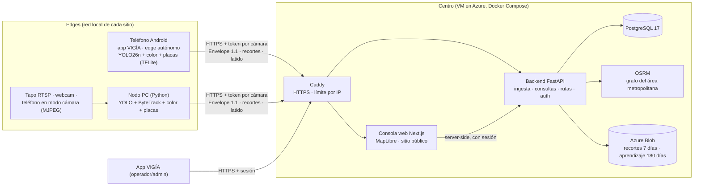

# Arquitectura de VIGIA

Estado al 18/11/2026. Decisiones: [ADR-001](../adr/001-hybrid-edge-architecture.md) (edge híbrido), [ADR-002](../adr/002-backend-central.md) (backend central y rutas), [ADR-003](../adr/003-mobile-react-native-migration.md) (app en React Native). Modelo de datos: [data-model.md](./data-model.md).

## Enfoque

VIGIA procesa el video **donde se captura** y al centro solo envía metadatos: tipo de vehículo, color, dirección, hora, placa votada (opcional) y un recorte pequeño por vehículo (opcional, 7 días, solo admin). Ante una consulta autorizada, el centro busca detecciones cercanas en espacio y tiempo, las encadena siguiendo la red vial y devuelve rutas candidatas con un puntaje explicable. Una ruta es una estimación, no una identificación.

## Componentes

| Componente | Responsabilidad | No hace |
|---|---|---|
| `apps/movil-rn` | App Android (iOS compila sin firma en CI): consulta, rutas, historial, alta de edges y credenciales, **edge autónomo** (detección, color, placas, recortes y latido en el teléfono) y **modo cámara** (MJPEG local para un nodo PC) | Enviar video al centro |
| `apps/vision` | Nodo PC: RTSP/webcam/MJPEG, YOLO + ByteTrack, color, placas, recortes, cola en disco y latido | Exponer credenciales RTSP ni construir rutas |
| `apps/backend` | Ingesta idempotente, estado de los nodos, consultas y rutas ponderadas sobre OSRM, confirmaciones y etiquetas del admin, usuarios, roles y auditoría | Ejecutar modelos de visión o guardar video |
| `apps/web` | Sitio público, demo, consola de operación (mapa, consultas, rutas, cámaras, administración) y proxy server-side al backend | Hablar con RTSP o con el backend desde el navegador |
| `packages/contracts` | Contratos versionados (Detection Envelope 1.1) | Lógica de negocio o secretos |
| `infra/` | Despliegue en Azure, Caddy, OSRM, PostgreSQL, scripts de edges y WireGuard (preparado, no activo) | — |
| `apps/movil` | App Flutter anterior; se conserva y compila en CI mientras haya teléfonos con ella | Recibir funciones nuevas |

## Flujo de una detección

1. El edge detecta y sigue cada vehículo; vota su color y, si la vista lo permite, su placa.
2. Cada 2 s publica un **Detection Envelope 1.1** (`POST /api/v1/ingest/detections`) desde una cola en disco, con reintentos. El centro deduplica por `eventId` y por track: un reenvío nunca duplica.
3. Cuando la vista de un vehículo deja de mejorar, sube un recorte JPEG de ≤ 64 KB (`POST /api/v1/ingest/thumbnails`), que vive 7 días.
4. Cada 30 s envía un **latido** (`POST /api/v1/ingest/heartbeat`). Con él y con el último evento, el centro calcula si el nodo está *detectando*, *en segundo plano*, *detenido* o *sin señal* ([phone-edges.md](../operations/phone-edges.md#está-activo-o-se-salieron-de-la-app-latido-1811)).

## Flujo de una consulta

1. El operador elige punto, radio, horario, tipo, color y, si es admin, placa.
2. El backend toma las cámaras dentro del radio y sus detecciones candidatas, y las encadena con un haz que pondera tiempo, distancia vial (OSRM), apariencia y dirección ([weighted-routes.md](./weighted-routes.md)). El top-k se diversifica para mostrar vehículos distintos antes que variantes del mismo.
3. La consola dibuja cada ruta sobre la red vial y explica su puntaje. El admin puede abrir cada paso, ver el recorte y responder «¿Es este el vehículo?»: las rutas se recalculan con esa respuesta.
4. El admin puede, además, **etiquetar** el recorte (color real, placa) para entrenamiento. Esas etiquetas se copian a un almacén separado y se exportan como versiones inmutables (fase 4, [recortes.md](../operations/recortes.md#aprendizaje-con-recortes-fase-4)).

## Seguridad y datos personales

- Los edges usan un token por cámara (hash en la base, caducidad, rotación y revocación). Las personas, sesiones revocables con roles `operator`/`admin`; todo cambio y consulta queda auditado.
- Solo 80/443 expuestos; Caddy limita peticiones por IP y la consola envía CSP. SSH solo por llave y desde la IP del administrador.
- Recortes y placas son datos personales (Ley 1581): contenedor privado, 7 días, solo admin y cada vista auditada. Las etiquetas de aprendizaje tienen su propio plazo (180 días mientras se aprueba la política) y la auditoría nunca guarda textos de placa.
- `.env`, pesos, videos y datasets no se versionan.

## Operación

- **CI/CD** ([ci-cd.md](../operations/ci-cd.md)): pruebas de backend (también con PostgreSQL), visión, web y móvil. Las imágenes se publican en GHCR y el servidor despliega solo, migra, verifica salud y vuelve atrás si falla.
- **App:** el APK se firma en el equipo del proyecto y se publica con `deploy.sh apk`. La app avisa cuando hay una versión nueva (`GET /api/v1/app/version`).
- **Base:** PostgreSQL 17 con migraciones Alembic (`0001`–`0008`), respaldos diarios y prueba de restauración ([postgres.md](../operations/postgres.md)).

## Pendiente

Ver el [roadmap](../ROADMAP.md): recorridos de campo independientes para evaluar rutas, el primer reentrenamiento con las etiquetas de la fase 4, detección con la pantalla apagada en Android, la actualización automática del nodo PC, WireGuard entre redes y la distribución firmada para iPhone.
